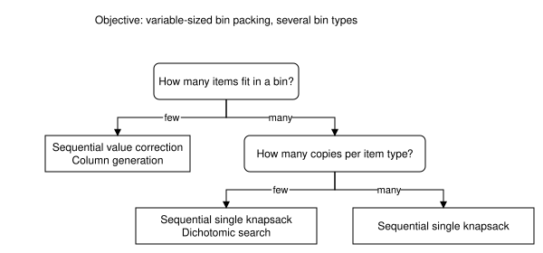

.. _internals_algorithm_selection:

Algorithm selection
=====================

For a given instance, each problem type usually has several applicable algorithms. All of them can be enabled or disabled individually with a ``--use-<algorithm>`` option (e.g. ``--use-tree-search 1``, ``--use-column-generation 0``); several can be enabled at once, in which case they run concurrently (in anytime mode) and the best solution found by any of them is kept, along with the best bound found by any of them. If none of the ``--use-<algorithm>`` options is set, the solver picks a combination automatically, as described below.

Steps
-----

The :code:`optimize` function of each problem type follows the same steps:

1. **Reduction.** The instance is simplified (for example, the identical item types are merged), the reduced instance is solved by a recursive call, and its solutions and bounds are converted back.
2. **Bounds.** Cheap bounds are computed first: the trivial bound (the total space of the items divided by the space of the bins), and, depending on the problem type, the bound of a one-dimensional relaxation, the :ref:`dual feasible functions <internals_rectangle_dual_feasible_functions>` (with a single bin type and at most 100 items, 50 for :code:`box`), the conservative scales, or the bar relaxation. If a bound already proves a solution optimal, or the instance infeasible, the solver stops.
3. **Exact algorithms for easy cases.** For example, for the onedimensional :code:`knapsack` objective with a single bin, the :ref:`dynamic programming <internals_onedimensional_dynamic_programming>` algorithm is run first, and often proves its solution optimal.
4. **Selection** of the algorithms to run (see below).
5. **Run.** The algorithms selected are run in parallel, each one reporting its solutions and bounds to the common output; all stop as soon as the best solution is proven optimal. In the :code:`not-anytime-deterministic` mode, each algorithm reports to its own output, and the outputs are merged at the end in a fixed order. In the :code:`not-anytime-sequential` mode, the algorithms are run one after the other.
6. **Post-processing.** For example, for the :code:`bin-packing-with-leftovers` objective in the non-anytime modes, the last bin of the solution is re-optimized to maximize its leftover.

Characteristics of the instance
-------------------------------

The selection is based on the objective, on the number of bins, and on two quantities:

* :math:`\bar{n}`, the *mean number of items in a bin*: the space (length, area or volume) of the largest bin divided by the mean space of the items;
* :math:`\bar{q}`, the *mean number of copies* of the item types: the number of items divided by the number of item types.

The item types have *many copies* if :math:`\bar{q} > \bar{n}`: then, the patterns of the bins are likely to be repeated in the solutions, as in cutting stock problems. *Many items fit in a bin* if :math:`\bar{n} > 16`. Both thresholds are parameters (:code:`many_item_type_copies_factor` and :code:`many_items_in_bins_threshold`).

A single bin
------------

With a single bin, the problem is a single :code:`knapsack`, :code:`feasibility` or open dimension problem, and only the pattern-generating algorithms apply. The tree search of the problem type is the default; the variants are chosen from the shape of the instance:

* :code:`rectangle`: the tree search in the directions in which few items fit in a section of the bin (at most 4 on average), and otherwise the :ref:`tree search with maximal spaces <internals_rectangle_tree_search_maximal_spaces>`; the bar relaxation for the small bins (at most 100 × 100); in the :code:`exact` mode, the :ref:`Benders decomposition <internals_rectangle_benders_decomposition>` for the :code:`knapsack` objective, and the :ref:`Benders decomposition with contiguity <internals_rectangle_benders_decomposition_contiguity>` for the :code:`feasibility` objective;
* :code:`rectangleguillotine`: depending on the number of stages, the cut type and the features used, the :ref:`tree search <internals_rectangleguillotine_tree_search>`, the :ref:`column generation strips <internals_rectangleguillotine_column_generation_strips>`, the :ref:`tree search with maximal spaces <internals_rectangleguillotine_tree_search_maximal_spaces>`, or the :ref:`tree search hypergraph with infinite copies <internals_rectangleguillotine_tree_search_hypergraph_infinite_copies>` when the item types have many copies;
* :code:`box`: the tree search; for the :code:`knapsack` and :code:`feasibility` objectives, only in the directions in which few items fit in a section of the bin (at most 8 on average), or the :ref:`tree search with maximal spaces <internals_box_tree_search_maximal_spaces>` if there is no such direction;
* :code:`boxstacks`: the :ref:`sequential one-dimensional / rectangle <internals_boxstacks_sequential_onedimensional_rectangle>` algorithm;
* :code:`irregular`: the tree search, or the :ref:`tree search with periodic packings <internals_irregular_tree_search_periodic_packing>` when the instance is dominated by item types with many copies (together with the tree search if fewer than 64 items fit in the bin), and the :ref:`local search <internals_irregular_local_search>` for the objectives it supports; in the :code:`exact` mode, the :ref:`Benders decomposition <internals_irregular_benders_decomposition>` for the :code:`knapsack` objective, and the :ref:`MILP NFP <internals_irregular_milp_nfp>` algorithm for the :code:`feasibility` objective.

Several bins
------------

With several bins, the generic algorithms are added. The rule is the same for most problem types and objectives:

.. list-table::
   :header-rows: 1
   :widths: 2 2 4

   * - Copies
     - Items in a bin
     - Algorithms
   * - many
     - many
     - :ref:`sequential single knapsack <internals_generic_algorithms_sequential_single_knapsack>`
   * - many
     - few
     - :ref:`sequential value correction <internals_generic_algorithms_sequential_value_correction>` and :ref:`column generation <internals_generic_algorithms_column_generation>`
   * - few
     - any
     - tree search and :ref:`column generation <internals_generic_algorithms_column_generation>`

The ideas behind it:

* when the item types have many copies and many items fit in a bin, packing the bins one by one wastes little space, and the sequential single knapsack algorithm does it quickly;
* when the item types have many copies but few items fit in a bin, the choice of the combinations of items in the bins matters, which is what the sequential value correction and the column generation are good at;
* when the item types have few copies, the tree search builds all the bins at once, and the column generation gives good bounds.

The variations by objective and problem type:

* :code:`bin-packing` and :code:`bin-packing-with-leftovers`: with few copies, the tree search is run together with the sequential single knapsack algorithm (if many items fit in a bin) or with the sequential value correction and the column generation (otherwise). For onedimensional, the tree search is skipped when the instance has no constraint other than the lengths: its sub-problems are then solved by dynamic programming, and the tree search wouldn't find better solutions. The column generation doesn't support the :code:`bin-packing-with-leftovers` objective with several bin types;
* :code:`variable-sized-bin-packing`: the :ref:`dichotomic search <internals_generic_algorithms_dichotomic_search>` is also used with several bin types, as illustrated below;
* the algorithms which don't support an objective or a feature of the instance are removed from the selection.

The details for each algorithm are given in the *Automatic selection* section of its page.

Source files
------------

* :code:`src/<problem type>/optimize.cpp`: the steps and the selection
