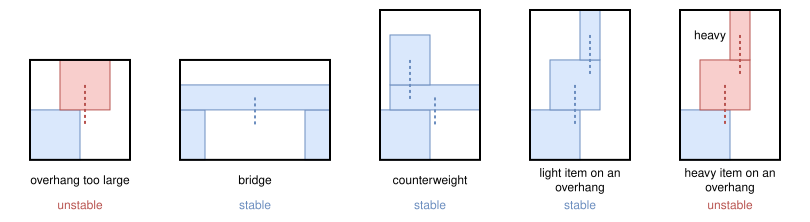
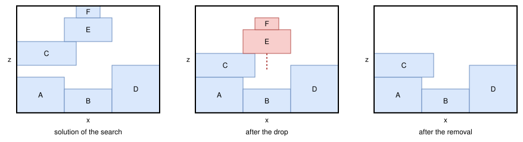

.. _internals_box_static_stability:

Static stability
================

With the :ref:`static stability <box-static-stability>` constraint, the items of each bin must be in static mechanical equilibrium. This page describes how it is checked, and how the tree search algorithms, which don't model it, repair their solutions so that they satisfy it.

Feasibility criterion
---------------------

The criterion is the static mechanical equilibrium of Galrão Ramos, Oliveira, Gonçalves and Lopes (2016). The items are rigid bodies whose only external force is their weight, applied at their center. An item is supported through the contacts between its bottom face and the floor of the bin or the top faces of the items whose top is at the height of its bottom. Each contact is a rectangle, the intersection of the two faces. Lateral contacts are not taken into account: an item leaning against another one is not supported.

Any pressure on a contact rectangle which only pushes is equivalent to non-negative vertical forces at its four corners. The items are in equilibrium if and only if there exist such forces for which the vertical forces and the moments about the horizontal axes through the center of each item are balanced. This is a linear program, without objective: the bin is stable if and only if it is feasible.

Unlike the rules which check the support of each item alone, the forces that an item transmits to the items below it are taken into account. Two such rules are common: a minimum supported fraction of the bottom face of each item, and the center of gravity of each item above the convex hull of its contacts. The examples below, seen from the beginning of the y-axis (the items span the whole bin along y), are scenarios of the tests. The dashed lines are below the centers of gravity of the items, and the items in red fall. The weight of an item is its volume, except for the heavy item:

.. list-table::
   :header-rows: 1

   * - Example
     - Equilibrium
     - Center of gravity above the contacts
     - Supported fraction at least 50%
   * - overhang too large
     - unstable
     - unstable
     - unstable
   * - bridge
     - stable
     - stable
     - unstable
   * - counterweight
     - stable
     - unstable
     - unstable
   * - light item on an overhang
     - stable
     - stable
     - stable
   * - heavy item on an overhang
     - unstable
     - stable
     - stable

* **Overhang too large.** The center of gravity of the top item is beyond its contact with the bottom item, which supports 40% of its bottom face: all the rules agree.
* **Bridge.** The plank rests on two pillars which support a third of its bottom face. The supported fraction rule rejects it, while it is stable: its center of gravity is between the pillars.
* **Counterweight.** The center of gravity of the plank is beyond its support, so both rules reject it. But the item on the end of the plank above the support balances it: the center of gravity of the plank and the item together is above the support.
* **Light and heavy item on an overhang.** The middle item is stable on the bottom item, and the top item is stable on the middle item, so both rules accept both examples. But a heavy top item, whose center of gravity is beyond the support of the middle item, tips the middle item: only the equilibrium detects it.

The criterion is checked by :code:`Solution` on each bin, for every solution, whichever algorithm built it. A solution with a bin which is not stable is not feasible.

The algorithms don't model it, so they only prove an infeasibility, and only compute a bound from the value of a solution, with the constraints they model: the copies, the minimum copies and the resources (:code:`Solution::feasible_without_unmodeled_constraints`).

Model
-----

**Input**:

* the items :math:`i = 1, \ldots, n` of the bin; for each item :math:`i`: its weight :math:`w_i`, and the coordinates :math:`(\bar{x}_i, \bar{y}_i)` of its center in the horizontal plane
* the contacts :math:`c`; for each contact :math:`c`: the item :math:`u(c)` it supports, the item :math:`l(c)` which supports it (none if :math:`u(c)` is on the floor of the bin), and :math:`K(c)` the four corners of its rectangle; for each corner :math:`k`: its coordinates :math:`(x_k, y_k)` in the horizontal plane

**Variables**:

* :math:`f_k \ge 0`: vertical force at corner :math:`k` of a contact; it pushes the item :math:`u(c)` up and the item :math:`l(c)` down

**Objective**: none

**Constraints**:

* Vertical forces: for each item, the forces of the contacts below it minus the forces of the contacts above it equal its weight

.. math::

   \forall i \qquad \sum_{c : u(c) = i} \; \sum_{k \in K(c)} f_k
   - \sum_{c : l(c) = i} \; \sum_{k \in K(c)} f_k = w_i

* Moments about the axis parallel to y through the center of the item

.. math::

   \forall i \qquad \sum_{c : u(c) = i} \; \sum_{k \in K(c)} (x_k - \bar{x}_i) \, f_k
   - \sum_{c : l(c) = i} \; \sum_{k \in K(c)} (x_k - \bar{x}_i) \, f_k = 0

* Moments about the axis parallel to x through the center of the item

.. math::

   \forall i \qquad \sum_{c : u(c) = i} \; \sum_{k \in K(c)} (y_k - \bar{y}_i) \, f_k
   - \sum_{c : l(c) = i} \; \sum_{k \in K(c)} (y_k - \bar{y}_i) \, f_k = 0

The model has 4 variables per contact and 3 rows per item. The forces are divided by the largest weight of the items and the lever arms by the largest dimension of the bin, so that the coefficients are between -1 and 1. It is solved with HiGHS.

The linear program is not solved when all the items are on the floor of the bin (the bin is stable), or when an item with a weight has no support (the bin is not stable).

Repair of the solutions
-----------------------

The tree search algorithms often generate solutions with floating items, especially the :ref:`tree search with maximal spaces <internals_box_tree_search_maximal_spaces>`, which places a block on the floor of a maximal space, while the space can extend beyond the items supporting it. Without repair, with this constraint, they may find no stable solution at all.

So, before passing a new solution to the algorithm formatter, :ref:`tree search <internals_box_tree_search>` and :ref:`tree search with maximal spaces <internals_box_tree_search_maximal_spaces>` repair it in two steps. Only the bins which are not stable are changed.

**Drop.** The items fall until they rest on the floor or on another item. They are processed in a single pass, from the lowest to the highest one: an item lands on the highest top face of the items already processed whose footprints intersect its footprint, or on the floor. The items which may stop an item are below it, so they are already at their final positions. The items only move down, and the items whose footprints intersect keep their vertical order, so the solution remains valid, with the same items in the same bins.

**Removal of the unbalanced items.** After the drop, no item floats, but an item may still tip, when its center of gravity is beyond its support, or because of the weight of the items above it. While a bin is not stable:

* the items which can't be balanced are found by solving the equilibrium linear program in which each row may be violated, at a cost equal to the violation (see below); the items whose rows are violated in an optimal solution are the unbalanced items;
* the highest of them is removed, with the items which rest on it, directly or not;
* the other items keep their positions, so they remain supported.

In the example below, seen from the beginning of the y-axis (the items span the whole bin along y), the items C, E and F float in the solution of the search. After the drop, C rests on A, E on C and F on E. The center of gravity of E (dashed line) is beyond its contact with C, so E tips: it is removed, with F which rests on it:

The linear program which finds the unbalanced items has the input and the variables of the equilibrium model, and:

**Variables**, in addition:

* :math:`s_{i,r}^+ \ge 0`, :math:`s_{i,r}^- \ge 0`: violations of the row :math:`r \in \{1, 2, 3\}` of the equilibrium model for item :math:`i` (vertical forces, moments about the axes parallel to y and to x), in both directions

**Objective**: minimize the violations

.. math::

   \min \sum_i \sum_{r = 1}^{3} \left( s_{i,r}^+ + s_{i,r}^- \right)

**Constraints**: the rows of the equilibrium model, with the violations; for the vertical forces, for example:

.. math::

   \forall i \qquad \sum_{c : u(c) = i} \; \sum_{k \in K(c)} f_k
   - \sum_{c : l(c) = i} \; \sum_{k \in K(c)} f_k
   + s_{i,1}^+ - s_{i,1}^- = w_i

It always has a solution: the null forces, with the violations of the vertical forces equal to the weights. Its optimal value is zero if and only if the bin is stable. An item :math:`i` is unbalanced if :math:`\sum_r (s_{i,r}^+ + s_{i,r}^-) > 10^{-7}` in the optimal solution found.

The removed items are not re-inserted. With the :code:`knapsack` objective, the repaired solution is feasible. With the objectives which require all the items to be packed, it often isn't.

The infeasibility proofs and the bounds of the tree searches are computed from the solution of the search, not from the repaired one, since the repair may remove items.

Source files
------------

* :code:`src/box/static_stability.hpp`, :code:`src/box/static_stability.cpp`: the equilibrium linear program, the drop and the removal of the unbalanced items
* :code:`src/box/solution.cpp`: the check of the criterion on each bin
* :code:`src/box/tree_search.cpp`, :code:`src/box/tree_search_maximal_spaces.cpp`: the calls to the repair
* :code:`scripts/doc_figures/box.py`: the figure of this page

References:

* "A container loading algorithm with static mechanical equilibrium stability constraints" (Galrão Ramos, Oliveira, Gonçalves and Lopes, 2016)

  * https://doi.org/10.1016/j.trb.2016.06.003

* "Standing on a common ground: a comparison of static stability approaches for pallet loading" (Mazur, Gamer, Ramos and Schoder, 2027)

  * https://doi.org/10.1111/itor.70059
