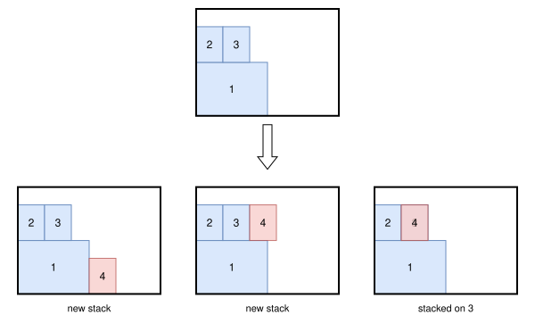

.. _internals_boxstacks_tree_search:

Tree search
===========

Objectives
----------

This algorithm solves the :code:`feasibility` and :code:`knapsack` objectives with a single bin. It is run by the :ref:`sequential one-dimensional / rectangle <internals_boxstacks_sequential_onedimensional_rectangle>` algorithm when its solution violates the axle weight constraints.

Principle
---------

It is a constructive tree search where a single item is packed at each stage, generalizing the :ref:`tree search for rectangle <internals_rectangle_tree_search>`: the floor of the bin is filled with stacks of items along x, and a node stores the skyline of the stacks packed. The possible insertions for an unpacked item are:

* in a new stack, with its lower y touching either another packed stack or the side of the bin at y = 0, then pushed along x until it doesn't overlap the stacks packed;
* on top of a stack of the skyline.

The figure below shows a node, seen from above, and its children inserting item 4, which can be stacked on item 3 (same stackability id) but not on item 2:

An insertion above a stack must satisfy the stacking constraints: same stackability id, maximum stackability, maximum weight above, the height of the bin (using the nesting heights), the maximum stack density. Any insertion must satisfy the maximum weight of the bin and the unloading constraints.

**Axle weights.** The axle weights of a semi-trailer truck depend on the position of the center of gravity of the items, which is only known once the items are packed. So the axle weight constraints are checked when the last item of an unloading group is inserted, and the insertion is discarded if an axle is then overloaded.

Guides
------

The guides are the ones of the rectangle tree search, with volumes: by default, guides 4 and 5 for the :code:`knapsack` objective, guides 0 and 1 for the :code:`bin-packing-with-leftovers` objective, and guides 0 and 2 for the other objectives.

Dominance
---------

Two nodes with the same number of copies of each item type packed can be compared. Node 1 dominates node 2 if it uses fewer bins, or as many bins and:

* leftover values which aren't smaller (for the :code:`bin-packing-with-leftovers` objective);
* a middle axle weight which isn't larger;
* the same stacks on the floor (same footprints, in the same order), each stack of node 1 being not higher than the corresponding stack of node 2, allowing at least as much weight and as many items on top of it, and ending with an item of the same stackability id.

Since the stacks must have the same footprints, this dominance is much more restrictive than the one of the rectangle tree search.

This algorithm is more expensive than the sequential one-dimensional / rectangle algorithm. It is useful when the axle weight constraints are active in the best solutions, which then need sparse packings.

Source files
------------

* :code:`src/boxstacks/tree_search.hpp`, :code:`src/boxstacks/tree_search.cpp`
