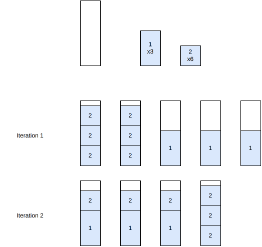

.. _internals_generic_algorithms:

Generic algorithms
===================

The following algorithms are conceptually the same across all domains: each one solves a multi-bin problem by repeatedly solving single-bin (knapsack) sub-problems of the *same* domain.

Sequential single knapsack
----------------------------

This algorithm solves the :code:`knapsack`, :code:`bin-packing`, :code:`bin-packing-with-leftovers` and :code:`variable-sized-bin-packing` objectives.

It iteratively generates new solution bins by solving a knapsack sub-problem with the remaining items for each remaining bin type. Once all items have been packed, it restarts and puts more effort into the sub-problems.

.. image:: ../img/generic_algorithms_sequential_single_knapsack.png
   :scale: 100%
   :align: center

See :doc:`the detailed description <generic_algorithms/sequential_single_knapsack>`.

Sequential value correction
----------------------------

This algorithm solves the :code:`knapsack`, :code:`bin-packing`, :code:`bin-packing-with-leftovers` and :code:`variable-sized-bin-packing` objectives.

It is closely related to sequential single knapsack, but instead of restarting with a larger search effort, it restarts by increasing the profit of the items that were packed in high-waste bins, so that they get packed earlier in the next pass and hopefully generate less waste.

See :doc:`the detailed description <generic_algorithms/sequential_value_correction>`.

Dichotomic search
------------------

This algorithm solves the :code:`variable-sized-bin-packing` objective.

It searches, by dichotomy, for the smallest achievable waste percentage: for a given waste estimate, it deduces which bins would be needed to reach that quantity of waste, and solves a bin packing sub-problem restricted to those bins.

.. image:: ../img/generic_algorithms_dichotomic_search.png
   :scale: 100%
   :align: center

See :doc:`the detailed description <generic_algorithms/dichotomic_search>`.

Column generation
-------------------

This algorithm solves the :code:`knapsack`, :code:`bin-packing` and :code:`variable-sized-bin-packing` objectives.

This is a tree search algorithm. At each stage, a new bin is added to the solution. Bins are generated dynamically at each node through column generation, the pricing problems being single-bin knapsack problems.

.. image:: ../img/generic_algorithms_column_generation.png
   :scale: 100%
   :align: center

See :doc:`the detailed description <generic_algorithms/column_generation>`.

Sequential feasibility
-------------------------

This algorithm solves the :code:`bin-packing`, :code:`bin-packing-with-leftovers`, :code:`open-dimension-x`, :code:`open-dimension-y` and :code:`open-dimension-xy` objectives with an algorithm solving the :code:`feasibility` objective.

It repeatedly solves a :code:`feasibility` sub-problem asking whether all the items fit into a shrinking amount of space, and stops as soon as a sub-problem turns out infeasible.

See :doc:`the detailed description <generic_algorithms/sequential_feasibility>`.

.. toctree::
   :maxdepth: 1
   :hidden:

   generic_algorithms/sequential_single_knapsack
   generic_algorithms/sequential_value_correction
   generic_algorithms/dichotomic_search
   generic_algorithms/column_generation
   generic_algorithms/sequential_feasibility
