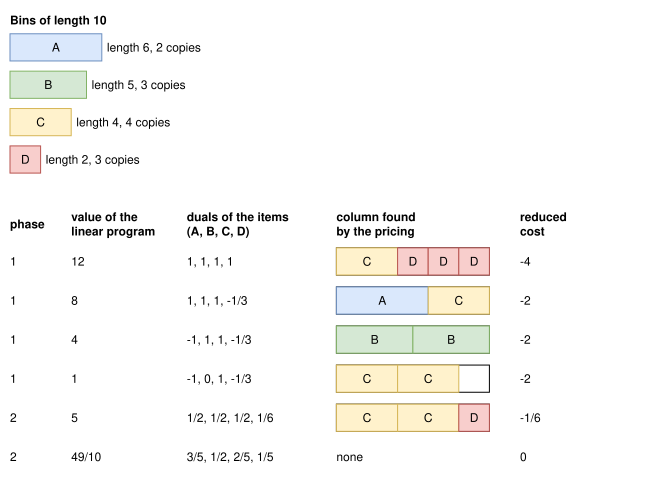
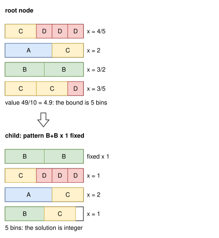

.. _internals_generic_algorithms_column_generation:

Column generation
=================

Objectives
----------

This algorithm solves the :code:`knapsack`, :code:`bin-packing` and :code:`variable-sized-bin-packing` objectives, with several bins. It is available for the onedimensional, rectangle, rectangleguillotine, box and irregular problem types. It also gives a bound.

Principle
---------

It solves a Dantzig-Wolfe reformulation of the problem, where a variable is a *pattern* (or *column*): the content of a single bin of a given type. Since there are exponentially many patterns, the linear relaxation of the reformulation is solved by column generation: it starts with no pattern, and the patterns are generated by a *pricing problem*, a single knapsack problem solved with the regular algorithms of the problem type. Integer solutions are then found by a limited discrepancy search, which fixes the patterns of the solution of the linear relaxation one by one.

Model
-----

**Input**:

* bin types :math:`i = 1, \ldots, m`; for each bin type :math:`i`: a minimum :math:`l_i` and a maximum :math:`u_i` number of copies, and a cost :math:`c_i`
* item types :math:`j = 1, \ldots, n`; for each item type :math:`j`: a minimum :math:`q_j^{\min}` and a maximum :math:`q_j` number of copies (for the objectives other than :code:`knapsack`, all the items must be packed: :math:`q_j^{\min} = q_j`), and a profit :math:`p_j`
* for each bin type :math:`i`, the set :math:`K_i` of its patterns; for each pattern :math:`k \in K_i`, :math:`x_{j,i}^k` is its number of copies of item type :math:`j`

**Variables**:

* :math:`y_i^k \in \mathbb{N}`: the number of bins of type :math:`i` filled with pattern :math:`k`

**Objective**: minimize the cost of the bins used

.. math::

   \min \sum_{i} c_i \sum_{k} y_i^k

**Constraints**:

* Number of bins of each bin type, with dual variables :math:`u_i`

.. math::

   \forall i \qquad l_i \le \sum_{k} y_i^k \le u_i

* Number of copies of each item type, with dual variables :math:`v_j`

.. math::

   \forall j \qquad q_j^{\min} \le \sum_{i} \sum_{k} x_{j,i}^k \, y_i^k \le q_j

For the :code:`knapsack` objective, the profit of the items packed :math:`\sum_i \sum_k \sum_j p_j \, x_{j,i}^k \, y_i^k` is maximized instead. The costs and the profits are divided by the largest power of two not exceeding the largest bin cost or item profit, for the numerical stability of the linear programs.

Column generation
-----------------

The *restricted master problem* is the linear relaxation of the model with only the patterns generated so far. At each iteration, it is solved with a linear programming solver (parameter :code:`linear_programming_solver_name`), and its dual values :math:`u_i` and :math:`v_j` are given to the pricing problem, which looks for a pattern of negative *reduced cost*

.. math::

   c_i - u_i - \sum_j v_j \, x_{j,i}^k

(for the :code:`knapsack` objective, a pattern whose profit :math:`\sum_j (p_j - v_j) \, x_{j,i}^k` exceeds :math:`u_i`). The patterns found are added to the restricted master problem, and the iterations continue until the pricing problem finds no new pattern of negative reduced cost.

**Two phases.** At the start, the restricted master problem has no pattern, so it is infeasible. In the first phase, it gets a *dummy column* for each constraint with a positive lower bound, which covers it at a cost of 1, and the patterns cost 0: minimizing the cost of the dummy columns looks for patterns covering all the constraints. Once no dummy column is used, the second phase minimizes the real objective. If the first phase can't remove the dummy columns, the bound below proves the instance infeasible.

The table below shows the iterations on a small instance, with a cost of 1 per bin. In the first phase, the value is the total amount of the dummy columns: at the first iteration, there is no pattern, and all the demands are covered by dummy columns. In the second phase, the value is the number of bins:

The final solution of the linear relaxation uses 4.9 bins: 0.8 bins with C+D+D+D, 2 bins with A+C, 1.5 bins with B+B and 0.6 bins with C+C+D.

**Column pool.** Every pattern generated is kept in a pool. When a new restricted master problem is built, for example at a node of the search below, the patterns of the pool with a negative reduced cost are added before calling the pricing problem.

Pricing problem
---------------

For each bin type with bins left, the pricing problem is a :code:`knapsack` instance with a single bin of this type. The profit of an item type is its dual value :math:`v_j` (or :math:`p_j - v_j` for the :code:`knapsack` objective); the item types of non-positive profit are removed, and the other ones have their remaining copies. The bin types are thus priced one by one, and each solution found becomes a pattern.

The pricing problems are solved with the regular algorithms of the problem type, in a non-anytime mode, with a small effort: a queue of size 128 for the tree searches (512 for onedimensional). They are heuristic, but they don't need to find the best pattern: any pattern of negative reduced cost lets the column generation continue. So each pricing instance gets a *knapsack goal*: the profit above which a pattern has a negative reduced cost; the algorithms stop as soon as they find a solution reaching it.

**Bound.** The value of the restricted master problem is not a bound until no pattern of negative reduced cost remains, which a heuristic pricing can't prove. But the algorithms of the pricing problem also return a bound on the profit of the best pattern (for example the area of the bin, or a :ref:`dual feasible function <internals_rectangle_dual_feasible_functions>` bound), which bounds the best reduced cost :math:`\bar{r}` of a pattern of each bin type. Since a solution uses at most :math:`N` bins, the value of the linear relaxation is at least the value of the restricted master problem plus :math:`N \bar{r}`: this *Lagrangian bound* is valid at each iteration. :math:`N` is the number of items or of bins, whichever is smaller; for the :code:`bin-packing` objective, the number of bins of the best solution found; for the :code:`variable-sized-bin-packing` objective, the largest number of bins whose cost doesn't exceed the cost of the best solution found.

**Exact pricing for rectangle and irregular.** For the rectangle and irregular problem types, once the column generation converges with the regular pricing, the pricing problems are solved once more with the Benders decomposition (:ref:`rectangle <internals_rectangle_benders_decomposition>`, :ref:`irregular <internals_irregular_benders_decomposition>`, with the :ref:`tree search on relative positions <internals_irregular_tree_search_relative_positions>` in its subproblems) (at most twice per column generation), which returns a much tighter bound on the best pattern, and proves the bound of the linear relaxation when it is exact. In the :code:`exact` mode, this Benders decomposition is itself run in :code:`exact` mode.

Search
------

The integer solutions are found by a limited discrepancy search. A node is a set of *fixed* patterns, each with a number of bins, already in the solution. At each node, the column generation is run on the *residual* problem: the bins and the items of the fixed patterns are removed. Then:

* if the solution of the linear relaxation is integer, it completes a solution, and the node has no child;
* otherwise, its values rounded down and rounded to the nearest integer are tried as solutions;
* a pattern of the solution is chosen to be fixed: for each pattern of value :math:`y`, its *main value* is :math:`\lfloor y \rfloor`, or one more than its fixed number of bins if :math:`\lfloor y \rfloor` doesn't exceed it; the pattern whose main value minus :math:`y` is the smallest is chosen, i.e. preferably a pattern whose value is far above an integer it can be rounded down to, otherwise the one which is the closest to be rounded up.

The children fix this pattern to its main value :math:`v` (*discrepancy* 0), or to :math:`v - 1`, :math:`v - 2`, :math:`v - 3` (discrepancy 1, 2, 3, when it is not below its current fixed number). In the children with a discrepancy, the pattern is *tabu*: it can't be fixed again, nor generated again by the pricing, which gets, for each tabu pattern of its bin type, a resource forbidding it (its items consume 1 up to their number of copies in the pattern, and the capacity is one less than its number of items).

The nodes are explored by increasing discrepancy, the nodes of discrepancy 0 and 1 first; beyond, by increasing sum of the distances between the values chosen and the values of the linear relaxation; the deepest node first in case of a tie. The first dive (discrepancy 0) quickly gives a solution; the next ones revise the choices of the dive, the least confident ones first. When the fixed pattern leaves room for every pattern of the parent solution, the child of discrepancy 0 reuses the solution of its parent instead of running the column generation again.

The figure below shows the dive on the example above. At the root node, B+B has the value 1.5: its main value is 1, at a distance -0.5, the smallest. With one bin B+B fixed, the solution of the residual problem is integer: 5 bins, which is optimal since the bound of the root node is :math:`\lceil 4.9 \rceil = 5`:

In anytime mode, the search continues until the solution is proven optimal or the time limit. In the non-anytime modes, it stops once it has explored at least 64 nodes and 4 times the maximum depth reached.

**Heuristics at the root node.** At the root node, before the search, the column generation runs two heuristics, which find solutions and generate useful patterns:

* *internal diving*: at the first iteration, the pricing problem is called repeatedly; after each call, the new patterns are fixed in the order of their reduced costs, each as many times as the constraints allow, and the pricing problem is called on the residual problem, until no new pattern can be fixed;
* *rounding heuristic*: at each iteration of the second phase, the patterns of the solution of the restricted master problem are fixed greedily, then the remaining items are completed with the pricing problem.

Both call the pricing problem many times. They are disabled for onedimensional, whose restricted master problems are cheap compared to them, and for rectangleguillotine when the item types have many copies.

Bin packing
-----------

For the :code:`variable-sized-bin-packing` and :code:`knapsack` objectives, the bound of the linear relaxation is a bound of the problem. For the :code:`bin-packing` objective, the bins must be used in the order of the instance, and the minimum cost of the linear relaxation can only be converted into a number of bins (rounded up) by dividing it by the cost of the bin type when there is a single bin type.

Otherwise, the column generation solves a sequence of :code:`feasibility` problems: for :math:`k = L, L + 1, \ldots`, starting from a lower bound :math:`L`, whether the items fit in the first :math:`k` bins of the instance. Each one is solved by the column generation and the search above, with a cost of 1 per bin. The first feasible one gives the solution; each one proven infeasible raises the bound to :math:`k + 1`. The patterns, and the patterns and cuts of the root node, are passed from one problem to the next.

This scheme is used with several bin types, and with a single bin type for the rectangle, box and irregular problem types, and for rectangleguillotine with at most 100 items (not for onedimensional).

Subset-row cuts
---------------

For the rectangle problem type, subset-row cuts (Jepsen et al., 2008) tighten the linear relaxation. For a subset :math:`S` of item types with an odd number of item types, of which each pattern contains :math:`|S \cap k|`:

.. math::

   \sum_i \sum_k \left\lfloor \frac{|S \cap k|}{2} \right\rfloor y_i^k \le \left\lfloor \frac{|S|}{2} \right\rfloor

For :math:`|S| = 3`, at most one pattern contains two of the three item types. The cut is valid when each item type of :math:`S` has a single copy to pack, so only these item types are considered.

**Separation.** After the column generation converges, the violated cuts are searched in the solution: the subsets of 3 item types built from two item types which appear together in a pattern of the solution and a third one appearing with one of them; then, from each such pair, subsets of 5 and 7 item types, grown greedily by adding the item type which increases the violation the most. The violated cuts are added, and the column generation runs again.

**Pricing.** A cut only helps if the pricing problem accounts for its dual value :math:`\sigma \le 0`: a pattern containing 2 or 3 of the item types of :math:`S` gets the penalty :math:`-\sigma`. It is modeled with *penalize* resources of the bin: for a cut, resources of capacities 1, 3, 5, …, each consumed 1 by the first copy of each item type of :math:`S` and with the penalty :math:`-\sigma`: a pattern with :math:`2t` or :math:`2t + 1` item types of :math:`S` exceeds :math:`t` capacities. The tree searches of rectangle handle these resources.

Automatic selection
-------------------

With several bins, it is run in many cases, often alongside the tree search or the sequential value correction algorithm: when the item types have few copies compared to the number of items fitting in a bin, or when they have many copies but few items fit in a bin. See :ref:`algorithm selection <internals_algorithm_selection>`.

It can be forced with :code:`--use-column-generation 1` (CLI) or :code:`use_column_generation` (Python).

Source files
------------

* :code:`src/algorithms/column_generation.hpp`: the model, the pricing problem, the cuts and the scheme for the :code:`bin-packing` objective
* :code:`src/<problem type>/optimize.cpp`: the pricing algorithms and the parameters of each problem type
* the column generation and the limited discrepancy search are provided by the `columngenerationsolver <https://github.com/fontanf/columngenerationsolver>`_ library
* :code:`scripts/doc_figures/generic_algorithms.py`, :code:`scripts/doc_figures/generic_algorithms_model.py`: the figures, computed with the rules above (without the heuristics of the root node)

References:

* "Subset-row inequalities applied to the vehicle-routing problem with time windows" (Jepsen, Petersen, Spoorendonk and Pisinger, 2008)

  * https://doi.org/10.1287/opre.1070.0449
