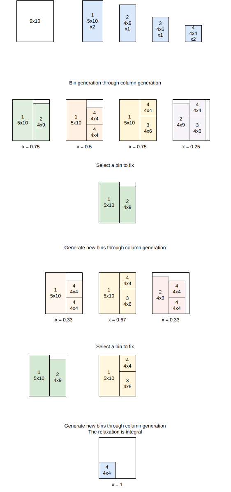

.. _internals_generic_algorithms_column_generation:

Column generation
=================

Objectives
----------

This algorithm solves the :code:`knapsack`, :code:`bin-packing` and :code:`variable-sized-bin-packing` objectives, with several bins. It is available for the onedimensional, rectangle, rectangleguillotine, box and irregular problem types. It also gives a bound.

Principle
---------

It solves a Dantzig-Wolfe reformulation of the problem, where a variable is a *pattern*: a set of items fitting in a bin of a given type. Since there are exponentially many patterns, the linear relaxation of the reformulation is solved by column generation, the patterns being generated by a pricing problem. Integer solutions are then found by a tree search where a pattern is added to the solution at each stage.

Model
-----

**Input**:

* bin types :math:`i = 1, \ldots, m`; for each bin type :math:`i`: a lower bound :math:`l_i` and an upper bound :math:`u_i` on its number of copies, and a cost :math:`c_i`
* item types :math:`j = 1, \ldots, n`; for each item type :math:`j`: a number of copies :math:`q_j`
* for each bin type :math:`i`, a set :math:`K_i` of feasible packing patterns; for each pattern :math:`k \in K_i`, :math:`x_{j,i}^k` is the number of copies of item type :math:`j` it contains

**Variables**:

* :math:`y_i^k \in \{0, \ldots, q^{\max}\}`, :math:`i = 1, \ldots, m`, :math:`k \in K_i`: number of times packing pattern :math:`k` of bin type :math:`i` is used

**Objective**: minimize the total cost of the bins used

.. math::

   \min \sum_{i} c_i \sum_{k} y_i^k

**Constraints**:

* Bin type bounds

.. math::

   \forall i \qquad l_i \le \sum_{k} y_i^k \le u_i

* Item demand: each item type is packed exactly :math:`q_j` times

.. math::

   \forall j \qquad \sum_{i} \sum_{k} x_{j,i}^k \, y_i^k = q_j

For the :code:`knapsack` objective, the profit of the items packed is maximized instead, and each item type is packed at most :math:`q_j` times.

Pricing problem
---------------

The pricing problem consists in finding, for some bin type :math:`i`, a pattern of negative reduced cost

.. math::

   rc(y_i^k) = c_i - u_i - \sum_{j} x_{j,i}^k \, v_j

where :math:`u_i` and :math:`v_j` are the dual variables of the bin type bound and item demand constraints. For each bin type, this is a single-bin :code:`knapsack` problem with item profits :math:`v_j`, solved with the regular algorithms of the problem type, in non-anytime mode (a beam of size 128 for the tree searches by default).

These heuristic solutions of the pricing problem are enough to generate good patterns, but not to prove that no pattern of negative reduced cost remains, so the bound of the linear relaxation is only valid when the pricing problems are solved exactly. For the rectangle problem type, the pricing problems are solved with the :ref:`Benders decomposition <internals_rectangle_benders_decomposition>` when a bound is needed; in the :code:`exact` mode, this Benders decomposition is itself run in :code:`exact` mode, so that the bound is proven.

Search
------

The integer solutions are found by a limited discrepancy search: at each node, a pattern of the solution of the linear relaxation is fixed in the solution, and the column generation is run again on the residual problem; the discrepancies are the patterns of the linear solution which are not followed. The linear relaxation at the root node gives a bound on the objective: a knapsack bound, or a bin packing bound for the :code:`bin-packing` objective.

**Bin packing.** The linear relaxation minimizes a cost, which is converted into a number of bins by dividing it by the cost of the bin type; this is only valid with a single bin type. So for the :code:`bin-packing` objective, the column generation is instead run as a sequence of :code:`feasibility` problems (each with a given number of bins, tried in increasing order from a lower bound), the first feasible one being optimal. This scheme is always used with several bin types, and, depending on the problem type, with a single one too.

**Subset-row cuts.** Subset-row cuts (Jepsen et al., 2008) can be separated to tighten the linear relaxation: for a subset of item types, they bound the number of patterns containing at least two of them. They only help when the pricing problems enforce them too, so they are only enabled for the rectangle problem type, whose tree searches enforce them through the resources of the bins (a subset-row cut becomes a *penalize* resource, whose penalty is the dual value of the cut).

Automatic selection
-------------------

With several bins, it is run in many cases, often alongside the tree search or the sequential value correction algorithm: when the item types have few copies compared to the number of items fitting in a bin, or when they have many copies but few items fit in a bin. See :ref:`algorithm selection <internals_algorithm_selection>`.

It can be forced with :code:`--use-column-generation 1` (CLI) or :code:`use_column_generation` (Python).

Source files
------------

* :code:`src/algorithms/column_generation.hpp`: the model, the pricing problem and the cuts
* the limited discrepancy search is provided by the `columngenerationsolver <https://github.com/fontanf/columngenerationsolver>`_ library

References:

* Jepsen, Petersen, Spoorendonk and Pisinger (2008), for the subset-row cuts
