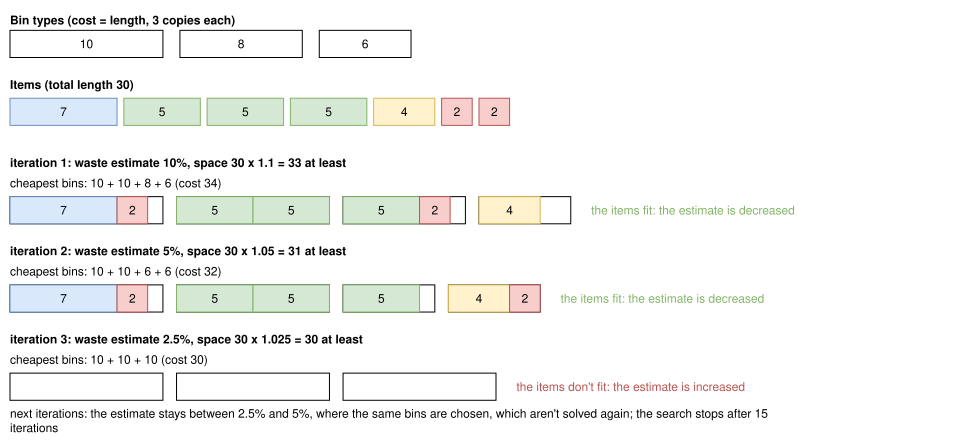

.. _internals_generic_algorithms_dichotomic_search:

Dichotomic search
=================

Objectives
----------

This algorithm solves the :code:`variable-sized-bin-packing` objective. It is available for the onedimensional, rectangle, rectangleguillotine, box and irregular problem types.

Principle
---------

In variable-sized bin packing, the difficulty is to choose which bins to use; once they are chosen, packing the items into them is a bin packing problem. The algorithm chooses the bins from an estimate of the waste of the solution: the cheapest bins providing the space of the items plus this waste. If the items fit in them, the estimate was large enough, and it is decreased; otherwise, it is increased. The smallest estimate for which the items fit is searched by dichotomy.

Choosing the bins
-----------------

For a waste estimate :math:`w` (a fraction of the space of the items), the bins to use must provide a space of at least :math:`(1 + w)` times the space of the items. The bins of the bin types with a minimum number of copies are always used. The cheapest set of bins is computed by solving a one-dimensional knapsack problem choosing the optional bins which are *not* used:

**Input**:

* the optional bins :math:`b` (the copies of the bin types beyond their minimum numbers of copies); for each optional bin :math:`b`: its cost :math:`c_b` and its space :math:`S_b`
* the total space :math:`S` of all the bins, the space :math:`S^{\min}` of the mandatory bins, and the space :math:`S^{\text{items}}` of the items

**Variables**:

* :math:`z_b \in \{0, 1\}`: :math:`z_b = 1` iff bin :math:`b` is *not* used

**Objective**: maximize the cost of the bins not used, that is, minimize the cost of the bins used

.. math::

   \max \sum_b c_b \, z_b

**Constraint**: the bins used provide at least the space of the items plus the estimated waste

.. math::

   \sum_b S_b \, z_b \le S - \max \left( S^{\min}, \lfloor (1 + w) \, S^{\text{items}} \rfloor \right)

It is solved with the primal-dual dynamic programming algorithm of the `knapsacksolver <https://github.com/fontanf/knapsacksolver>`_ library, limited to :math:`2^{20}` states (above, its current solution, which is feasible, is used).

Checking the bins
-----------------

The bins chosen are checked by solving a :code:`bin-packing` sub-problem: the items, the bins chosen, then the other bins of the instance, each group sorted by increasing space (in the :code:`bin-packing` objective, the bins are used in their order). If all the items are packed in the bins chosen, the estimate succeeds; otherwise, it fails. In both cases, the solution of the sub-problem is a solution of the instance, possibly using more bins than the bins chosen, and it is reported.

The sub-problems are solved with the tree search of the problem type (with the automatic selection of the algorithms for irregular), in a non-anytime mode, with a queue of a given size.

Search
------

The search keeps the largest estimate which failed (initially 0) and the smallest estimate which succeeded (initially infinite):

* while no estimate has succeeded, the next estimate is 10% if no estimate has failed, otherwise twice the largest estimate which failed;
* then, the next estimate is the middle of the two;
* the search stops when they are closer than 0.001%.

Close estimates often lead to the same bins: the result of each set of bins is memorized, and a set of bins is never checked twice.

In the example below, the bins have lengths 10, 8 and 6, with a cost equal to their length and 3 copies each, and the items have a total length of 30. With a waste estimate of 10%, the cheapest bins providing a length of 33 are 10 + 10 + 8 + 6 (cost 34), and the items fit. With 5%, the bins 10 + 10 + 6 + 6 (cost 32) provide a length of 31, and the items fit again. With 2.5%, the bins 10 + 10 + 10 provide exactly the length of the items, and they don't fit. The next estimates stay between 2.5% and 5%, where only these two sets of bins are chosen: the search ends without solving another sub-problem, with the solution of cost 32, which is optimal here.

The dichotomy assumes that if the items don't fit in the bins of an estimate, they don't fit in the bins of a smaller one either. This is not always true, since the bins chosen for a smaller estimate can be of different types, in which the items fit better: the algorithm is a heuristic.

In anytime mode, a first search is run with a queue of size 1 for the sub-problems. Then a new search is run with a queue twice as large, and so on until the time limit; each new search keeps the smallest estimate which succeeded in the previous one, and starts with the largest failed estimate at 0. In the non-anytime modes, a single search is run, with the queue size given by the parameter :code:`not_anytime_dichotomic_search_subproblem_tree_search_queue_size`.

This algorithm works well for the instances with many bin types, or with bins in which many items fit: then, the column generation algorithm struggles.

Automatic selection
-------------------

For the :code:`variable-sized-bin-packing` objective with several bin types, it is run when many items fit in a bin. See :ref:`algorithm selection <internals_algorithm_selection>`.

It can be forced with :code:`--use-dichotomic-search 1` (CLI) or :code:`use_dichotomic_search` (Python).

Source files
------------

* :code:`src/algorithms/dichotomic_search.hpp`
* :code:`src/<problem type>/optimize.cpp`: the sub-problems and the increasing effort
* :code:`scripts/doc_figures/generic_algorithms.py`, :code:`scripts/doc_figures/generic_algorithms_model.py`: the figure, computed with the rules above
