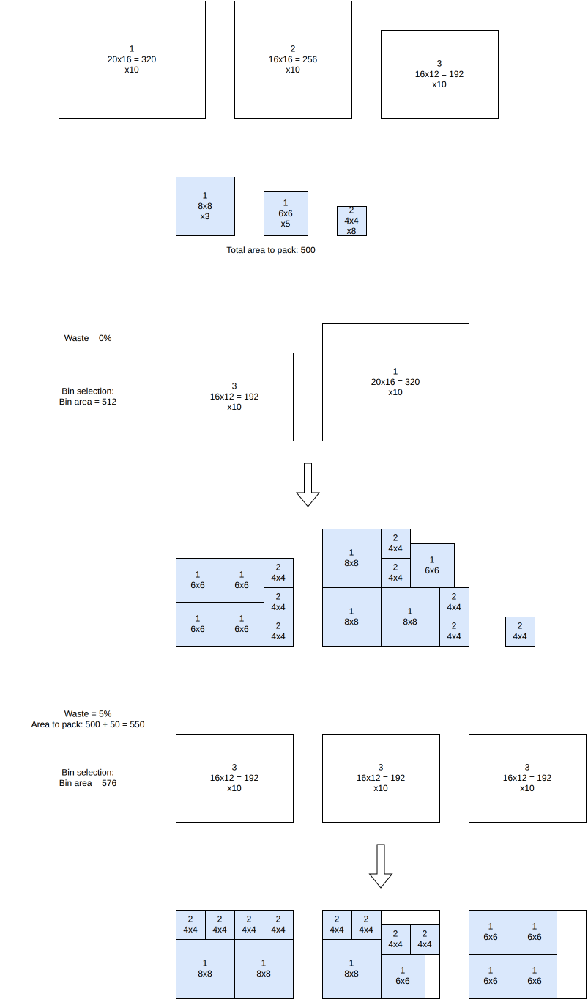

.. _internals_generic_algorithms_dichotomic_search:

Dichotomic search
=================

Objectives
----------

This algorithm solves the :code:`variable-sized-bin-packing` objective. It is available for the onedimensional, rectangle, rectangleguillotine, box and irregular problem types.

Principle
---------

In variable-sized bin packing, the difficulty is to choose which bins to use; once they are chosen, packing the items into them is a bin packing problem. The algorithm chooses the bins from an estimate of the waste of the solution, and searches the smallest waste which can be reached, by dichotomy.

For a waste estimate :math:`w` (a fraction of the space of the items), the bins to use must provide at least the space of the items times :math:`1 + w`. The cheapest set of bins providing this space is computed by solving a one-dimensional knapsack problem with dynamic programming, choosing the bins *not* used:

**Input**:

* the optional bins :math:`b` (the copies of the bin types beyond their minimum numbers of copies; the mandatory ones are always used); for each optional bin :math:`b`: its cost :math:`c_b` and its space :math:`S_b`
* the total space :math:`S` of all the bins, the space :math:`S^{\min}` of the mandatory bins, and the space :math:`S^{\text{items}}` of the items

**Variables**:

* :math:`z_b \in \{0, 1\}`: :math:`z_b = 1` iff bin :math:`b` is *not* used

**Objective**: maximize the cost of the bins not used, that is, minimize the cost of the bins used

.. math::

   \max \sum_b c_b \, z_b

**Constraints**:

* Space: the bins used provide at least the space of the items plus the estimated waste

.. math::

   \sum_b S_b \, z_b \le S - \max \left( S^{\min}, (1 + w) \, S^{\text{items}} \right)

Then a :code:`bin-packing` sub-problem is solved, with the items and the bins chosen, then the other bins. If all the items are packed in the bins chosen, the waste estimate is decreased; otherwise, it is increased.

In the example below, the items to pack have a total area of 500, and three bin types are available (20x16, 16x16 and 16x12). At a waste estimate of 0%, the smallest combination of bins reaching the required area is one 16x12 and one 20x16 bin (total area 512); packing all the items into exactly these two bins turns out to be infeasible, so the waste estimate is increased. At a waste estimate of 5% (required area 550), three 16x12 bins (total area 576) are enough, and this time every item packs successfully:

Search
------

The first estimate is 10%. While no estimate has succeeded, a failed estimate is doubled; then the estimate is the middle of the smallest estimate which succeeded and of the largest one which failed. The search stops when the two are closer than 0.001%. The result of each set of bins is memorized, so a set of bins is never solved twice.

This algorithm works well for the instances with many bin types, or with bins in which many items fit: then, the column generation algorithm struggles.

Automatic selection
-------------------

For the :code:`variable-sized-bin-packing` objective with several bin types, it is run when many items fit in a bin. See :ref:`algorithm selection <internals_algorithm_selection>`.

It can be forced with :code:`--use-dichotomic-search 1` (CLI) or :code:`use_dichotomic_search` (Python).

Source files
------------

* :code:`src/algorithms/dichotomic_search.hpp`
