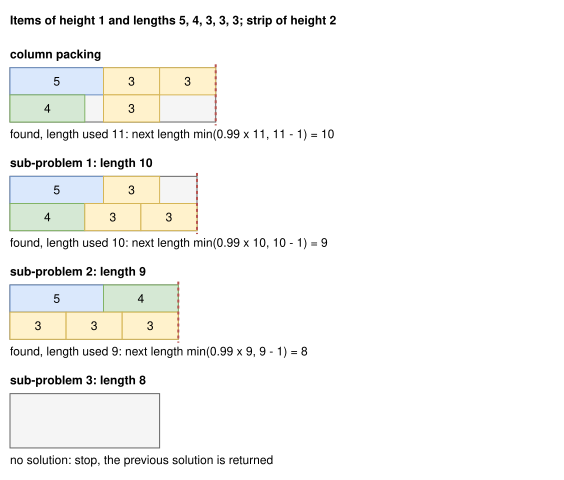

.. _internals_generic_algorithms_sequential_feasibility:

Sequential feasibility
======================

Objectives
----------

This algorithm solves the :code:`bin-packing`, :code:`bin-packing-with-leftovers`, :code:`open-dimension-x`, :code:`open-dimension-y`, :code:`open-dimension-z` (box) and :code:`open-dimension-xy` (irregular) objectives with an algorithm solving the :code:`feasibility` objective. It is not selected by itself: the algorithms which only solve the :code:`feasibility` objective use it for the other objectives.

Principle
---------

It solves a sequence of :code:`feasibility` sub-problems, asking whether all the items fit into a shrinking space:

* :code:`bin-packing`: the first :math:`k` bins of the instance;
* :code:`bin-packing-with-leftovers`: the first :math:`k` bins, the last one cut to a length :math:`L`;
* :code:`open-dimension-x`, :code:`open-dimension-y` and :code:`open-dimension-z`: the bin cut to a length :math:`L` along the open dimension;
* :code:`open-dimension-xy`: a bin of width :math:`L` and of height :math:`L` times the aspect ratio.

The first space comes from a first solution, found by a simple packing (see below). As long as a sub-problem is solved, the solution found is reported, and the next space is smaller than the space this solution actually uses. The algorithm stops as soon as a sub-problem isn't solved: the inner algorithm proves it infeasible, or doesn't find a solution within its effort. The last solution found is the result.

In the example below, the open dimension is x, the strip has a height of 2, and the items have a height of 1: the column packing uses a length of 11, so the first length is 10. The first solution uses a length of 10, so the next length is 9; the second solution uses a length of 9, so the next length is 8, for which the inner algorithm finds no solution:

First space
-----------

If the simple packing packs all the items, and its solution is feasible, it is the first solution, and the first space is shrunk from it as after any solution (see below). If the first sub-problem then fails, this solution is the result. Otherwise, the first space is all the bins of the instance, not cut. The simple packing depends on the problem type.

For rectangleguillotine, the items are packed in strips, in the bins one after the other: the first-stage cuts are vertical (horizontal for :code:`open-dimension-y`) and cut the bins into strips, the second-stage cuts cut the strips into the items, with a third-stage cut when an item is narrower than its strip. Each item which can be rotated is packed with its smaller side across the strips, unless it is then longer than the bins; the items are sorted by decreasing width, and each one is packed in the first strip where it fits, else in a new strip, else in the next bin. The cut thickness and the trims are taken into account. The packing isn't used for the instances with fewer than 3 stages, the homogenous cut type, a first stage orientation different from the one of the strips, defects, fixed items, resources, stacks of several item types, a minimum waste length, distances between cuts, or a maximum number of cuts.

For rectangle, the items are first packed in columns (in rows for :code:`open-dimension-y`, and for :code:`bin-packing-with-leftovers` with the leftover mode :code:`Y`), in the bins one after the other. Each item which can be rotated is packed with its smaller side across the columns, unless it is then longer than the bins; the items are sorted by decreasing width, and each one is packed in the first column where it fits, else in a new column, else in the next bin. In a column, an item is moved up while it intersects a defect; a new column is moved right the same way; a bin is also full when an item would exceed its maximum weight. If all the items are packed and the solution is feasible, this is the first solution, and the first space is shrunk from it as after any solution (see below). Otherwise, or if the instance has eligibilities, resources or fixed items, which this packing doesn't handle, the first space is all the bins of the instance, not cut.

For box, the items are first packed in columns, in the bins one after the other: the columns are stacks of items along z (along y if the bins are shrunk along z), they stand in rows across the shrunk dimension, and the rows follow each other along the shrunk dimension. Each item is packed with the allowed rotation which minimizes its length along the shrunk dimension, then across the rows, among the ones which fit in the largest bin; the items are sorted by decreasing length along the shrunk dimension, then across the rows, and each one is packed on top of the first column whose footprint contains its own, else in a new column at the end of the last row, else in a new row, else in the next bin; a bin is also full when an item would exceed its maximum weight. If all the items are packed and the solution is feasible, this is the first solution, as for rectangle. Otherwise, or if the instance has resources or fixed items, the first space is all the bins of the instance, not cut.

For irregular, the bounding boxes of the items are first packed in columns (in rows for :code:`open-dimension-y`), in the bins one after the other. Each item is packed with the orientation which minimizes the area of its bounding box, the items are sorted by decreasing width, and each one is packed in the first column where it fits, else in a new column, else in the next bin. In a column, an item is moved up while its bounding box intersects a border of the bin, a defect or a fixed item; a new column is moved right the same way. For :code:`open-dimension-xy`, the height of the bin is the aspect ratio times the width used. If all the items are packed, this is the first solution, and the first space is shrunk from it as after any solution (see below). Otherwise, the first space is all the bins of the instance, not cut.

Shrinking
---------

After a solution is found:

* :code:`bin-packing`: :math:`k` is one less than the number of bins the solution uses;
* open dimensions: :math:`L` is the length used by the solution along the open dimension, shrunk: for rectangle, rectangleguillotine and box, :math:`\min(\lfloor 0.99 \, \ell \rfloor, \ell - 1)` for a length used :math:`\ell`; for irregular, :math:`(1 - r) \, \ell` with the shrink ratio :math:`r` (1% by default, 0.1% for the :ref:`local search <internals_irregular_local_search>`), plus the minimum spacing between the items and the bin;
* :code:`bin-packing-with-leftovers`: :math:`L` is the length used in the last bin, shrunk the same way. If the solution uses fewer bins than available, :math:`k` becomes its number of bins and the last bin isn't cut; if :math:`L` reaches 0, :math:`k` is decreased by one, and the new last bin isn't cut. The last bin is cut along the direction of the leftover: along x for rectangleguillotine and irregular, along the direction of the leftover mode for rectangle (y for the mode :code:`Y`, otherwise x) and box (its first dimension: z for the mode :code:`Z`, y for the modes :code:`Y` and :code:`YZ`, otherwise x);
* :code:`open-dimension-xy` (irregular): the width is shrunk by the shrink ratio, and at most the width of a bin of the given aspect ratio with the area of the bounding box of the solution.

The algorithm also stops when nothing is left to try: no bin, or a length of 0. For irregular, the bins up to the last one with fixed items are always kept, since a sub-problem without them would turn their fixed items into free items.

**Warm start.** For irregular, each sub-problem, except the first one, receives the previous solution found as a warm start. The first one receives the column packing only for :code:`open-dimension-xy`: otherwise the local search, which would start from it, is slower to compact the items than when it starts from scratch. It is generally not a feasible solution of the sub-problem: the space has been shrunk, so some items may stick out of their bin, and the bins which aren't available anymore are dropped together with their items. It is up to the inner algorithm to repair it, and the :ref:`irregular local search <internals_irregular_local_search>` does.

Uses
----

* irregular: the :ref:`local search <internals_irregular_local_search>`, the :ref:`tree search with periodic packings <internals_irregular_tree_search_periodic_packing>`, the :ref:`tree search with maximal spaces <internals_irregular_tree_search_maximal_spaces>`, and the :ref:`tree search <internals_irregular_tree_search>` for the :code:`open-dimension-xy` objective;
* rectangle: the :ref:`tree search with maximal spaces <internals_rectangle_tree_search_maximal_spaces>`, for the :code:`bin-packing`, :code:`bin-packing-with-leftovers`, :code:`open-dimension-x` and :code:`open-dimension-y` objectives with a single bin;
* rectangleguillotine: the :ref:`tree search with maximal spaces <internals_rectangleguillotine_tree_search_maximal_spaces>`, for the same objectives;
* box: the :ref:`tree search with maximal spaces <internals_box_tree_search_maximal_spaces>`, for the same objectives and :code:`open-dimension-z`.

The :ref:`MILP assignment <internals_onedimensional_milp_assignment>` and :ref:`column generation <internals_generic_algorithms_column_generation>` algorithms use a similar scheme for the :code:`bin-packing` objective, but in the opposite direction: they try the numbers of bins in increasing order from a lower bound, so that the first feasible one is optimal.

Source files
------------

* :code:`src/irregular/sequential_feasibility.hpp`, :code:`src/irregular/sequential_feasibility.cpp`
* :code:`src/rectangle/sequential_feasibility.hpp`, :code:`src/rectangle/sequential_feasibility.cpp`
* :code:`src/rectangleguillotine/sequential_feasibility.hpp`, :code:`src/rectangleguillotine/sequential_feasibility.cpp`
* :code:`src/box/sequential_feasibility.hpp`, :code:`src/box/sequential_feasibility.cpp`
* :code:`scripts/doc_figures/generic_algorithms.py`, :code:`scripts/doc_figures/generic_algorithms_model.py`: the figure, with a simple inner algorithm (a depth-first search placing the items in two rows)
