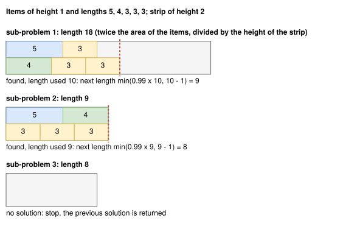

.. _internals_generic_algorithms_sequential_feasibility:

Sequential feasibility
======================

Objectives
----------

This algorithm solves the :code:`bin-packing`, :code:`bin-packing-with-leftovers`, :code:`open-dimension-x`, :code:`open-dimension-y`, :code:`open-dimension-z` (box) and :code:`open-dimension-xy` (irregular) objectives with an algorithm solving the :code:`feasibility` objective. It is not selected by itself: the algorithms which only solve the :code:`feasibility` objective use it for the other objectives.

Principle
---------

It solves a sequence of :code:`feasibility` sub-problems, asking whether all the items fit into a shrinking space:

* :code:`bin-packing`: the first :math:`k` bins of the instance;
* :code:`bin-packing-with-leftovers`: the first :math:`k` bins, the last one cut to a length :math:`L`;
* :code:`open-dimension-x`, :code:`open-dimension-y` and :code:`open-dimension-z`: the bin cut to a length :math:`L` along the open dimension;
* :code:`open-dimension-xy`: a bin of width :math:`L` and of height :math:`L` times the aspect ratio.

The first space is large: twice the space of the items. As long as a sub-problem is solved, the solution found is reported, and the next space is smaller than the space this solution actually uses. The algorithm stops as soon as a sub-problem isn't solved: the inner algorithm proves it infeasible, or doesn't find a solution within its effort. The last solution found is the result.

In the example below, the open dimension is x, the strip has a height of 2, and the items have a height of 1: the first length is twice the area of the items (18) divided by the height of the strip, 18. The first solution uses a length of 10, so the next length is 9; the second solution uses a length of 9, so the next length is 8, for which the inner algorithm finds no solution:

First space
-----------

* :code:`bin-packing` and :code:`bin-packing-with-leftovers`: the smallest number of first bins of the instance whose space is at least twice the space of the items (at least 1); for :code:`bin-packing-with-leftovers`, the last of these bins is not cut at first;
* open dimensions: twice the space of the items divided by the section of the bin (e.g. its height for :code:`open-dimension-x`), at most the length of the bin;
* :code:`open-dimension-xy` (irregular): the items are first packed in columns by a simple procedure, which gives a first solution; the first width is the width of this solution, shrunk by the shrink ratio below.

For irregular, the space of an item is the area of its bounding box.

Shrinking
---------

After a solution is found:

* :code:`bin-packing`: :math:`k` is one less than the number of bins the solution uses;
* open dimensions: :math:`L` is the length used by the solution along the open dimension, shrunk: for rectangle, rectangleguillotine and box, :math:`\min(\lfloor 0.99 \, \ell \rfloor, \ell - 1)` for a length used :math:`\ell`; for irregular, :math:`(1 - r) \, \ell` with the shrink ratio :math:`r` (1% by default, 0.1% for the :ref:`local search <internals_irregular_local_search>`), plus the minimum spacing between the items and the bin;
* :code:`bin-packing-with-leftovers`: :math:`L` is the length used in the last bin, shrunk the same way. If the solution uses fewer bins than available, :math:`k` becomes its number of bins and the last bin isn't cut; if :math:`L` reaches 0, :math:`k` is decreased by one, and the new last bin isn't cut. The last bin is cut along the direction of the leftover: along x for rectangleguillotine and irregular, along the direction of the leftover mode for rectangle (y for the mode :code:`Y`, otherwise x) and box (its first dimension: z for the mode :code:`Z`, y for the modes :code:`Y` and :code:`YZ`, otherwise x);
* :code:`open-dimension-xy` (irregular): the width is shrunk by the shrink ratio, and at most the width of a bin of the given aspect ratio with the area of the bounding box of the solution.

The algorithm also stops when nothing is left to try: no bin, or a length of 0. For irregular, the bins up to the last one with fixed items are always kept, since a sub-problem without them would turn their fixed items into free items.

**Warm start.** For irregular, each sub-problem, except the first one, receives the previous solution found as a warm start. It is generally not a feasible solution of the sub-problem: the space has been shrunk, so some items may stick out of their bin, and the bins which aren't available anymore are dropped together with their items. It is up to the inner algorithm to repair it, and the :ref:`irregular local search <internals_irregular_local_search>` does.

Uses
----

* irregular: the :ref:`local search <internals_irregular_local_search>`, the :ref:`tree search with periodic packings <internals_irregular_tree_search_periodic_packing>`, the :ref:`tree search with maximal spaces <internals_irregular_tree_search_maximal_spaces>`, and the :ref:`tree search <internals_irregular_tree_search>` for the :code:`open-dimension-xy` objective;
* rectangle: the :ref:`tree search with maximal spaces <internals_rectangle_tree_search_maximal_spaces>`, for the :code:`bin-packing`, :code:`bin-packing-with-leftovers`, :code:`open-dimension-x` and :code:`open-dimension-y` objectives with a single bin;
* rectangleguillotine: the :ref:`tree search with maximal spaces <internals_rectangleguillotine_tree_search_maximal_spaces>`, for the same objectives;
* box: the :ref:`tree search with maximal spaces <internals_box_tree_search_maximal_spaces>`, for the same objectives and :code:`open-dimension-z`.

The :ref:`MILP assignment <internals_onedimensional_milp_assignment>` and :ref:`column generation <internals_generic_algorithms_column_generation>` algorithms use a similar scheme for the :code:`bin-packing` objective, but in the opposite direction: they try the numbers of bins in increasing order from a lower bound, so that the first feasible one is optimal.

Source files
------------

* :code:`src/irregular/sequential_feasibility.hpp`, :code:`src/irregular/sequential_feasibility.cpp`
* :code:`src/rectangle/sequential_feasibility.hpp`, :code:`src/rectangle/sequential_feasibility.cpp`
* :code:`src/rectangleguillotine/sequential_feasibility.hpp`, :code:`src/rectangleguillotine/sequential_feasibility.cpp`
* :code:`src/box/sequential_feasibility.hpp`, :code:`src/box/sequential_feasibility.cpp`
* :code:`scripts/doc_figures/generic_algorithms.py`, :code:`scripts/doc_figures/generic_algorithms_model.py`: the figure, with a simple inner algorithm (a depth-first search placing the items in two rows)
