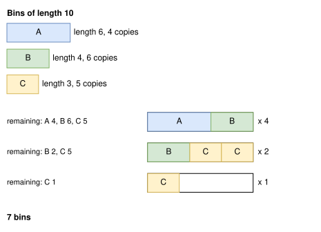

.. _internals_generic_algorithms_sequential_single_knapsack:

Sequential single knapsack
==========================

Objectives
----------

This algorithm solves the :code:`knapsack`, :code:`bin-packing`, :code:`bin-packing-with-leftovers` and :code:`variable-sized-bin-packing` objectives, with several bins. It is available for all the problem types. For the :code:`variable-sized-bin-packing` objective, it doesn't handle the minimum numbers of copies of the bin types.

Principle
---------

It builds a solution bin by bin. For the first bin, it solves a *single knapsack* sub-problem: a :code:`knapsack` instance with this bin only and all the items. The items packed are removed, and the next bin is filled the same way with the remaining items, until all the items are packed or there is no bin left.

The profit of an item in the sub-problems is its own profit for the :code:`knapsack` objective, and its space (length, area or volume) for the other objectives: each bin is filled as much as possible.

**Repeated bins.** When the item types have many copies, the content of a bin can be used for several bins. Once a bin is filled, it is copied as many times as the remaining items allow: for each item type in the bin, the number of remaining copies divided by its number of copies in the bin (rounded down), and at most the number of bins left of the bin type. A single sub-problem then fills many bins.

In the example below, the bins have a length of 10. The first sub-problem fills a bin with an item A and an item B; since 4 copies of A remain, this bin is used 4 times. The second sub-problem only has the remaining items, B (2 copies) and C (5 copies), and so on:

It is the :ref:`sequential value correction <internals_generic_algorithms_sequential_value_correction>` algorithm with a single pass, so the details below are described on its page:

* **Order of the bins.** The bins are filled in the order of the instance, or by increasing space for the :code:`knapsack` objective. If the sub-problem of a bin packs no item, the bin is left empty, and the next bin is tried.
* :code:`variable-sized-bin-packing`: the sub-problem is solved for each bin type with copies left, and the bin type with the best ratio between the profit of its solution and its cost is kept.
* :code:`bin-packing-with-leftovers`: the last bin is re-optimized to maximize its leftover.

The sub-problems are solved with the regular algorithms of the problem type (e.g. the tree search), in a non-anytime mode, with a given effort: the size of the queue of the tree searches.

Search
------

In anytime mode, a first pass is performed with a queue of size 1 for the tree searches of the sub-problems; then, after each pass, a new pass is performed with a queue twice as large, until the time limit. Each pass is a new solution, and the best one is kept. For the irregular problem type, the effort of each algorithm of the sub-problems grows the same way from its own initial value (queue of size 1 for the tree search, 4 for the tree search with periodic packings, a factor 4 on the number of moves of the local search).

In the non-anytime modes, a single pass is performed, with the effort given by the parameters (e.g. :code:`not_anytime_sequential_single_knapsack_subproblem_tree_search_queue_size`, 2048 for rectangle).

Each pass is cheap when the sub-problems are, so it is well suited to the instances where many items fit in a bin and the item types have many copies: then, packing the bins one by one wastes little space, and the repeated bins make the passes fast.

Automatic selection
-------------------

With several bins, it is run when the item types have many copies compared to the number of items fitting in a bin, and many items fit in a bin. See :ref:`algorithm selection <internals_algorithm_selection>`.

It can be forced with :code:`--use-sequential-single-knapsack 1` (CLI) or :code:`use_sequential_single_knapsack` (Python).

Source files
------------

* :code:`src/algorithms/sequential_value_correction.hpp`: the algorithm
* :code:`src/<problem type>/optimize.cpp`: the sub-problems and the increasing effort
* :code:`scripts/doc_figures/generic_algorithms.py`: the figure
