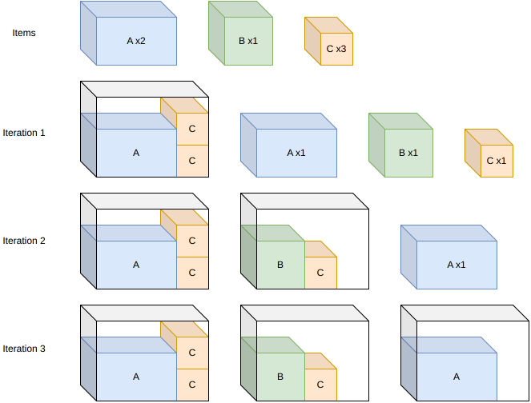

.. _internals_generic_algorithms_sequential_single_knapsack:

Sequential single knapsack
==========================

Objectives
----------

This algorithm solves the :code:`knapsack`, :code:`bin-packing`, :code:`bin-packing-with-leftovers` and :code:`variable-sized-bin-packing` objectives, with several bins. It is available for all the problem types.

Principle
---------

It builds a solution bin by bin. For the first bin, it solves a *single knapsack* sub-problem: a :code:`knapsack` instance with this bin only and all the items. The items packed are removed, and the next bin is filled the same way with the remaining items, until all the items are packed or there is no bin left.

The profit of an item in the sub-problems is its own profit for the :code:`knapsack` objective, and its space (length, area or volume) for the other objectives, so that each bin is filled as much as possible. When a knapsack solution can be repeated (enough copies of its items remain), it is used for as many bins as possible at once.

For the :code:`variable-sized-bin-packing` objective, the sub-problem is solved for each bin type, and the bin type with the best ratio between the profit of its solution and its cost is kept. For the :code:`bin-packing-with-leftovers` objective, the last bin is re-optimized to maximize the leftover value.

The sub-problems are solved with the regular algorithms of the problem type (e.g. the tree search), in non-anytime mode, with a given effort (e.g. the size of the beam of the tree search).

Search
------

It is the :ref:`sequential value correction <internals_generic_algorithms_sequential_value_correction>` algorithm with a single iteration, without correcting the profits. Instead, in anytime mode, once all the items are packed, it restarts with twice the effort for the sub-problems, and so on until the time limit. In the non-anytime modes, a single pass is performed, with the effort given by the parameters.

Each pass is cheap when the sub-problems are, so it is well suited to the instances where many items fit in a bin and the item types have many copies: then, packing the bins one by one wastes little space.

Automatic selection
-------------------

With several bins, it is run when the item types have many copies compared to the number of items fitting in a bin, and many items fit in a bin. See :ref:`algorithm selection <internals_algorithm_selection>`.

It can be forced with :code:`--use-sequential-single-knapsack 1` (CLI) or :code:`use_sequential_single_knapsack` (Python).

Source files
------------

* :code:`src/algorithms/sequential_value_correction.hpp`: the algorithm
* :code:`src/<problem type>/optimize.cpp`: the sub-problems and the increasing effort
