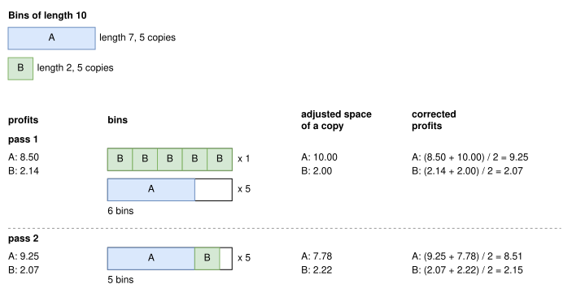

.. _internals_generic_algorithms_sequential_value_correction:

Sequential value correction
===========================

Objectives
----------

This algorithm solves the :code:`knapsack`, :code:`bin-packing`, :code:`bin-packing-with-leftovers` and :code:`variable-sized-bin-packing` objectives, with several bins. It is available for all the problem types. For the :code:`variable-sized-bin-packing` objective, the bins of the bin types with a minimum number of copies are used first.

Principle
---------

A *pass* builds a solution bin by bin, as the :ref:`sequential single knapsack <internals_generic_algorithms_sequential_single_knapsack>` algorithm: for each bin, it solves a single knapsack sub-problem with the remaining items, until all the items are packed or there is no bin left. Between two passes, the profits of the items in the sub-problems are *corrected*: the items which were packed in bins with a lot of waste get a higher profit, so that they are packed earlier in the next pass, together with other items, and hopefully generate less waste.

A pass
------

**Sub-problems.** The sub-problem of a bin is a :code:`knapsack` instance with this bin only, and, for each item type, its remaining copies, with the current profit of the item type. It is solved with the regular algorithms of the problem type, in a non-anytime mode (a queue of size 128 for the tree searches by default; 512 for onedimensional and boxstacks).

**Repeated bins.** Once the sub-problem of a bin is solved, its solution is used for as many bins as possible: for each item type in the bin, its number of remaining copies divided by its number of copies in the bin (rounded down), and at most the number of bins left of the bin type.

**Order of the bins.** For the :code:`knapsack` objective, the bins are filled by increasing space; for the :code:`bin-packing` and :code:`bin-packing-with-leftovers` objectives, in the order of the instance (the order in which they must be used). If the sub-problem of a bin packs no item, the bin is left empty, and the next bin is tried.

**Several bin types.** For the :code:`variable-sized-bin-packing` objective, the bin types are not used in a fixed order. At each step:

* if a bin type hasn't reached its minimum number of copies, the smallest such bin type is used;
* otherwise, the sub-problem is solved for each bin type with copies left, and the bin type whose solution has the largest ratio between its profit and the cost of the bin is kept. The solution of a bin type is kept from one step to the next, and only solved again once some of its items are packed in another bin.

For the irregular problem type, the bin types tried can be restricted: among the remaining item types, the one which fits in the fewest available bins (the largest one in case of a tie) must be packed in one of them anyway, so only the bin types in which it fits are tried.

**Leftovers.** For the :code:`bin-packing-with-leftovers` objective, when the content of a bin packs all the remaining items, this last bin is solved again as a :code:`bin-packing-with-leftovers` sub-problem with these items, to maximize its leftover.

Profit correction
-----------------

**Initial profits.** For the :code:`knapsack` objective, the profit of an item is its own profit. For the other objectives, it is its space (length, area or volume) raised to the power 1.1: larger items are slightly preferred, which breaks the ties between solutions of the same space.

For the irregular problem type with the :code:`variable-sized-bin-packing` objective, the item types which only fit in a few bin types also get an initial profit increased by a factor: the ratio between the space of the items competing for these bin types divided by the space of these bins, and the same ratio for all the bins (when it is larger than 1). They are packed first.

**Adjusted space.** During a pass, each bin spreads its waste over its items, in proportion to their space: an item of space :math:`s` in a bin of space :math:`B` whose items have a total space :math:`S` gets an *adjusted space*

.. math::

   s + \frac{s}{S} (B - S)

An item packed in a full bin keeps its space; an item packed in a bin with a lot of waste gets a large adjusted space.

**New profits.** After the pass, for each item type :math:`j` with :math:`q_j` copies:

* for the :code:`knapsack` objective, if some copies are packed, the new profit is its profit per unit of space times the mean adjusted space of its packed copies; otherwise, the profit is unchanged;
* for the other objectives, each copy left unpacked counts for an adjusted space of 100 times the space of the largest bin, and the new profit is the total adjusted space of the copies divided by :math:`q_j`: an item type left unpacked gets a very large profit.

The profit used in the next pass is the mean of the previous profit and of the new one.

**Example.** The bins have a length of 10, and there are 5 items A of length 7 and 5 items B of length 2. In the first pass, the profit of B (2.14 per length 2, i.e. 1.07 per unit) is close to the profit of A (8.50 per length 7, i.e. 1.21 per unit), and five B (profit 10.72) are worth more than an A and a B (profit 10.64): the first bin gets the five B. Each A is then alone in a bin: 6 bins. The waste of these bins goes to A, whose adjusted space is 10, while the adjusted space of B is 2: A gets a profit of 9.25 and B of 2.07. In the second pass, an A and a B (11.32) are worth more than five B (10.36), and each bin gets an A and a B: 5 bins.

The corrections can also overshoot: after the second pass, where A had no waste, the profit of A decreases to 8.51, and the third pass finds the solution of the first pass again. The best solution of all the passes is kept.

Search
------

The passes are repeated, each one a new solution, until:

* :code:`bin-packing`: a solution packs all the items in at most 2 bins: if all the items didn't fit in a single bin in the first pass, the next passes are very unlikely to manage it;
* :code:`knapsack`: a solution packs all the items;
* the time limit in anytime mode, or a number of passes in the non-anytime modes (parameter :code:`not_anytime_sequential_value_correction_number_of_iterations`, 32 by default).

For the irregular problem type in anytime mode, the passes first run with an increasing effort: 3 passes (parameter :code:`anytime_sequential_value_correction_growing_queue_maximum_number_of_iterations`) with a queue of size 1 for the tree searches of the sub-problems, then 3 passes with a queue of size 2, 4, and so on, up to the regular effort. These passes are run as the :ref:`sequential single knapsack <internals_generic_algorithms_sequential_single_knapsack>` algorithm runs them, and each effort starts again from the initial profits, without the exponent 1.1. The passes then continue with the regular effort until the time limit.

Automatic selection
-------------------

With several bins, it is run when the item types have many copies compared to the number of items fitting in a bin, but few items fit in a bin, and in some other cases depending on the problem type. See :ref:`algorithm selection <internals_algorithm_selection>`.

It can be forced with :code:`--use-sequential-value-correction 1` (CLI) or :code:`use_sequential_value_correction` (Python).

Source files
------------

* :code:`src/algorithms/sequential_value_correction.hpp`
* :code:`src/<problem type>/optimize.cpp`: the sub-problems
* :code:`scripts/doc_figures/generic_algorithms.py`, :code:`scripts/doc_figures/generic_algorithms_model.py`: the figure, computed with the rules above

References:

* "Linear one-dimensional cutting-packing problems: numerical experiments with the sequential value correction method (SVC) and a modified branch-and-bound method (MBB)" (Mukhacheva et al., 2000)

  * https://doi.org/10.1590/S0101-74382000000200002

* "Parallelized sequential value correction procedure for the one-dimensional cutting stock problem with multiple stock lengths" (Cui and Tang, 2014)

  * https://doi.org/10.1080/0305215X.2013.841903

* "Sequential value correction heuristic for the two-dimensional cutting stock problem with three-staged homogenous patterns" (Chen et al., 2016)

  * https://doi.org/10.1080/10556788.2015.1048860
