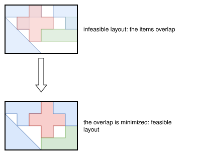
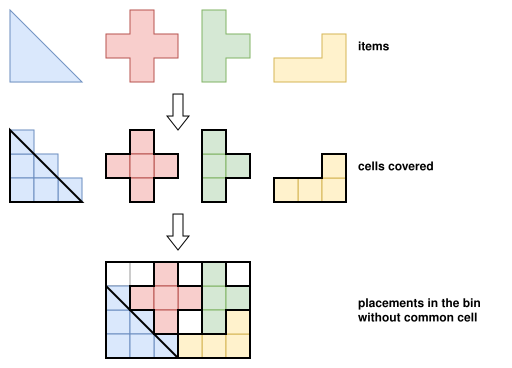

.. _internals_irregular:

:code:`irregular` algorithms
============================

See :ref:`irregular<irregular>` for the input/output format and CLI usage of this solver.

Trivial single item
-----------------------

This algorithm solves the :code:`feasibility` objective.

This is not an algorithm aimed at generating real patterns. It is aimed at providing a fast debug routine to check if an item fits in at least one bin.

It tries to place the item by aligning the center of its bounding box with the center of the bin's bounding box, then validates (and, if needed, adjusts) the placement against the bin's actual shape.

Tree search
------------

This algorithm solves the :code:`feasibility`, :code:`knapsack`, :code:`bin-packing`, :code:`bin-packing-with-leftovers`, :code:`open-dimension-x`, :code:`open-dimension-y` objectives, and the :code:`open-dimension-xy` objective through sequential feasibility.

It is a tree search algorithm where a single item is packed at each stage. The root node is an empty partial solution (no item packed). Given a node, a child node is generated for each feasible insertion of each unpacked item: the new item rests on the last inserted item, and is pushed to the right until it doesn't overlap the items already packed.

It is a generalization of the tree search algorithm for :code:`rectangle`.

.. image:: ../img/irregular_tree_search.svg
   :align: center

See :doc:`the detailed description <irregular/tree_search>`.

Tree search with periodic packings
-------------------------------------

This algorithm solves the :code:`knapsack` and :code:`feasibility` objectives with a single bin, and the other objectives with a single bin through sequential feasibility.

It is designed for instances with many copies of a few item types. The periodic packings of the item types (lattice packings of one or two items) are computed first; blocks of items are built from them, and a tree search with maximal empty spaces packs a block at each stage.

See :doc:`the detailed description <irregular/tree_search_periodic_packing>`.

Tree search with maximal spaces
----------------------------------

This algorithm solves the :code:`knapsack` and :code:`feasibility` objectives with a single bin, and the other objectives with a single bin through sequential feasibility.

It lies between the two previous algorithms. Like the tree search with periodic packings, a node stores the maximal empty spaces of the bin and a block of items (a single item or a periodic block) is packed at each stage, in the empty space closest to the bottom-left corner of the bin. Like the tree search, the blocks are described by their actual shapes: they rest on the items already packed and slide until they don't overlap them, so they may fit in the gaps and in the concavities of the items already packed.

See :doc:`the detailed description <irregular/tree_search_maximal_spaces>`.

Local search
--------------

This algorithm solves the :code:`feasibility` objective, and the :code:`bin-packing`, :code:`bin-packing-with-leftovers` and :code:`open-dimension-*` objectives through sequential feasibility.

It works on complete layouts which are allowed to be infeasible, and tries to make them feasible. When it fails, it starts again from a disruption of a failed layout, drawn from a population (iterated local search). Three engines are available:

* direct trigonometry: the items may overlap, and the overlap is minimized by moving the items one by one to the best of many sampled positions;
* linear programming: the items may be shrunk instead of overlapping, and linear programs move them slightly while maximizing their sizes;
* nonlinear programming: the same with nonlinear programs, in which the items may also rotate (requires Knitro).

See :doc:`the detailed description <irregular/local_search>`.

MILP raster
--------------

This algorithm solves the :code:`feasibility` and :code:`knapsack` objectives.

It rasterizes the bins and the items onto a grid and solves the resulting placement problem as a mixed-integer linear program, refining the grid iteratively.

See :doc:`the detailed description <irregular/milp_raster>`.

Benders decomposition
------------------------

This algorithm solves the :code:`knapsack`, :code:`bin-packing` and :code:`variable-sized-bin-packing` objectives.

Its master problem assigns the items to the bins considering only their areas, as a one-dimensional problem. For each bin of its solution, a subproblem checks whether the items actually fit; if not, no-good cuts forbidding infeasible subsets of them are added to the master problem, which is solved again. With the :ref:`MILP NFP <internals_irregular_milp_nfp>` algorithm in its subproblems, the cuts are proven, so the value of the master problem is a bound, and the algorithm is exact.

See :doc:`the detailed description <irregular/benders_decomposition>`.

MILP NFP
------------

This algorithm solves the :code:`feasibility` objective with a single bin. Its main use is to prove that a set of items doesn't fit in a bin, in the subproblems of the Benders decomposition.

For each combination of rotations of the items, the non-overlap of each pair of items is modeled with the convex pieces of the complement of their no-fit polygon, in a mixed-integer linear program. The items don't fit if every program is infeasible.

See :doc:`the detailed description <irregular/milp_nfp>`.

One-dimensional bound
------------------------

This algorithm computes a bound for the :code:`bin-packing`, :code:`knapsack` and :code:`variable-sized-bin-packing` objectives.

Relaxes the instance to a one-dimensional problem (each bin and item type keeps only its area) and solves it, which is much cheaper than solving the irregular problem itself. The resulting bin-packing / knapsack / variable-sized-bin-packing bound is a valid bound for the original instance, since no irregular packing can use less total area than this relaxation requires.

.. toctree::
   :maxdepth: 1
   :hidden:

   irregular/tree_search
   irregular/tree_search_periodic_packing
   irregular/tree_search_maximal_spaces
   irregular/local_search
   irregular/milp_raster
   irregular/benders_decomposition
   irregular/milp_nfp
