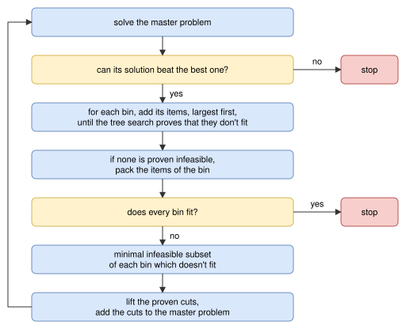

.. _internals_irregular_benders_decomposition:

Benders decomposition
=====================

Objectives
----------

This algorithm solves the :code:`knapsack` objective, with one or several bins, and the :code:`bin-packing` and :code:`variable-sized-bin-packing` objectives. It supports the resources of the bins.

It is an exact method when its subproblems use the :ref:`MILP NFP <internals_irregular_milp_nfp>` algorithm: when it converges, the solution found is optimal, and before that, the value of its master problem is a bound.

Principle
---------

It is the combinatorial Benders decomposition of the :ref:`rectangle Benders decomposition <internals_rectangle_benders_decomposition>`, with the geometry of irregular items. The problem is split in two:

* the *master problem* decides which items go in which bin, ignoring the geometry: it is a one-dimensional problem, where each item is reduced to its area and each bin to its area;
* the *subproblems* check, for each bin of the solution of the master problem, whether its items actually fit together in the bin.

When the items of a bin don't fit, *no-good cuts* are added to the master problem, forbidding infeasible subsets of them in a bin of this type, and the master problem is solved again. Since the master problem is a relaxation of the problem, the value of its optimal solution is a bound. The algorithm stops when the items of every bin fit, or when the solution of the master problem can't be better than the best solution found: the best solution found is then optimal.

Unlike in the rectangle version, nothing is known about the geometry before the first iteration: two irregular items which don't fit side by side or one above the other may still fit together, interlocked or rotated, so there are no incompatible pairs or triplets, and no dual feasible function cuts. All the geometric information of the master problem comes from the subproblems.

Master problem
--------------

The master problem is a :ref:`onedimensional <internals_onedimensional>` instance, with the objective of the instance:

* each bin type has its area, rounded up, as length, and keeps its copies, its cost and its resources;
* each item type has its area, rounded down, as length, and keeps its copies and, for the :code:`knapsack` objective, its profit.

The roundings keep the master problem a relaxation. It is solved with the :ref:`MILP assignment <internals_onedimensional_milp_assignment>` algorithm, in non-anytime mode, or in :code:`exact` mode in the :code:`exact` mode.

The cuts are encoded as onedimensional *resources* on the bin types, as in the rectangle version: a cut forbidding :math:`n_i` copies of each item type :math:`i` of a set :math:`S`, with lifted item types :math:`L`, is the resource of capacity :math:`\sum_{i \in S} n_i - 1` where the copies of item type :math:`i \in S` consume :math:`(1, \ldots, 1, 0)` (:math:`n_i` ones) and the copies of item type :math:`j \in L` consume :math:`(1, 0)`. With the variables :math:`x_{i,t,k,c}` of the MILP assignment model (bin :math:`k` of type :math:`t` contains at least :math:`c` copies of item type :math:`i`), it is the constraint, for each bin :math:`(t, k)`:

.. math::

   \sum_{i \in S} \sum_{c \le n_i} x_{i,t,k,c} + \sum_{j \in L} x_{j,t,k,1} \le \sum_{i \in S} n_i - 1

Iterations
----------

At each iteration, the master problem is solved, then the bins of its solution are checked. With the MILP NFP algorithm in the subproblems:

The steps are:

1. **Master problem.** If all the cuts are proven (see below), the value of its solution is reported as a bound of the instance. If a solution has already been found, and the solution of the master problem can't be better (smaller profit for the :code:`knapsack` objective, as many bins or more for the :code:`bin-packing` objective, cost as large or larger for the :code:`variable-sized-bin-packing` objective), the algorithm stops.
2. **Subproblems.** The selection of items of each bin of the solution of the master problem is checked (see below). A selection containing the items of a cut added earlier in the same iteration, for another bin, is known to be infeasible and is skipped. The bins whose items fit are assembled into a solution, which is reported if it is better than the best one (for the :code:`knapsack` objective, a subset of the bins is a feasible solution).
3. **Convergence.** If every bin fits, the solution of the master problem is feasible, and the algorithm stops. Otherwise, no-good cuts are added for the bins which don't fit, and the master problem is solved again.

Subproblems
-----------

Without the MILP NFP algorithm, the items of a bin are packed by solving a single-bin instance with the :code:`feasibility` objective with the irregular algorithms, in non-anytime mode (a queue of size 128 for the tree search). This finds packings, but it rarely proves that the items don't fit, so the cuts are mostly unproven.

With the :ref:`MILP NFP <internals_irregular_milp_nfp>` algorithm:

* **Infeasible prefix.** The items of the bin are sorted by decreasing area, and the MILP NFP algorithm is called on the largest one, then on the two largest ones, and so on, until it proves that they don't fit. Proving it for a few large items is often much cheaper than for all the items of the bin, and a small infeasible subset is what the cuts need anyway. If the MILP NFP algorithm is inconclusive (time limit, continuous rotations), the search stops.
* **Packing.** If no prefix is proven infeasible, the MILP NFP algorithm is called on all the items of the bin. If its relaxation is feasible, the positions of its solution are checked, and used as a packing if the items don't overlap. Otherwise, the single-bin :code:`feasibility` instance is solved, as above.

The answers of the MILP NFP algorithm are stored, so that the same selection of items is never checked twice, and the data of the MILP NFP algorithm (the convex pieces of the pairs of item types, the infeasible rotation combinations) are shared by all its calls.

No-good cuts
------------

**Minimal infeasible subsets.** The infeasible items of a bin (the infeasible prefix, or all the items of the bin) are reduced to a minimal infeasible subset with the depth-first search of the rectangle version: the items are sorted by increasing area, and removed one at a time, as long as the remaining items don't fit. Each check is a subproblem, which is expensive for irregular items, so the search stops after a single subset per bin by default. The subset gives a no-good cut: no bin of this type contains at least these copies of these item types.

**Lifting.** A proven cut forbidding a set :math:`S` of items is lifted by giving a coefficient 1 to other item types: the cut then forbids any :math:`|S|` items among :math:`S` and the lifted item types. The item types not in the cut are visited by decreasing area. An item type :math:`j` is lifted if every selection made of one copy of :math:`j` and of :math:`|S| - 1` items among :math:`S` and the item types already lifted (:math:`L`) is proven infeasible, either because it contains the items of a proven cut, or by the MILP NFP algorithm. Then no feasible selection reaches :math:`|S|` on the lifted cut, so it stays valid. Unlike in the rectangle version, the coefficients are only 0 or 1: there is no cheap bound, like the bar relaxation, on the number of items of the cut which fit together with :math:`j`. At most 4 item types are lifted in a cut.

Lifting makes each cut much stronger, but it is expensive: on :code:`jakobs2_sb`, it adds about 3 item types per cut, but it takes 60% of the time.

**Proofs.** A cut is *proven* if every check of its derivation proved that the items don't fit, which in practice requires the MILP NFP algorithm. A cut which isn't proven is still added, so that the algorithm keeps converging, but then the master problem may not be a relaxation anymore: while a cut is unproven, the value of the master problem is not reported as a bound of the instance, and the solution found is not proven optimal.

Search parameters
-----------------

In anytime mode, the algorithm runs until it converges or reaches the time limit. In the non-anytime modes, it also stops after 32 iterations. In the :code:`exact` mode, it runs as in anytime mode, its master problem is solved in :code:`exact` mode, and its subproblems always use the MILP NFP algorithm, so that its bound is proven.

Automatic selection
-------------------

In the :code:`exact` mode, it is run for the :code:`knapsack` objective with a single bin, alongside the other algorithms. The :ref:`column generation <internals_generic_algorithms_column_generation>` algorithm uses it, with the MILP NFP algorithm, to solve its pricing problems when it needs to prove a bound.

It can be selected with :code:`--use-benders-decomposition 1` (CLI) or :code:`use_benders_decomposition` (Python), and its subproblems use the MILP NFP algorithm with :code:`--benders-decomposition-use-milp-nfp 1`. It only finds a solution once every bin of the solution of its master problem is packed, which may take long, while its bound may be good much earlier: it is best run together with other algorithms (e.g. :code:`--use-tree-search 1`), whose solutions may then be proven optimal by this bound.

Strengths and limitations
-------------------------

The algorithm proves the optimality of the instances in which few items fit in a bin, or with few item types, whose minimal infeasible subsets are small and shared by many selections. With the tree search, in the :code:`exact` mode, on the :code:`bin-packing` instances of :code:`data/irregular/martinez2017`, it proves the optimality of :code:`albano_sb`, :code:`dighe1_sb`, :code:`dighe2_sb`, :code:`fu_sb`, :code:`han_sb`, :code:`jakobs1_sb`, :code:`mao_sb`, :code:`poly1a_sb`, :code:`shapes0_sb`, :code:`shapes1_sb` and :code:`shapes2_sb`, in a few seconds to a few minutes.

When more items fit in a bin, the minimal infeasible subsets have 5 items or more, and the MILP NFP algorithm takes seconds to prove each of them: on :code:`poly2a_sb` (15 item types), the bound stays at the area bound.

Source files
------------

* :code:`src/irregular/benders_decomposition.hpp`, :code:`src/irregular/benders_decomposition.cpp`: the decomposition
* :code:`src/irregular/milp_nfp.hpp`, :code:`src/irregular/milp_nfp.cpp`: the MILP NFP algorithm of the subproblems
* :code:`scripts/doc_figures/irregular_benders_decomposition.py`: the figures of this page

References:

* "Combinatorial Benders Decomposition for the Two-Dimensional Bin Packing Problem" (Côté, Haouari and Iori, 2021)

  * https://doi.org/10.1287/ijoc.2020.1014

* "Facets of the knapsack polytope" (Balas, 1975)

  * https://doi.org/10.1007/BF01580430
