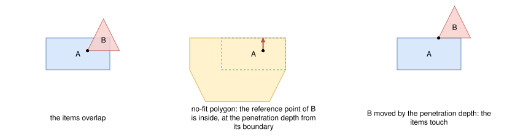

.. _internals_irregular_local_search_black_box_optimization:

Local search: black-box optimization engine
===========================================

This page describes the separator of the black-box optimization engine of the :ref:`local search <internals_irregular_local_search>`. It follows the separation algorithm of Imamichi, Yagiura and Nagamochi (2009). It requires Knitro: PackingSolver must be built with :code:`-DPACKINGSOLVER_USE_KNITRO=ON`.

Principle
---------

As in the :ref:`direct trigonometry engine <internals_irregular_local_search_direct_trigonometry>`, the items may overlap each other and the obstacles of their bin: its borders, its defects and its fixed items. The overlap of two items is measured by their *penetration depth*, the length of the smallest translation which separates them, computed exactly from their no-fit polygon. A separation solves a sequence of nonlinear programs, each one minimizing the weighted sum of the squared penetration depths over the positions of the items. The orientations of the items are fixed.

The programs have no constraints, only bounds on the variables, and their objective is evaluated by a function, with its gradient, rather than given by a formula: they are solved as black-box programs, hence the name of the engine.

No-fit polygons
---------------

The no-fit polygon of a fixed item :math:`A` and of an orbiting item :math:`B` is the set of the positions of the reference point of :math:`B`, relatively to the reference point of :math:`A`, for which the two items overlap. The penetration depth of :math:`B` into :math:`A` is then the distance from the relative position of :math:`B` to the boundary of the no-fit polygon, when it is inside. The no-fit polygons may have holes, for example when :math:`B` fits into a hole of :math:`A`, and several components.

In the example below, the reference points of the items are their bottom-left corners. The reference point of :math:`B` is inside the no-fit polygon, so the items overlap; the closest point of the boundary is above it, so the smallest translation separating the items moves :math:`B` up, by the penetration depth:

The shapes are simplified as for the direct trigonometry engine, in the same orientations, and the circular arcs are approximated by line segments. The no-fit polygon of two items is the union of the no-fit polygons of the pairs of their shapes, the shapes of the fixed item being inflated by the item-item minimum spacing. The no-fit polygons are computed lazily, the first time a pair of item types in given orientations is close enough to be evaluated, and they are shared by the sub-problems of the sequential feasibility algorithm. The no-fit polygons of the items and of the obstacles of a bin are computed the same way, the borders and the defects being inflated by the item-bin minimum spacing.

The *signed distance* of a relative position is its distance to the boundary of the no-fit polygon, positive inside and negative outside. Its gradient is the direction from the closest point of the boundary, or the normal of the closest edge on the boundary. Outside the no-fit polygon, it is only computed up to a small margin, beyond which the items are considered far from each other; the bounding boxes of the items are checked first.

Nonlinear program of a step
---------------------------

A step builds a nonlinear program for each bin with overlap.

**Variables**: :math:`p_i \in \mathbb{R}^2`, the position of the reference point of each item :math:`i` of the bin, bounded so that the bounding box of the item is in the bounding box of the bin, minus the item-bin spacing. The variables are divided by the mean smallest dimension of the items, so that they are of the order of 1.

**Objective**: minimize the weighted squared penetration depths

.. math::

   \min \sum_{i < j} w_{ij} \, \max(0, d_{ij}(p_j - p_i) + m)^2 + \sum_i \sum_{o} w_{io} \, \max(0, d_{io}(p_i) + m)^2

where :math:`d_{ij}` is the signed distance of the no-fit polygon of items :math:`i` and :math:`j`, :math:`d_{io}` the one of item :math:`i` and obstacle :math:`o`, :math:`w` the guided local search weights, and :math:`m` a margin, :math:`10^{-4}` times the mean smallest dimension of the items. With the margin, the items are pushed slightly beyond contact, so that the solutions have no overlap despite the tolerances of the solver.

The programs are solved by Knitro, with a quasi-Newton method (L-BFGS), in a single thread, with at most 1000 iterations. The new positions are clamped to their bounds.

**Loss.** The *loss* of a layout is the sum of the squared penetration depths, without the margin and the weights, and of the squared distances by which the items stick out of the bounding box of their bin.

Guided local search weights
---------------------------

Each pair of items, and each pair of an item and an obstacle, has a guided local search weight, updated after each step as in the direct trigonometry engine: the weights of the overlapping pairs are increased by a factor between 1.2 and 2, proportional to their loss divided by the largest loss, and the weights of the other pairs decay by a factor 0.95, down to 1.

Separation
----------

A separation is a sequence of *strikes*. In a strike, steps are performed until a counter of steps without improvement reaches 20: the counter is reset when the smallest loss found decreases by at least 2%, and incremented when it doesn't decrease. The strike is a failure if it hasn't decreased the loss by at least 2%. Between strikes, the best layout found is restored, keeping the weights. The separation stops after 3 failed strikes in a row (1 while the loss is above the reference loss of the iterated local search), or as soon as the loss is 0.

For the :code:`knapsack` objective, the separations are shorter: 2 steps without improvement and 1 failed strike.

Initial layout and disruption
-----------------------------

The loading of a solution, the insertion of the missing items, the disruption and the distance between two layouts are the ones of the direct trigonometry engine, whose separator is used for them. In particular, the disruption is the only way for an item to change orientation.

Strengths and limitations
-------------------------

Each nonlinear program only moves the items continuously from their current positions, so an item can't jump to a free space far away, except through the disruptions. The computation of the no-fit polygons can be expensive for items with many vertices. It is not part of the automatic selection.

It can be selected with :code:`--use-local-search-black-box-optimization 1` (CLI) or :code:`use_local_search_black_box_optimization` (Python).

Source files
------------

* :code:`src/irregular/black_box_optimization/no_fit_polygon.hpp`, :code:`src/irregular/black_box_optimization/no_fit_polygon.cpp`: the no-fit polygons and the signed distances
* :code:`src/irregular/black_box_optimization/separator.hpp`, :code:`src/irregular/black_box_optimization/separator.cpp`: the separator

References:

* "An iterated local search algorithm based on nonlinear programming for the irregular strip packing problem" (Imamichi, Yagiura and Nagamochi, 2009)

  * https://doi.org/10.1016/j.disopt.2009.04.002

* "A General Heuristic Approach for Maximum Polygon Packing (CG Challenge)" (Luo, Su and Lü, 2024), which uses the same separation algorithm

  * https://doi.org/10.4230/LIPIcs.SoCG.2024.86
