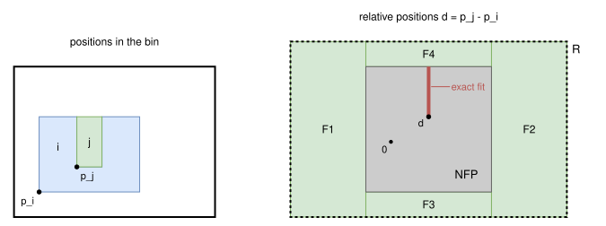
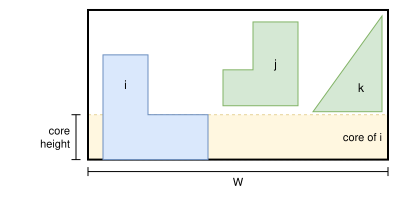

.. _internals_irregular_milp_nfp:

MILP NFP
========

Objectives
----------

Given a bin type and a set of items, this algorithm tries to prove that the items don't fit in a bin of this type. It is used in the subproblems of the :ref:`Benders decomposition <internals_irregular_benders_decomposition>`.

It also solves the :code:`feasibility` objective with a single bin. If it doesn't prove that the instance is infeasible, the positions of the solution of its relaxation are checked, and used as a solution if the items don't overlap.

It returns *infeasible* (proven), *feasible* (the relaxation is feasible, so the items may fit), or *unknown* (time limit, or an item type with a continuous rotation range).

Principle
---------

The rotations of the items are enumerated. For a given rotation of each item, the positions of two items which don't overlap are described exactly by their *no-fit polygon*: item :math:`j` overlaps item :math:`i` if and only if the relative position :math:`p_j - p_i` of their reference points is in the interior of the no-fit polygon :math:`\text{NFP}_{ij}`. The complement of the no-fit polygon is not convex, so it is partitioned into convex pieces, and a binary variable selects the piece containing the relative position: this is the mixed-integer linear program (MILP) of Fischetti and Luzzi (2009), with the bounding box of the bin instead of a strip.

In the example below, item :math:`i` is a 4 × 3 rectangle with a 1 × 2 notch, item :math:`j` a 1 × 2 rectangle, and the bin is 8 × 6. The relative positions allowed by the bin form the rectangle :math:`R`. The no-fit polygon covers its middle, and the region outside of it is partitioned into the convex pieces :math:`F_1` to :math:`F_4`. Item :math:`j` also fits exactly in the notch: its relative positions there form a segment inside the no-fit polygon, an additional piece (see *Exact fits* below):

The items don't fit if the program of every rotation combination is infeasible. The programs of the rotation combinations are independent, so they are solved in parallel (4 threads by default), and the search stops as soon as one of them is feasible. A single program in which binary variables select the rotations was tried, but its linear relaxation is much weaker and it was several times slower.

The model is a relaxation, so that an infeasible program is a proof:

* the bin is replaced by its bounding box; the defects, the fixed items and the item-item spacing are ignored;
* the circular arcs of the regions below are approximated by line segments outside of them.

Model
-----

**Input**, for a rotation combination:

* the items :math:`i = 1, \ldots, n`, each with its rotation;
* for each item :math:`i`, its *inner-fit rectangle* :math:`\text{IFP}_i`: the positions of its reference point for which its bounding box is in the bounding box of the bin (minus the item-bin spacing);
* for each pair of items :math:`(i, j)`, the region :math:`R_{ij} = \text{IFP}_j - \text{IFP}_i` of the relative positions allowed by the inner-fit rectangles, and the region :math:`F_{ij} = R_{ij} \setminus \text{int}(\text{NFP}_{ij})` of the ones for which the items don't overlap, partitioned into convex pieces :math:`k \in K_{ij}`. Each piece is described by its edges :math:`(n, c)`, the half-planes :math:`n \cdot d \ge c`.

**Variables**:

* :math:`p_i \in \text{IFP}_i`: the position of the reference point of item :math:`i`
* :math:`z^{ij}_k \in \{0, 1\}`, :math:`k \in K_{ij}`: :math:`z^{ij}_k = 1` iff the relative position of items :math:`i` and :math:`j` is in piece :math:`k`

There is no objective: only the feasibility of the program matters.

**Constraints**:

* Piece selection: the relative position of each pair of items is in one of the pieces.

.. math::

   \forall (i, j) \qquad \sum_{k \in K_{ij}} z^{ij}_k = 1

* Pieces: the edges of a piece are relaxed with big-M coefficients when the piece isn't selected.

.. math::

   \forall (i, j), \; \forall k \in K_{ij}, \; \forall \text{ edge } (n, c) \text{ of } k \qquad n \cdot (p_j - p_i) \ge c - M (1 - z^{ij}_k)

where :math:`M = c - \min_{d \in R_{ij}} n \cdot d` is the smallest value for which the constraint is always satisfied in :math:`R_{ij}`.

* Symmetry breaking: identical items with the same rotation are sorted by :math:`x`.

**Exact fits.** An item may fit exactly in a notch of another one, or two items may touch along a whole edge: the relative position is then on a line segment or at a point strictly inside the no-fit polygon, but on no edge of the region :math:`F_{ij}`. These feasible positions of null area are returned by the no-fit polygon computation, and each one is an additional convex piece of :math:`F_{ij}`, so that the program stays a relaxation.

**Three-item cuts** (optional, off by default). For three items :math:`i < j < u`, the relative positions satisfy :math:`d_{iu} = d_{ij} + d_{ju}`. So if the piece :math:`a` of :math:`F_{ij}` and the piece :math:`b` of :math:`F_{ju}` are selected, :math:`d_{iu}` is in the Minkowski sum :math:`a \oplus b`, and the pieces :math:`c` of :math:`F_{iu}` which don't intersect it can't be selected:

.. math::

   z^{ij}_a + z^{ju}_b + \sum_{c \in K_{iu}, \; c \cap (a \oplus b) = \emptyset} z^{iu}_c \le 2

The pieces are first clipped to the rectangles :math:`R`, and a cut is only added when the separation of the two convex sets is larger than a small tolerance, so that the program stays a relaxation. The cuts of each triple of item types and rotations are computed once and cached, and they are only added to programs with 4 items or more. They are the feasibility cuts of Lastra-Díaz and Ortuño (2024), restricted to three items. On the 5 items of :code:`data/irregular/tests/feasibility_poly2a_five_items_infeasible.json`, they make the proof 3 times faster, but they slow down the other calls, and they didn't improve any bound of the Benders decomposition, so they are off by default.

Rotation combinations
---------------------

The rotation combinations are enumerated item by item. Some of them are never solved:

* **Identical rotations.** Two rotations of an item type which give the same shape (for example, the rotations by 0 and 180 degrees of a rectangle) are only considered once.
* **Identical items.** The rotations of identical items are non-decreasing.
* **Symmetry of the bin.** The program only considers the bounding box of the bin, so turning a solution by 180 degrees gives another solution. If every rotation of every item type has its counterpart turned by 180 degrees, then an item, the only copy of its item type, is restricted to one rotation of each such pair.
* **Pairs.** A partial combination in which the region :math:`F_{ij}` of a pair of items is empty isn't extended.

Before solving the program of a rotation combination:

1. **Core widening.** A cheap area test may prove it infeasible (see below).
2. **Sub-combinations.** Its sub-combinations without one of the items are checked first: if one of them is infeasible, so is the combination. Their programs are cheaper, and each of them is shared by several combinations.

The statuses of the combinations and of the sub-combinations are cached, as well as the convex pieces of the pairs of item types, so that the next calls on other sets of items reuse them. On the 5 items of :code:`data/irregular/tests/feasibility_poly2a_five_items_infeasible.json`, 406 of the 512 rotation combinations are proven infeasible by a sub-combination, and the proof goes from 17.6 to 13 seconds.

Core widening
-------------

The *core* of an item is the part of its :math:`y`-range that no other item can reach, given the regions :math:`F_{ij}` (each piece is convex, so its :math:`y`-range gives exactly the heights at which the other item can be). Since the rotations are fixed, no other item has any point in the horizontal band of the core of an item, across the whole bin. So the item can be counted as widened to the width :math:`W` of the bin on its core:

.. math::

   \text{widened area}(i) = W \times \text{core height}(i) + \text{area of } i \text{ outside of its core}

In the example below, items :math:`j` and :math:`k` can't be lower than the top of the foot of item :math:`i`, so the band of the foot belongs to item :math:`i` alone, across the whole bin:

The cores of different items are disjoint, so the rotation combination is infeasible if the sum of the widened areas exceeds the area of the bin.

This is not a reduction: the parts of an item outside of its core may be interlocked with other items, so the item can't always be moved against a side of the bin to actually be widened. The test helps when the items are large compared to the bin; when they fill less than about three quarters of it, the cores are usually empty.

Search parameters
-----------------

The programs are solved with HiGHS, with 4 threads by default, until the time limit. When the algorithm is run on its own, in the :code:`not-anytime-sequential` mode, a single thread is used.

Automatic selection
-------------------

In the :code:`exact` mode, it is run for the :code:`feasibility` objective with a single bin, alongside the other algorithms. It is always used in the subproblems of the :ref:`Benders decomposition <internals_irregular_benders_decomposition>` in the :code:`exact` mode.

It can be selected with :code:`--use-milp-nfp 1` (CLI) or :code:`use_milp_nfp` (Python), for the :code:`feasibility` objective with a single bin only.

Strengths and limitations
-------------------------

The number of rotation combinations grows exponentially with the number of items, and the programs get harder as the items get smaller compared to the bin, since the regions :math:`F_{ij}` then have more pieces. The algorithm proves in a fraction of a second that 2 or 3 large items don't fit; for 5 items with 4 rotations each, a proof may take 10 to 20 seconds.

Source files
------------

* :code:`src/irregular/milp_nfp.hpp`, :code:`src/irregular/milp_nfp.cpp`: the algorithm
* :code:`scripts/doc_figures/irregular_milp_nfp.py`: the figures of this page

References:

* "Mixed-integer programming models for nesting problems" (Fischetti and Luzzi, 2009)

  * https://doi.org/10.1007/s10732-008-9088-9

* "A branch & bound algorithm for cutting and packing irregularly shaped pieces" (Alvarez-Valdes, Martinez and Tamarit, 2013)

  * https://doi.org/10.1016/j.ijpe.2013.04.007

* "Mixed-integer programming models for irregular strip packing based on vertical slices and feasibility cuts" (Lastra-Díaz and Ortuño, 2024)

  * https://doi.org/10.1016/j.ejor.2023.08.009
