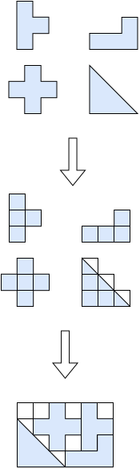

.. _internals_irregular_milp_raster:

MILP raster
===========

Objectives
----------

This algorithm solves the :code:`feasibility` and :code:`knapsack` objectives, with one or several bins.

In the :code:`exact` mode, it also computes a bound, with a relaxation on the same grids: a knapsack bound for the :code:`knapsack` objective, or a proof that the instance is infeasible.

Principle
---------

The bins are discretized into a grid of square cells, and the items are only placed at positions of the grid. The problem then becomes a set packing problem: select placements of the items, such that no two placements cover the same cell, maximizing the profit of the items placed. It is solved as a mixed-integer linear program (MILP). The grid is then refined, and the program solved again.

Rasterization
-------------

The rasterization is conservative, so that the solutions of the program are feasible packings:

* a cell is *covered* by an item as soon as the item covers a part of it, however small;
* a cell is *unavailable* in a bin as soon as a border of the bin or a defect covers a part of it, and the cells covered by fixed items are left to them.

For each item type and each of its orientations (the allowed angles, or a finite set of angles for the item types with continuous rotations), the item is rasterized once. Its *placements* are all the translations of this pattern by whole cells such that all its cells are available.

**Minimum spacings.** They are taken into account by inflating the shapes before rasterizing them:

* item-defect spacing: the defects are inflated by their spacing;
* item-bin spacing: the borders of the bin (the parts of its bounding box outside of it) are inflated by the spacing, and the cells within the spacing of the sides of the bounding box are unavailable too. This is how the spacing is enforced for a rectangular bin, which has no borders;
* item-item spacing: each placement also has the cells of the item inflated by half the spacing, which are the ones used in the cell conflict constraints below; the fixed items are inflated by half the spacing too. Two placements whose inflated cells don't overlap are at least the spacing apart.

Model
-----

**Input**:

* the cells :math:`G` of the grids of the bins
* the placements :math:`P`; for each placement :math:`p`, its item type :math:`j(p)` and the set of cells :math:`C_p \subseteq G` it covers (with the item inflated by half the item-item spacing)
* the item types :math:`j = 1, \ldots, n`; for each item type :math:`j`, its profit :math:`v_j`, and its minimum and maximum numbers of copies :math:`q^{\min}_j` and :math:`q_j` (without its fixed copies)

**Variables**:

* :math:`x_p \in \{0, 1\}`, :math:`p \in P`: :math:`x_p = 1` iff placement :math:`p` is selected

**Objective**: maximize the profit of the items placed

.. math::

   \max \sum_{p \in P} v_{j(p)} \, x_p

**Constraints**:

* Copies: each item type is placed between its minimum and its maximum number of copies. For the :code:`feasibility` objective, the minimum is the number of copies, so all the items must be placed.

.. math::

   \forall j \qquad q^{\min}_j \le \sum_{p \,:\, j(p) = j} x_p \le q_j

* Cell conflicts: each cell is covered by at most one placement.

.. math::

   \forall c \in G \qquad \sum_{p \,:\, c \, \in \, C_p} x_p \le 1

Grid refinement
---------------

The initial size of the cells is computed from the coordinates of the vertices of the shapes: if they are all multiples of a common value, the size of the cells is this value times a power of two, so that, once the grid has been refined down to this value, the shapes made of axis-aligned edges on this grid are rasterized exactly. The size of the cells is halved after each program, until the time limit.

The programs are solved with HiGHS. For the :code:`knapsack` objective, the solutions found by the solver are reported as they are found, and the solver stops as soon as its bound shows that it can't improve the best solution found.

Bound
-----

In the :code:`exact` mode, a *relaxation* of the problem is solved on the same grids as the restriction above, for the same decreasing cell sizes, in another thread. It is only used if every allowed rotation of the item types is a single angle.

In the restriction, an item is placed at a point of the grid and occupies every cell it touches. In the relaxation, a placement :math:`p` of an item type :math:`j(p)`, in a rotation, at a cell :math:`k`, means that the bottom-left corner of the bounding box of the item is *anywhere* in cell :math:`k`, so every position of the item is covered by a placement. Several copies may share a placement.

**Coefficients.** The coefficient :math:`a_{p,c}` of placement :math:`p` in cell :math:`c` is a lower bound on the area of cell :math:`c` covered by the item, wherever its corner is in cell :math:`k`. The item is partitioned into convex parts. For a convex part, the square root of the area of its intersection with the cell is concave in their relative position (Brunn-Minkowski inequality), so its minimum over the positions in cell :math:`k` is reached at a corner of cell :math:`k`. Each convex part is rasterized at the 4 corners, and :math:`a_{p,c}` is the sum over the convex parts of the minimum of their coverage of cell :math:`c` over the 4 corners.

**Capacities.** The capacity :math:`b_c` of a cell is the area of the cell inside the bin, minus the area of the fixed items in it. The defects and the item-item spacing are ignored, which keeps the relaxation valid.

**Variables**:

* :math:`y_p \in \mathbb{N}`, :math:`p \in P`: the number of copies placed at placement :math:`p`

**Objective**: for the :code:`knapsack` objective, maximize the profit of the items placed

.. math::

   \max \sum_{p \in P} v_{j(p)} \, y_p

**Constraints**:

* Copies:

.. math::

   \forall j \qquad q^{\min}_j \le \sum_{p \,:\, j(p) = j} y_p \le q_j

* Cell capacities:

.. math::

   \forall c \in G \qquad \sum_{p \in P} a_{p,c} \, y_p \le b_c

* Areas: the coefficients :math:`a_{p,c}` underestimate the areas of the items, so the area of the items placed in a bin, :math:`A_{j(p)}` for each copy, is also bounded by the sum :math:`B` of the capacities of its cells.

.. math::

   \forall \text{ bin} \qquad \sum_{p \text{ in the bin}} A_{j(p)} \, y_p \le B

The value of the relaxation is a knapsack bound, and if it is infeasible, the instance is infeasible. On :code:`data/irregular/tests/knapsack_incompatible_crosses.json`, three crosses which fit by area can't be packed together, since each of them covers the center of the bin: the area bounds count all three, while the relaxation proves the optimality of a solution with a single one.

There is no limit on the size of the program of the relaxation: its solve may not stop at the time limit, which is acceptable in the :code:`exact` mode only.

Strengths and limitations
-------------------------

The rasterization wastes space along the boundaries of the items, so the algorithm is well suited to items made of axis-aligned edges on a common grid, like polyominoes and calendar puzzles, where it is exact. On general shapes, the number of cells, and so the size of the program, grows quickly as the grid is refined.

Automatic selection
-------------------

It is not part of the automatic selection. It can be selected with :code:`--use-milp-raster 1` (CLI) or :code:`use_milp_raster` (Python).

Source files
------------

* :code:`src/irregular/milp_raster.hpp`, :code:`src/irregular/milp_raster.cpp`
