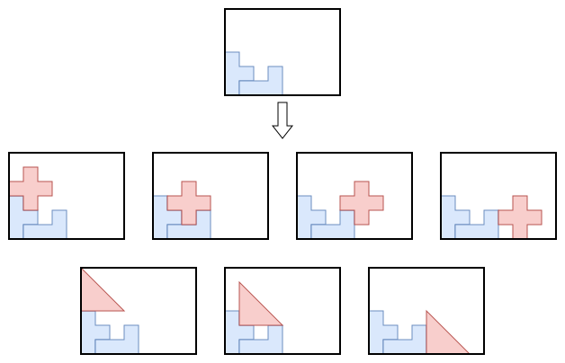

.. _internals_irregular_tree_search:

Tree search
===========

Objectives
----------

This algorithm solves the :code:`feasibility`, :code:`knapsack`, :code:`bin-packing`, :code:`bin-packing-with-leftovers`, :code:`open-dimension-x` and :code:`open-dimension-y` objectives directly. It also solves the :code:`variable-sized-bin-packing` objective when there is a single bin type (it is then a bin packing problem).

The :code:`open-dimension-xy` objective is solved through the :ref:`sequential feasibility <internals_generic_algorithms_sequential_feasibility>` algorithm, the tree search solving its :code:`feasibility` sub-problems.

Principle
---------

It is a constructive tree search where a single item is packed at each stage. The root node is an empty partial solution. Given a node, a child node is generated for each candidate insertion of each unpacked item, either in the current (last) bin or in a new bin. The tree is explored by an iterative beam search, guided by a guide function (see below).

It is a generalization of the :ref:`tree search for rectangle <internals_rectangle_tree_search>`: the items are packed from left to right, each new item resting on the item inserted just before it, and pushed to the right until it doesn't overlap the items already packed.

Preprocessing
-------------

**Simplified shapes.** The shapes of the items, of the bin borders and of the defects, inflated by the minimum spacings, are replaced by polygons with fewer vertices containing them (circular arcs are first approximated by line segments), so that a packing of the simplified shapes is a packing of the original ones. Fewer vertices make the insertions faster. The vertices are removed by increasing cost, as long as the total area added by the approximations stays below a *maximum approximation ratio* times the smaller of the total area of the bins and the total area of the items.

**Directions.** The branching scheme always packs the items from left to right, then from bottom to top, in its own frame. The other directions (from right to left, from top to bottom, and the ones filling the columns first) are obtained by mirroring and transposing the instance. The directions used depend on the objective:

* :code:`open-dimension-x`: from left to right, then from bottom to top or from top to bottom;
* :code:`open-dimension-y`: from bottom to top, then from left to right or from right to left;
* :code:`bin-packing-with-leftovers`: the directions keeping the leftover at the position given by the leftover mode;
* the other objectives with a single bin: from left to right and from bottom to top;
* the other objectives with several bins: a single direction, given by the leftover mode.

**Rotations.** Each item type is considered in a finite set of orientations. With discrete allowed rotations, these are the allowed angles (and their mirrored versions, if mirroring is allowed). With continuous rotations, the candidate angles are the ones making an edge of the item, or of its convex hull, parallel to the x-axis or to the y-axis. They are scored by the area of the bounding box not covered by the convex hull, divided by the square of the area of the convex hull, which favors the angles where the item fills its bounding box well, and the large items. For each item type, the least wide and the least high angles (with their 180° counterparts) and the best scored one are kept, then the best scored angles over all the item types, up to a budget.

**Trapezoids and supports.** For each item type and orientation, the simplified shapes are decomposed into *generalized trapezoids*, whose parallel sides are horizontal. They are used to check the overlaps quickly. The boundaries are also decomposed into *supports*:

* the *supporting parts*: chains of edges with the material below them, on which another item can rest;
* the *supported parts*: chains of edges with the material above them, with which an item rests on another one.

Nodes
-----

A node stores the items packed in the current bin through two lists of trapezoids:

* the *skyline*: the parts of the trapezoids of the packed items which are visible from the right of the bin;
* the *extra trapezoids*: the trapezoids of the packed items which are not part of the skyline, but which are not behind it either, so that they can still block a new item.

The bins before the current one are closed: no item can be added to them anymore.

Insertions
----------

To insert an item in the current bin, a supported part of the item, in one of its orientations, is put on a supporting part of the last inserted item. The item then slides along the supporting part, following the slopes of both chains, to the right, until it doesn't overlap the skyline and the extra trapezoids anymore. The insertion is discarded if the item then sticks out of the bin.

The insertions of the parent node which are still valid are kept: each one is checked against the last inserted item, and slides further if needed. So the candidate positions accumulate along the search, and an item can be inserted against any item of the front, not only the last one.

If no item can be inserted in the current bin, the items are inserted in a new bin, resting on the supporting parts of the bin itself: its bottom border, and the tops of its defects. Bins in which no item fits are skipped.

Guides
------

The guide of a node estimates the quality of the partial solution; the beam search keeps the nodes with the smallest guides. Most guides compare the space already lost with the area of the packed items.

The *guide area* of a node is the area of the bins before the current one, plus the area of the current bin to the left of :math:`x_s`, the largest x-coordinate of the leftmost points of the packed items, plus the area of the skyline to the right of :math:`x_s`. It approximates the area that new items can no longer use.

* Guide 0: guide area divided by the total area of the convex hulls of the packed items.
* Guide 1: same as guide 0, divided again by the total area of the convex hulls, to favor the large items.
* Guide 2: area of the bounding box of the items of the current bin divided by the total area of the convex hulls of the packed items.
* Guide 3: same as guide 2, divided again by the total area of the convex hulls.
* Guide 4: guide area divided by the profit of the packed items.
* Guide 5: same as guide 4, divided by the mean area of the packed items.

By default, guides 4 and 5 are used for the :code:`knapsack` objective, and guides 0 and 1 for the other objectives. Guides 2 and 3 are used by the post-process re-optimizing the last bin of the solutions.

Dominance and pruning
---------------------

Two nodes with the same number of copies of each item type packed can be compared: a node dominates the other one if it uses as many bins, if its skyline is everywhere to the left of the other one, and if their extra trapezoids are the same. Dominated nodes are discarded.

A node is also discarded when it can't lead to a better solution than the best one found, e.g. when it already uses as many bins as the best solution for the :code:`bin-packing` objective, or when it already reaches as far as the best solution for the :code:`open-dimension-x` objective.

Search
------

In anytime mode, a sequence of beam searches is run for each pair (guide, direction), in parallel. Unlike in the other tree searches, each one is a separate beam search, with its own queue size and its own simplified shapes, rather than a restart of the :ref:`iterative beam search <internals_tree_search>`: the first one has a queue of size 1, and the size of the queue is multiplied by 1.5 at each restart; the shapes are simplified with a maximum approximation ratio of 20% at first, multiplied by 0.75 at each restart, so that the first solutions are found quickly and the next ones are more accurate. The best solution found is used as a cutoff by the next beam searches: the nodes which can't lead to a better solution are discarded. The sequence stops when a beam search explores its whole tree, which is only complete for its simplified shapes.

When all the items can rotate freely and the bins are squares, the directions are equivalent, and a single one is used.

In the non-anytime modes, a single beam search is run for each pair (guide, direction), with a queue of size 512 (parameter :code:`not_anytime_tree_search_queue_size`) and a maximum approximation ratio of 5% (parameter :code:`not_anytime_maximum_approximation_ratio`).

Strengths and limitations
-------------------------

The items are packed along a front, each against the items already packed. This works well when the items fit together edge to edge, like the pieces of a puzzle. It works less well when the items are large and concave, or when the small items should fill the gaps between the large ones: once the front has moved beyond a gap, the gap can't be used anymore. The :ref:`local search <internals_irregular_local_search>` doesn't have this limitation.

Automatic selection
-------------------

With a single bin, the tree search is run unless the instance is dominated by item types with many copies, in which case the :ref:`tree search with periodic packings <internals_irregular_tree_search_periodic_packing>` is run instead (and the tree search too if few items fit in the bin). With several bins, it is run when the item types have few copies compared to the number of items fitting in a bin, alongside the generic algorithms using it to solve their sub-problems. See :ref:`algorithm selection <internals_algorithm_selection>`.

It can be forced with :code:`--use-tree-search 1` (CLI) or :code:`use_tree_search` (Python).

Source files
------------

* :code:`src/irregular/tree_search.hpp`, :code:`src/irregular/tree_search.cpp`: the branching scheme and the search
* :code:`src/irregular/shape_simplification.hpp`: the simplified shapes
* :code:`src/irregular/rotations.hpp`: the orientations considered for the items with continuous rotations
