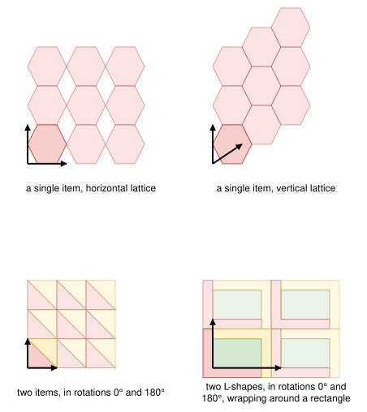

.. _internals_irregular_tree_search_periodic_packing:

Tree search with periodic packings
==================================

Objectives
----------

This algorithm only handles instances with a single bin. It solves the :code:`knapsack` and :code:`feasibility` objectives directly, and the :code:`bin-packing`, :code:`bin-packing-with-leftovers`, :code:`open-dimension-x`, :code:`open-dimension-y` and :code:`open-dimension-xy` objectives through the :ref:`sequential feasibility <internals_generic_algorithms_sequential_feasibility>` algorithm. It supports the resources of the bin.

Principle
---------

It is designed for instances with many copies of a few item types. Packing such items one by one, as the :ref:`tree search <internals_irregular_tree_search>` does, requires many decisions which all look alike. Instead, the good ways to pack many copies of an item type together are computed first, as *periodic packings*, and the tree search packs whole blocks of them at once.

The tree search is the one of the :ref:`tree search with maximal spaces for rectangle <internals_rectangle_tree_search_maximal_spaces>`, where each block is described by its bounding box.

Periodic packings
-----------------

A periodic packing is a lattice packing: a *unit cell* of one or two items, repeated by the translations :math:`n v_1 + m v_2` for integers :math:`n` and :math:`m`, where :math:`v_1` and :math:`v_2` are the two vectors of the lattice, without overlap between the copies.

For each item type and each of its orientations, the following unit cells are considered:

* a single item;
* two items: the item in orientation :math:`r` and the item in orientation :math:`r + 180°`, when it is allowed. The candidate positions of the second item are the vertices of the no-fit polygon of the two items, where the second item touches the first one without overlapping it, and its feasible elements and points (see below).

Given a unit cell, the region forbidden to the translations of the cell is the union of the no-fit polygons of its items with each other. The lattice vectors are then computed in two ways:

* horizontal: :math:`v_1` is the shortest horizontal translation outside the forbidden region; :math:`v_2` is the lowest translation outside the forbidden regions of the cell and of its copy translated by :math:`v_1`;
* vertical: the same with the roles of the x and y axes exchanged.

A rectangular lattice, where :math:`v_2` is perpendicular to :math:`v_1`, is also considered in each case. Each candidate lattice is checked on the actual shapes.

A no-fit polygon may contain translations of null area where the items don't overlap, for example when an item fits exactly the width of a slot of the other item: it can slide along a line segment in the slot, while all the translations around this segment make the items overlap. The union of the no-fit polygons can't represent them, so the shape library returns them separately, as the *feasible elements and points* of the no-fit polygon. They are candidate translations too, unless they are strictly inside another no-fit polygon of the forbidden region. With an item-item minimum spacing, the no-fit polygons are inflated by the spacing, and there is no such translation: the items would touch.

Periodic packings mixing item types are also built, for the items shaped like an L or a U: such a *wrapper* item has a large empty rectangle touching a side of its bounding box. A *base*, a single item of another item type or the unit cell of one of its periodic packings, is put in this empty rectangle, and a second copy of the wrapper, rotated by 180°, is put on the other side of the base.

The figure below shows a periodic packing of each kind, as computed by the solver: the unit cell is darker, and the arrows are the vectors of the lattice. The horizontal lattice of the hexagons is also rectangular; their vertical lattice is denser. Two triangles in rotations 0° and 180° form a square, and two L-shapes in rotations 0° and 180° wrapped around a rectangle tile the plane exactly:

The periodic packings only depend on the item types, so they are computed once, on simplified shapes, the first time an algorithm needs them, and stored in the cache of the instance. The sub-instances built from it get the periodic packings of their item types from this cache.

Blocks
------

The blocks are built from the periodic packings, for the bin of the instance: tilings of unit cells, clipped lattices, grids of bounding boxes, and blocks framed by L-shaped or U-shaped items. Their generation, their dominance and their resource consumption are described in :ref:`blocks <internals_irregular_blocks>`. This algorithm uses all of them, described by their bounding boxes.

Branching scheme
----------------

A node stores the blocks placed, their resource consumption (the sum of the consumptions of the fixed items and of the blocks placed) and the list of the *maximal empty spaces* of the bin: the empty rectangles which aren't contained in another empty rectangle. The obstacles (the borders of a non-rectangular bin, the defects and the fixed items) are approximated by rectangles and cut out of the empty spaces from the start.

To generate the children of a node, the empty space with a corner closest to a corner of the bin is selected, and one child is generated for each block fitting in it, placed in that corner. The blocks which would exceed the capacity of a resource which is not *penalize* given the blocks already placed are not considered. The empty spaces are then updated.

Each insertion is scored by

.. math::

   V \times C^\alpha \times F^\beta \times N^{-\gamma}

where :math:`V` is the profit of the block, minus the penalties of the *penalize* resources whose capacity it makes exceeded, :math:`C` its relative contact with the sides of the space and the other blocks, :math:`F` its fill rate (the area of its items divided by the area of its bounding box), and :math:`N` its number of items. Two sets of exponents are used: one while the bin is not filled much, and the other once the fill rate of the node exceeds a threshold. The children of a node are generated by decreasing score.

A node is evaluated by completing it greedily, inserting the best scored block at each step; the beam search keeps the nodes with the best completions. The final solutions are completed greedily too.

Search
------

The tree is explored by the :ref:`iterative beam search <internals_tree_search>` generating the children one at a time, by decreasing score, with a growth factor of 2. Two nodes with the same number of copies of each item type packed are compared by their greedy values: the one with the smallest greedy value is dominated. Since the depth of a node is its number of blocks, the dominance compares the nodes of all the queues (global dominance). In the non-anytime modes, the search is run with a queue of size 1, then with a queue of the size given by the parameter :code:`not_anytime_tree_search_periodic_packing_queue_size` (16 by default).

Automatic selection
-------------------

With a single bin, the algorithm is run when the instance is dominated by item types with many copies (more than 16): when these items alone take more than 80% of the free area of the bin, or more than 80% of the area of all the items. The :ref:`tree search <internals_irregular_tree_search>` is then run too if fewer than 64 items fit in the bin. See :ref:`algorithm selection <internals_algorithm_selection>`.

It can be forced with :code:`--use-tree-search-periodic-packing 1` (CLI) or :code:`use_tree_search_periodic_packing` (Python).

Source files
------------

* :code:`src/irregular/periodic_packing.hpp`, :code:`src/irregular/periodic_packing.cpp`: the periodic packings
* :code:`src/irregular/tree_search_periodic_packing.hpp`, :code:`src/irregular/tree_search_periodic_packing.cpp`: the blocks, the branching scheme and the search

References:

* "A beam search algorithm for the biobjective container loading problem" (Araya, Moyano and Sanchez, 2020)

  * https://doi.org/10.1016/j.ejor.2020.03.040
