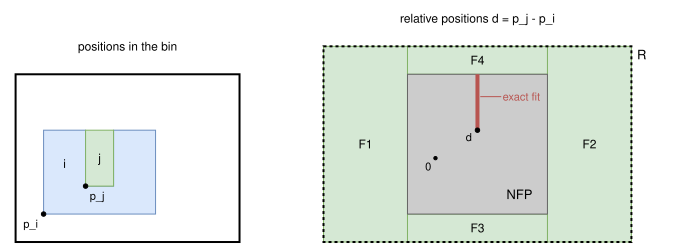
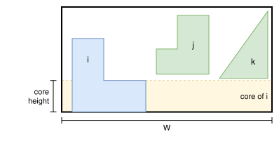

.. _internals_irregular_tree_search_relative_positions:

Tree search on relative positions
=================================

Objectives
----------

This algorithm solves the :code:`feasibility` objective with a single bin: it tries to prove that the items don't fit in the bin. A subset of items that doesn't fit proves that the instance is infeasible, so the largest item, then the two largest items, and so on, are tried one after the other: if a few large items don't fit, the search doesn't branch on the rotations of the small ones. If it doesn't prove that the instance is infeasible, the positions of the solution of its relaxation are checked, and used as a solution if the items don't overlap. Nothing is proven for an item type with a continuous rotation range.

The subproblems of the :ref:`Benders decomposition <internals_irregular_benders_decomposition>` are instances with the :code:`feasibility` objective and a single bin, solved with this algorithm.

For the :code:`open-dimension-x` and :code:`open-dimension-y` objectives, it computes a bound on the open dimension instead: the minimum open dimension of the relaxation (see *Open dimension objectives* below).

Principle
---------

For a given rotation of each item, the positions of two items which don't overlap are described exactly by their *no-fit polygon*: item :math:`j` overlaps item :math:`i` if and only if the relative position :math:`p_j - p_i` of their reference points is in the interior of the no-fit polygon :math:`\text{NFP}_{ij}`. The complement of the no-fit polygon is not convex, so it is partitioned into convex pieces, and the relative position of each pair of items must be in one of them.

Choosing a rotation for each item and a piece for each pair gives a linear program. The choice is made by a tree search, which fixes the rotation of an item or the piece of a pair at each node, and propagates the consequences to the positions and the rotations of the other items (see *Tree search* below).

In the example below, item :math:`i` is a 4 × 3 rectangle with a 1 × 2 notch, item :math:`j` a 1 × 2 rectangle, and the bin is 8 × 6. The relative positions allowed by the bin form the rectangle :math:`R`. The no-fit polygon covers its middle, and the region outside of it is partitioned into the convex pieces :math:`F_1` to :math:`F_4`. Item :math:`j` also fits exactly in the notch: its relative positions there form a segment inside the no-fit polygon, an additional piece (see *Exact fits* below):

The model is a relaxation, so that an infeasible program is a proof:

* the bin is replaced by its bounding box; the defects, the fixed items and the item-item spacing are ignored;
* the circular arcs of the regions below are approximated by line segments outside of them.

Program
-------

**Input**:

* the items :math:`i = 1, \ldots, n`, each with its allowed rotations :math:`r \in \mathcal{R}_i`;
* for each item :math:`i` in each rotation :math:`r`, its *inner-fit rectangle* :math:`\text{IFP}_i^r`: the positions of its reference point for which its bounding box is in the bounding box of the bin (minus the item-bin spacing);
* for each pair of items :math:`(i, j)` in each pair of rotations, the region :math:`R_{ij} = \text{IFP}_j - \text{IFP}_i` of the relative positions allowed by the inner-fit rectangles, and the region :math:`F_{ij} = R_{ij} \setminus \text{int}(\text{NFP}_{ij})` of the ones for which the items don't overlap, partitioned into convex pieces :math:`k \in K_{ij}`. Each piece is described by its edges :math:`(n, c)`, the half-planes :math:`n \cdot d \ge c`.

**Problem**: find a rotation :math:`r_i \in \mathcal{R}_i` and a position :math:`p_i \in \text{IFP}_i^{r_i}` of the reference point of each item, and a piece :math:`k_{ij} \in K_{ij}` of the regions of their rotations for each pair of items, such that

.. math::

   \forall (i, j) \qquad p_j - p_i \in k_{ij}

There is no objective: only the feasibility matters.

**Symmetries.**

* Two rotations of an item type which give the same shape (for example, the rotations by 0 and 180 degrees of a rectangle) are only considered once.
* The rotations of identical items are non-decreasing, and identical items with the same rotation are sorted by :math:`x`.
* The program only considers the bounding box of the bin, so turning a solution by 180 degrees gives another solution. If every rotation of every item type has its counterpart turned by 180 degrees, then an item, the only copy of its item type, is restricted to one rotation of each such pair.

**Exact fits.** An item may fit exactly in a notch of another one, or two items may touch along a whole edge: the relative position is then on a line segment or at a point strictly inside the no-fit polygon, but on no edge of the region :math:`F_{ij}`. These feasible positions of null area are returned by the no-fit polygon computation, and each one is an additional convex piece of :math:`F_{ij}`, so that the program stays a relaxation.

Tree search
-----------

The program is solved by a depth-first search. A node keeps, for each item, the rotations still allowed, for each pair of items, the pieces still allowed, and bounds on the positions:

* **Difference-bound matrices.** All the constraints on the positions which the search uses are bounds on differences of coordinates: :math:`x_j - x_i \le u^x_{ij}`, and the same for :math:`y`. The inner-fit rectangles are differences with an origin, and the symmetry breaking is :math:`x_{i+1} - x_i \ge 0`. These bounds form two matrices, one for each axis, and their closure, a shortest path computation, gives the tightest bounds they imply. They are infeasible if a matrix has a negative cycle. For a pair of items, the closed bounds give the box of its possible relative positions, which takes into account the other pairs: for example, :math:`x_k - x_i \le u^x_{ij} + u^x_{jk}`.
* **Propagation.** The rotations of an item whose inner-fit rectangle doesn't intersect the bounds of its position are removed, and the bounds are shrunk to the union of the inner-fit rectangles of the remaining ones. For each pair, the pieces of the rotations still allowed which don't intersect the box of the pair (and the region :math:`R_{ij}` of their rotations) are removed, and the box is shrunk to the bounding box of the remaining pieces clipped to it. The rotations of an item which no remaining piece of one of its pairs supports are removed. The matrices are closed again, and so on, until nothing changes. A node is infeasible if an item has no rotation left, or if a pair has no piece left.
* **Core bound.** A cheap area test may prove the node infeasible (see *Core bound* below).
* **Branching.** The search first fixes the rotations of the items, the largest ones first, with a child for each rotation; then, it branches on the pair with the fewest pieces left, with a child for each of its pieces.
* **Leaves.** Once each item has a single rotation and each pair a single piece, the program is a linear program, with the edges of the pieces as constraints, solved with HiGHS.

The propagation only uses bounding boxes, so a leaf may still be infeasible, which the linear program detects. But it removes most of the pieces.

The rotations were first enumerated outside of the tree search, with a search for each combination of rotations, which a mixed-integer linear program could also solve. A combination was skipped if one of its sub-combinations without one of the items was infeasible. Fixing the rotations in the tree search shares the search of the items whose rotations are fixed among all the rotations of the other items. Branching on the pieces first, and only on the rotation of an item when the pair with the fewest pieces had several rotations of it, was much slower (96 seconds instead of 0.45 on the first 10 items of jakobs1, with rotations, for the open dimension objectives).

**Parallelism.** The first levels of the tree are expanded breadth-first, until there are 4 nodes per thread, and their subtrees are explored in parallel (4 threads by default). When the algorithm is run on its own, in the :code:`not-anytime-sequential` mode, a single thread is used.

Core bound
----------

The *core* of an item is the part of its :math:`y`-range that no other item can reach, given the pieces and the bounds of the node (each piece is convex, so its :math:`y`-range gives exactly the heights at which the other item can be). No other item has any point in the horizontal band of the core of an item, across the whole bin. So the item can be counted as widened to the width :math:`W` of the bin on its core:

.. math::

   \text{widened area}(i) = W \times \text{core height}(i) + \text{area of } i \text{ outside of its core}

In the example below, items :math:`j` and :math:`k` can't be lower than the top of the foot of item :math:`i`, so the band of the foot belongs to item :math:`i` alone, across the whole bin:

The cores of different items are disjoint, so the node is infeasible if the sum of the widened areas exceeds the area of the bin. If the rotation of an item isn't fixed, the smallest widened area of its remaining rotations is taken. The areas of the items in the bands are computed exactly from their widths, which are linear between the coordinates of their vertices (the area of the item is used for the items with circular arcs).

This is not a reduction: the parts of an item outside of its core may be interlocked with other items, so the item can't always be moved against a side of the bin to actually be widened. The test helps when the items are large compared to the bin; when they fill less than about three quarters of it, the cores are usually empty.

Open dimension objectives
-------------------------

For the :code:`open-dimension-x` and :code:`open-dimension-y` objectives, the same tree search minimizes the open dimension :math:`L`: the largest coordinate of the items along the open axis. Below, the open axis is :math:`x`.

* **End of the strip.** The end of the strip is another node of the difference-bound matrix of :math:`x`, with the constraints :math:`x_i + \overline{w}_i \le L` for each item :math:`i`, where :math:`\overline{w}_i` is the largest coordinate of the item relative to its reference point. The closure then gives a lower bound on :math:`L` at each node: the longest chain of items, from the start of the strip, that the pieces of the node force.
* **Branch-and-bound.** Only the solutions with :math:`L` smaller than a threshold are searched: the size of the bin, or an upper bound given as a parameter, which is lowered each time a better solution is found. A node is pruned if its bound on :math:`L` isn't smaller than the threshold, and the threshold is also an upper bound on :math:`L` in the matrix, which the propagation uses. The children of a node are explored by increasing bound.
* **Leaves.** The linear program of a leaf minimizes :math:`L`. Its value is the largest end of the items in its solution, which is the open dimension of the packing if the solution is one: the constraints of the matrices are relaxed by a small tolerance, so the value of the linear program may be slightly smaller.
* **Core bound.** The cores of the items along the fixed axis are used, with the threshold as the length of the strip: with :math:`H` the height of the strip, :math:`c` the sum of the heights of the cores, and :math:`a` the sum of the areas of the items outside of their cores, a solution of length :math:`L` satisfies :math:`a + L c \le L H`.
* **Threads.** The subtrees explored in parallel share the threshold.

If the search doesn't find a better solution than the upper bound given as a parameter, the bound is this upper bound.

**Subsets of items.** The bound of a subset of the items is a bound for all the items. The bounds of the largest item, then of the two largest items, and so on, are computed until the time limit, and the bound of the instance is the last one. The search of a subset also stops when it finds a solution reaching the area bound of the subset, or the bound of the previous subset. The no-fit polygons of the pairs are computed once for all the subsets.

The following results are on the first items of :code:`data/irregular/fujita1993/fu_2007-05-15/fu.xml.json`, in a strip of height 38, without rotation and with the rotations of the instance (0, 90, 180 and 270 degrees), with a single thread, the tree search alone, without upper bound:

.. list-table::
   :header-rows: 1

   * - Items
     - Length, no rotation
     - Time (s)
     - Nodes
     - Length, rotations
     - Time (s)
     - Nodes
   * - 5
     - 17.8889
     - 0.03
     - 119
     - 14.1273
     - 0.03
     - 247
   * - 6
     - 23
     - 0.01
     - 144
     - 19
     - 0.04
     - 931
   * - 7
     - 24
     - 0.10
     - 595
     - 21
     - 0.53
     - 20578
   * - 8
     - 24
     - 0.50
     - 2203
     - 22.2143
     - 3.3
     - 170272
   * - 9
     - 25
     - 4.1
     - 27194
     - 24
     - > 120
     -
   * - 10
     - 28.6875
     - 22.2
     - 781086
     -
     -
     -

Without rotation, these lengths are the optimal ones reported in the literature for the instances fu5 to fu10. Without an upper bound, the search finds good solutions late: with 9 items and the rotations, it proves the optimal length in 102 seconds when it is given as an upper bound. In the :code:`exact` mode, the optimality is proven in 8 seconds for fu10 without rotation, and in 51 seconds for fu9 with the rotations. With the 12 items of the instance without rotation, the proof doesn't finish in 600 seconds, even with an upper bound of 33.2111 (22 million nodes). In the :code:`exact` mode, in 300 seconds, the bound of the subsets reaches 31.92, while the area bound is 28.5, and the best solution is 33.18. With the rotations, in the :code:`exact` mode, in 300 seconds, the bound of fu10 reaches 25.45, and the best solution is 28; with the 12 items, the bound doesn't exceed the area bound.

Two other bounds at the nodes were tried, and didn't reduce the number of nodes: the linear program of the pieces already fixed (on fu9), and an area bound using the bounds on the positions of the items, a cumulative scheduling relaxation along the open axis (on fu8 to fu10). The propagation was made about 12 times faster instead, by clipping the pieces without allocations and only when the box of their pair changes, and by updating the closure of the matrices incrementally; this also applies to the :code:`feasibility` objective.

Automatic selection
-------------------

In the :code:`exact` mode, it is run for the :code:`feasibility` objective with a single bin, and for the :code:`open-dimension-x` and :code:`open-dimension-y` objectives, alongside the other algorithms. It is always used in the subproblems of the :ref:`Benders decomposition <internals_irregular_benders_decomposition>` in the :code:`exact` mode.

It can be selected with :code:`--use-tree-search-relative-positions 1` (CLI) or :code:`use_tree_search_relative_positions` (Python), for the :code:`feasibility` objective with a single bin and for the open dimension objectives only.

Strengths and limitations
-------------------------

The tree grows exponentially with the number of items and of rotations, and the search gets harder as the items get smaller compared to the bin, since the regions :math:`F_{ij}` then have more pieces, and the boxes of the propagation remove fewer of them. The algorithm proves in a fraction of a second that 2 or 3 large items don't fit; for 5 items with 4 rotations each, a proof takes a few seconds. For the open dimension objectives, without rotation, it finds the optimal length of instances with up to about 10 items.

Source files
------------

* :code:`src/irregular/tree_search_relative_positions.hpp`, :code:`src/irregular/tree_search_relative_positions.cpp`: the algorithm
* :code:`scripts/doc_figures/irregular_tree_search_relative_positions.py`: the figures of this page

References:

* "Mixed-integer programming models for nesting problems" (Fischetti and Luzzi, 2009)

  * https://doi.org/10.1007/s10732-008-9088-9

* "A branch & bound algorithm for cutting and packing irregularly shaped pieces" (Alvarez-Valdes, Martinez and Tamarit, 2013)

  * https://doi.org/10.1016/j.ijpe.2013.04.007

