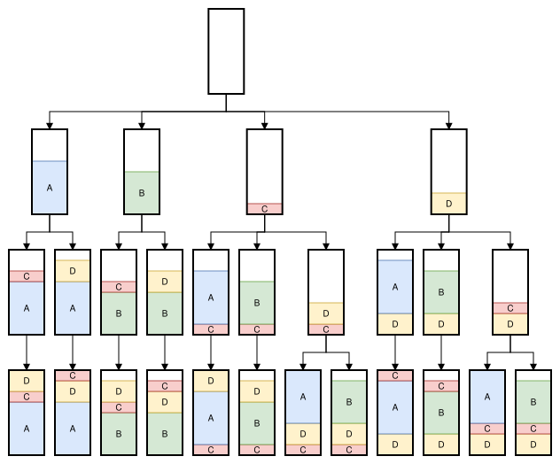

.. _internals_onedimensional:

:code:`one-dimensional` algorithms
==================================

See :ref:`onedimensional<onedimensional>` for the input/output format and CLI usage of this solver.

Trivial bound
-------------

This algorithm computes a bound for the :code:`knapsack`, :code:`bin-packing` and :code:`variable-sized-bin-packing` objectives, from the total length of the items and the lengths of the bins only:

* :code:`knapsack`: the continuous relaxation where the lengths of all the bins are pooled together;
* :code:`bin-packing`: the number of bins, in the order of the instance, needed to cover the total length of the items;
* :code:`variable-sized-bin-packing`: the minimum cost of a selection of bins whose total length covers the total length of the items, a knapsack problem solved by dynamic programming.

It is run first, before the other algorithms. It is also used by the other problem types to bound their one-dimensional relaxation when it has too many item types to be solved.

Dynamic programming
-------------------

This algorithm solves the :code:`knapsack` objective with a single bin.

It ignores all the constraints except the length of the bin, and solves the problem as a classical 0-1 knapsack problem, by dynamic programming. Afterwards, it checks whether the solution satisfies the other constraints. If so, the solution is optimal.

Thus, if the instance is a classical 0-1 knapsack problem, it is solved optimally. And even if it is not, as long as in practice only the length of the bin matters for the instance, it still gets solved very quickly to proven optimality. Otherwise, its running time remains small compared to the time of the other algorithms, which are run instead.

See :doc:`the detailed description <onedimensional/dynamic_programming>`.

Tree search
-----------

This algorithm solves the :code:`feasibility`, :code:`knapsack`, :code:`bin-packing` and :code:`bin-packing-with-leftovers` objectives.

It is a tree search algorithm where a single item is packed at each stage. The root node is an empty partial solution (no item packed). Given a node, a child node is generated for each feasible insertion of an unpacked item after the last one inserted, either in the same bin or in a new bin.

See :doc:`the detailed description <onedimensional/tree_search>`.

MILP assignment
---------------

This algorithm solves the :code:`feasibility`, :code:`knapsack`, :code:`bin-packing` and :code:`variable-sized-bin-packing` objectives.

It solves the classical assignment mixed-integer linear program, where each item is assigned to a bin, with HiGHS. It doesn't model the nesting lengths, the maximum stackability and the maximum weight after constraints.

See :doc:`the detailed description <onedimensional/milp_assignment>`.

Dual feasible functions
-----------------------

This algorithm computes a bound for the :code:`bin-packing`, :code:`feasibility` and :code:`knapsack` objectives, for instances with a single bin type.

It transforms the lengths of the items and of the bin with dual feasible functions, which round the long items up and the short items down while keeping the packings feasible, and computes the trivial bound of the transformed instance.

See :doc:`the detailed description <onedimensional/dual_feasible_functions>`.

.. toctree::
   :maxdepth: 1
   :hidden:

   onedimensional/dynamic_programming
   onedimensional/tree_search
   onedimensional/milp_assignment
   onedimensional/dual_feasible_functions
