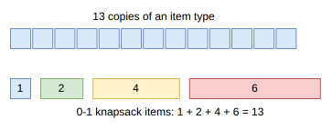

.. _internals_onedimensional_dynamic_programming:

Dynamic programming
===================

Objectives
----------

This algorithm solves the :code:`knapsack` objective with a single bin. It ignores all the constraints but the length of the bin; the solution it finds is kept only if it satisfies the other ones.

Principle
---------

The problem is solved as a classical 0-1 knapsack problem: the items have to be packed in a bin of length :math:`C`, maximizing the profit of the items packed, and an item takes its length minus its nesting length, :math:`\ell_j - \max(0, n_j)`, the least it can take. The other constraints (the length taken by the first item of the bin, the weights, the maximum stackability, the resources) are ignored, so the problem solved is a relaxation:

* its optimal value is a bound of the instance;
* its optimal solution is checked against all the constraints; if it satisfies them, it is optimal.

If the instance is a classical knapsack problem, it is therefore solved to optimality. Even if it isn't, if only the length of the bin matters in practice for the instance, it gets solved very quickly to proven optimality; otherwise, the running time of this algorithm is small compared to the one of the algorithms run after it.

**Copies.** An item type with :math:`q` copies is turned into 0-1 items by binary decomposition: items of 1, 2, 4, ... copies, the last one with the remaining copies. Any number of copies from 0 to :math:`q` is then a sum of a subset of these items. The items longer than the bin are left out: when an item of :math:`2^k` copies doesn't fit, the larger numbers of copies don't fit either.

Algorithms
----------

**Subset sum.** If the profit of each item is equal to the length it takes, the problem is a subset sum problem: packing as much length as possible. The lengths and the capacity are divided by their greatest common divisor, and the problem is solved with the dynamic programming of Bellman, implemented with bit operations: the reachable lengths are stored as bits of 64-bit words, and an item shifts and merges them, 64 lengths at once. It is used if the number of items times the number of words of the capacity, which estimates its running time, is at most :math:`2^{23}` (parameter :code:`dynamic_programming_subset_sum_maximum_size`). On subset sum problems, the bounds of the primal-dual dynamic programming below don't discard any state, so its number of states may grow with the capacity.

**Knapsack.** Otherwise, the problem is solved with the primal-dual dynamic programming of Pisinger (1997), implemented in `knapsacksolver <https://github.com/fontanf/knapsacksolver>`_. It starts from the items sorted by decreasing efficiency (profit per length) and their *break solution*, the items before the first one which doesn't fit, and enlarges a *core* of items around the break item, in which items are added to or removed from the break solution. The states whose upper bound isn't larger than the best solution found are discarded. The items of a binary decomposition all have the same efficiency, so many states survive; the *pairing* option, which adds a promising item from outside the core when the number of states grows, is enabled. The dynamic programming stops after :math:`2^{20}` states (parameter :code:`dynamic_programming_knapsack_maximum_number_of_states`): its solution is then still reported, but it isn't proven optimal.

Automatic selection
-------------------

It is run first, before the other algorithms, for the :code:`knapsack` objective with a single bin. If it proves its solution optimal, the other algorithms aren't run. It is also used to solve the knapsack subproblems of the generic algorithms (sequential single knapsack, sequential value correction, column generation, dichotomic search).

Source files
------------

* :code:`src/onedimensional/dynamic_programming.hpp`, :code:`src/onedimensional/dynamic_programming.cpp`
* :code:`scripts/doc_figures/onedimensional_dynamic_programming.py`: the figure of the binary decomposition

References:

* "A Minimal Algorithm for the 0-1 Knapsack Problem" (Pisinger, 1997)

  * https://doi.org/10.1287/opre.45.5.758
