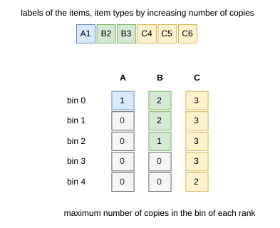

.. _internals_onedimensional_milp_assignment:

MILP assignment
===============

Objectives
----------

This algorithm solves the :code:`feasibility`, :code:`knapsack`, :code:`bin-packing` and :code:`variable-sized-bin-packing` objectives.

It doesn't model the nesting lengths, the maximum stackability and the maximum weight after constraints.

Principle
---------

It solves the classical assignment ("Kantorovich") mixed-integer linear program (MILP): each item is assigned to a bin, and the items assigned to a bin must fit in it. Depending on the objective, it is the model of the variable-sized bin packing problem, of the multiple knapsack problem, of the corresponding feasibility problem (all the items in the available bins), or of the bin packing problem where the bin types are used in the order in which they are given.

Model
-----

**Input**:

* bin types :math:`t = 1, \ldots, m`; for each bin type :math:`t`: a length :math:`L_t`, a maximum weight :math:`W_t`, a cost :math:`c_t`, a minimum and a maximum number of copies :math:`m_t` and :math:`M_t`, and, for each resource :math:`r`, a capacity :math:`C_{t,r}`; the *bin instances* :math:`(t, k)`, :math:`k = 1, \ldots, M_t`, are the copies of the bin types
* item types :math:`i = 1, \ldots, n`; for each item type :math:`i`: a length :math:`\ell_i`, a weight :math:`w_i`, a profit :math:`p_i`, a minimum and a maximum number of copies :math:`q^{\min}_i` and :math:`q_i`, and, for each resource :math:`r`, the consumption :math:`a_{i,r,c}` of its :math:`c`-th copy in a bin
* precedences: pairs :math:`(i, i')` where item type :math:`i` dominates item type :math:`i'`

**Variables**:

* :math:`y_{t,k} \in \{0, 1\}`: :math:`y_{t,k} = 1` iff bin instance :math:`(t, k)` is used (for the :code:`bin-packing` and :code:`variable-sized-bin-packing` objectives; for the other objectives, all the bin instances are available, and :math:`y_{t,k}` is replaced by 1 below)
* :math:`x_{i,t,k,c} \in \{0, 1\}`: :math:`x_{i,t,k,c} = 1` iff bin instance :math:`(t, k)` contains at least :math:`c` copies of item type :math:`i`
* :math:`z_{i,i'} \in \{0, 1\}`, for each precedence :math:`(i, i')`: :math:`z_{i,i'} = 1` iff the copies of item type :math:`i'` may be packed

Encoding the copies of an item type in a bin as "at least :math:`c` copies" variables gives a binary variable per copy without symmetry between the copies, and lets the consumption of a resource depend on the copy.

**Objective**: depending on the objective

.. math::

   \max \sum_{i,t,k,c} p_i \, x_{i,t,k,c}
   \qquad \text{(knapsack)}

.. math::

   \min \sum_{t,k} c_t \, y_{t,k}
   \qquad \text{(variable-sized bin packing)}

.. math::

   \min \sum_{t,k} y_{t,k}
   \qquad \text{(bin packing)}

**Constraints**:

* Ordered copies

.. math::

   \forall i, t, k, c \qquad x_{i,t,k,c+1} \le x_{i,t,k,c}

* Demand: each item type is packed between its minimum and its maximum number of copies (for the :code:`feasibility`, :code:`bin-packing` and :code:`variable-sized-bin-packing` objectives, both are the number of copies)

.. math::

   \forall i \qquad q^{\min}_i \le \sum_{t,k,c} x_{i,t,k,c} \le q_i

* Length: the items of a bin instance fit in its length, if it is used

.. math::

   \forall t, k \qquad \sum_{i,c} \ell_i \, x_{i,t,k,c} \le L_t \, y_{t,k}

* Weight: the items of a bin instance don't exceed its maximum weight

.. math::

   \forall t, k \qquad \sum_{i,c} w_i \, x_{i,t,k,c} \le W_t \, y_{t,k}

* Resources: the items of a bin instance don't exceed the capacity of its resources

.. math::

   \forall t, k, r \qquad \sum_{i,c} a_{i,r,c} \, x_{i,t,k,c} \le C_{t,r} \, y_{t,k}

* Mandatory bins

.. math::

   \forall t, \; \forall k \le m_t \qquad y_{t,k} = 1

* Precedences, given with the instance (the :ref:`Benders decomposition for rectangle <internals_rectangle_benders_decomposition>` uses them in its master problem): no copy of a dominated item type is packed unless all the copies of the dominating item type are packed. They only matter for the :code:`knapsack` objective.

.. math::

   \forall (i, i') \qquad \sum_{t,k,c} x_{i,t,k,c} \ge q_i \, z_{i,i'}
   \qquad \sum_{t,k,c} x_{i',t,k,c} \le q_{i'} \, z_{i,i'}

* Bin usage order, for the :code:`bin-packing` objective: the bin instances are used in the order in which they are given, all the instances of a bin type before the ones of the next bin type (with :math:`(t, k)` and :math:`(t', k')` consecutive instances in this order); for the :code:`variable-sized-bin-packing` objective, the same holds within each bin type, which breaks the symmetry between its instances

.. math::

   y_{t,k} \ge y_{t',k'}

**Symmetry breaking.** The bin instances of a bin type are interchangeable. The item types are sorted by increasing number of copies, and the copies get consecutive labels in this order; let :math:`S_i` be the label of the last copy of item type :math:`i`, counting only the item types which fit in bin type :math:`t`. Any solution can be relabeled so that its bin instances are ordered by increasing smallest label of the items they contain. Then the bin instance of rank :math:`k` (from 0) only contains labels larger than :math:`k`, so it contains at most :math:`\max(0, S_i - k)` copies of item type :math:`i`, and the variables :math:`x_{i,t,k,c}` beyond this number are not created. In the example below, item type A has a single copy, labeled 1: only the first bin can contain it.

The number of copies of an item type in a bin is also bounded by its number of copies and by the number of copies fitting in the bin by their length.

**Penalize resources.** A *penalize* resource doesn't constrain the bins: its penalty is subtracted from the profit when its capacity is exceeded in a bin. Only the resources of the form "at least :math:`N` of a set of copies in the same bin" are supported (an integer capacity, and consumptions of 1 per copy up to a threshold): a binary variable per bin instance pays the penalty, and is forced to 1 by a constraint for each subset of :math:`N` copies of the set. These resources come from the subset-row cuts of the column generation, which involve few item types.

Bin packing
-----------

For the :code:`bin-packing` objective, the MILP is solved, by default, as a sequence of :code:`feasibility` problems, packing all the items in the first :math:`b` bins of the instance (in the order in which the bin types are given), for increasing values of :math:`b`: from the best lower bound known when the algorithm starts (computed, for example, by the dual feasible functions) to the number of bins available. The first feasible one is optimal if all the previous ones were proven infeasible; each one proven infeasible raises the lower bound.

Otherwise (parameter :code:`use_sequential_feasibility` disabled), the instance is first solved heuristically, with the column generation if there is a single bin type and with the tree search otherwise. If a complete solution is found, its number of bins of each bin type bounds the number of bin instances of each bin type in the model: since the bin types are used in their order, a solution using fewer bins can't use more bins of a given type. Then a single MILP minimizes the number of bins.

For the :code:`variable-sized-bin-packing` objective, the number of bin instances of each bin type in the model is bounded by the number of bins needed to pack, with this bin type alone, all the items which fit in it, computed with the column generation.

Solver
------

The MILPs are solved with HiGHS, with the best solution found so far as a starting solution. The solutions found by the solver are reported as they are found, the bound of the solver is reported as a bound of the instance, and the solver is stopped as soon as the best solution is proven optimal.

Automatic selection
-------------------

It is not part of the automatic selection. It can be selected with :code:`--use-milp-assignment 1` (CLI) or :code:`use_milp_assignment` (Python).

Source files
------------

* :code:`src/onedimensional/milp_assignment.hpp`, :code:`src/onedimensional/milp_assignment.cpp`
* :code:`scripts/doc_figures/onedimensional_milp_assignment.py`: the figure of the symmetry breaking
