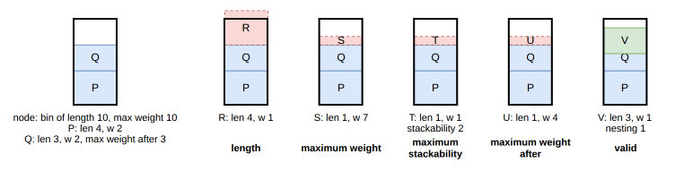
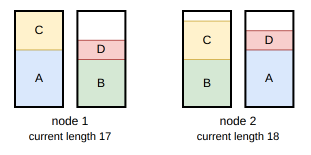

.. _internals_onedimensional_tree_search:

Tree search
===========

Objectives
----------

This algorithm solves the :code:`feasibility`, :code:`knapsack`, :code:`bin-packing` and :code:`bin-packing-with-leftovers` objectives, and the :code:`variable-sized-bin-packing` objective when there is a single bin type (it is then a bin packing problem). It supports all the constraints of onedimensional: the nesting lengths, the maximum stackability, the maximum weight of the bins, the maximum weight after an item, the eligibility and the resources.

Principle
---------

It is a constructive tree search where a single item is packed at each stage:

* the root node is the empty solution;
* a node is a partial solution: the items packed so far, bin by bin, each bin filled in order;
* the children of a node are obtained by packing one more item after the last item of the current (last) bin, or in a new bin if no item can be packed in the current bin anymore;
* a node is a *leaf* when all the items are packed.

The figure below shows the beginning of the tree, with four item types A, B, C and D. Each child adds one item on top of the bin of its parent:

.. image:: ../../img/onedimensional_tree_search.png
   :scale: 100%
   :align: center

The tree is explored by the :ref:`iterative beam search <internals_tree_search>`, guided by the guides below. Many nodes are also discarded by the dominance and the bounds.

**Order of the bins.** The bins are opened in a fixed order: in the order in which they appear in the instance, or by increasing length for the :code:`knapsack` objective.

Nodes
-----

A node stores:

* its parent, and the item type of the item it packed, from which the solution is rebuilt at the end;
* for each item type, its number of copies packed;
* the number of bins used;
* for the current bin: the length used, the weight of its items, its number of items, the smallest maximum stackability of its items, the weight still allowed after its items, and the consumption of each resource;
* the number of items packed, their length, their nested length and their profit;
* its *current length*: the total length of the bins before the current one, plus the length used in the current bin; and its *waste*: the current length minus the length of the items packed.

Children
--------

**Same bin.** For each item type allowed in the bin type of the current bin, and with copies left, an item is packed after the last item of the current bin, if:

* the length of the bin is not exceeded; an item packed after another item only needs its length minus its nesting length;
* the maximum weight of the bin is not exceeded;
* the number of items of the bin doesn't exceed the smallest maximum stackability of its items, including the new one;
* the weight of the new item doesn't exceed the weight still allowed after the items of the bin: the smallest, over the items of the bin, of the maximum weight allowed after the item minus the weight of the items packed after it;
* the capacities of the resources of the bin are not exceeded. A *penalize* resource never blocks an insertion: its penalty is subtracted from the profit of the node instead, once its capacity is exceeded.

In the figure below, items P and Q are packed in a bin of length 10 and of maximum weight 10, and Q allows a weight of at most 3 after it. Each candidate item is shown with the first condition it violates:

**New bin.** If no item can be packed in the current bin, a new bin is opened, and each item type allowed in it, with copies left, whose length, weight and resource consumption fit in the bin, gives a child. A new bin is never opened while an item still fits in the current one. If no item fits in the next bin, the bin after it is tried, and so on.

Guides
------

The guides compare the current length of a node, i.e. the length it has already "consumed", to the length or the profit of its items. With :math:`L_c` the current length, :math:`L` the length of the items packed, :math:`P` their profit, :math:`n` their number, :math:`\bar{\ell} = L / n` their mean length, :math:`\bar{\ell^2}` the mean of their squared lengths, and :math:`r = (L_c - L) / L_c` the waste ratio:

.. list-table::
   :header-rows: 1
   :widths: 1 2 4

   * - Guide
     - Value
     - Idea
   * - 0
     - :math:`L_c / L`
     - Little consumed length per length packed.
   * - 1
     - :math:`L_c / L / \bar{\ell}`
     - Same, favoring the long items.
   * - 2
     - :math:`(0.1 + r) / \bar{\ell}`
     - Little waste, favoring the long items.
   * - 3
     - :math:`(0.1 + r) / \bar{\ell^2}`
     - Same, favoring the long items more.
   * - 4
     - :math:`L_c / P`
     - Little consumed length per profit packed.
   * - 5
     - :math:`L_c / P / \bar{\ell}`
     - Same, favoring the long items.
   * - 6
     - :math:`L_c - L`
     - Little waste.
   * - 7, 8
     - knapsack bound
     - Largest bound first: the profit of the node plus the remaining length of the bins times the largest profit per nested length of the item types (then little waste, for guide 8).

By default, guides 4 and 5 are used for the :code:`knapsack` objective, guides 0 and 1 for the :code:`bin-packing-with-leftovers` objective, and guides 0 and 2 for the other objectives.

Solutions and bounds
--------------------

**Solutions.** Each node generated is compared to the best solution found so far:

* :code:`knapsack` and :code:`feasibility`: any node is a solution, compared by profit;
* :code:`bin-packing` and :code:`variable-sized-bin-packing`: the leaves, compared by number of bins;
* :code:`bin-packing-with-leftovers`: the leaves, compared by waste: the smallest waste leaves the longest leftover in the last bin.

**Bounds.** A node is discarded if it can't lead to a better solution than the best one found:

* :code:`bin-packing` and :code:`variable-sized-bin-packing`: the bins, in their order, must contain the current length of the node plus the nested length of the remaining items (the length of an item minus its nesting length, the least it can take). If the bins needed are at least as many as in the best solution, the node is discarded;
* :code:`bin-packing-with-leftovers`: if its waste is at least the waste of the best solution, since the waste can only increase;
* :code:`feasibility`: once a solution packing all the items is found;
* :code:`knapsack`: no node is discarded by a bound.

Dominance
---------

Two nodes with the same number of copies of each item type packed can be compared. Node 1 dominates node 2 if:

* its last item has the same item type as the last item of node 2;
* it uses as many bins;
* its current length is not larger;
* its profit is not smaller (which only matters with *penalize* resources);
* the resource consumption of its current bin is not larger, for each resource.

In the example below, the bins have a length of 10, and both nodes pack the items A (6), B (5), C (4) and D (2), with D last. In node 1, A and C fill the first bin; in node 2, B and C leave a gap of 1 in it, in which no remaining item fits. Node 1 dominates node 2.

Search
------

The tree is explored by the :ref:`iterative beam search <internals_tree_search>`, which generates all the children of a node at once. The depth of a node is its number of items packed.

In anytime mode, an iterative beam search is run for each guide, in parallel. When there are at most two guides, which is the case by default, each one is run twice, with the growth factors 1.33 and 1.5; otherwise, the growth factor is 1.5. In the non-anytime modes, each search is run with a queue of size 1, then with a queue of the size given by the parameter :code:`not_anytime_tree_search_queue_size` (4096 by default).

Automatic selection
-------------------

With a single bin, the tree search is run unless another algorithm has been selected explicitly. With several bins, it is run when the item types have few copies compared to the number of items fitting in a bin, alongside the generic algorithms using it to solve their sub-problems. See :ref:`algorithm selection <internals_algorithm_selection>`.

It can be forced with :code:`--use-tree-search 1` (CLI) or :code:`use_tree_search` (Python).

Source files
------------

* :code:`src/onedimensional/tree_search.hpp`, :code:`src/onedimensional/tree_search.cpp`
* :code:`scripts/doc_figures/onedimensional_tree_search.py`: the figures of the insertions and of the dominance
