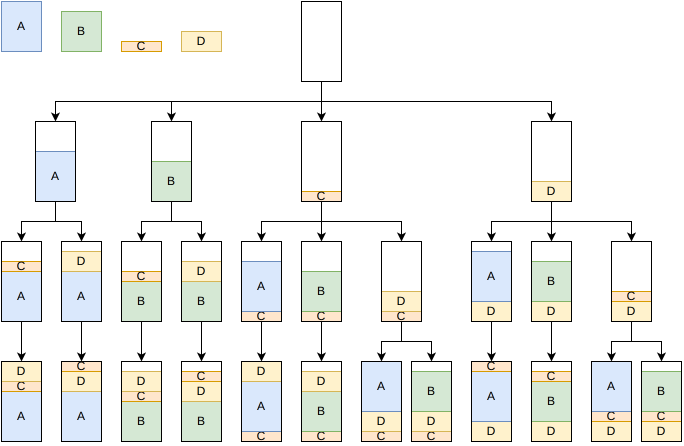

.. _internals_onedimensional_tree_search:

Tree search
===========

Objectives
----------

This algorithm solves the :code:`feasibility`, :code:`knapsack`, :code:`bin-packing` and :code:`bin-packing-with-leftovers` objectives, and the :code:`variable-sized-bin-packing` objective when there is a single bin type (it is then a bin packing problem).

Principle
---------

It is a constructive tree search where a single item is packed at each stage. The root node is an empty partial solution. Given a node, a child node is generated for each item type which can be packed after the last item of the current (last) bin. If no item can be packed in the current bin, a child node is generated for each item type which can be packed in a new bin. The tree is explored by an iterative beam search, guided by a guide function.

The bins are considered in a fixed order: in the order in which they appear in the instance, or by increasing length for the :code:`knapsack` objective. Bins in which no remaining item fits are skipped.

Insertions
----------

An item can be packed after the last item of the current bin if:

* the length of the bin is not exceeded; an item packed right after another item only needs its length minus its nesting length;
* the maximum weight of the bin is not exceeded;
* the maximum stackability of the items of the bin is not exceeded: the number of items in a bin can't exceed the smallest maximum stackability of its items;
* the maximum weight after constraint is satisfied: the weight of the new item doesn't exceed the remaining weight allowed after any of the items of the bin;
* the capacities of the resources of the bin are not exceeded (a *penalize* resource never blocks an insertion; its penalty is subtracted from the profit instead).

Guides
------

The guide of a node estimates the quality of the partial solution; the beam search keeps the nodes with the smallest guides. Most guides compare the *current length* of the node, the total length of the closed bins plus the length used in the current bin, with the length of the items packed.

* Guide 0: current length divided by the length of the items packed.
* Guide 1: same as guide 0, divided by the mean length of the items packed, to favor the long items.
* Guide 2: waste percentage (plus 0.1), divided by the mean length of the items packed.
* Guide 3: same as guide 2 with the mean squared length of the items.
* Guide 4: current length divided by the profit of the items packed.
* Guide 5: same as guide 4, divided by the mean length of the items packed.
* Guide 6: waste.
* Guides 7 and 8: knapsack upper bound of the node (then waste for guide 8).

By default, guides 4 and 5 are used for the :code:`knapsack` objective, guides 0 and 1 for the :code:`bin-packing-with-leftovers` objective, and guides 0 and 2 for the other objectives.

Dominance and pruning
---------------------

Two nodes with the same number of copies of each item type packed can be compared. A node dominates the other one if its last item has the same item type, if it uses as many bins, if its current length is not larger, if its profit is not smaller, and if the resource consumption of its current bin is not larger for any resource. Dominated nodes are discarded.

A node is also discarded when it can't lead to a better solution than the best one found. For the :code:`bin-packing` objective, the number of bins needed by a node is bounded by filling the bins, in order, with the current length plus the length of the remaining items (each one counted with its nested length).

Search
------

In anytime mode, an iterative beam search is run for each guide, in parallel. Each one starts with a beam of size 1, and the size of the beam is multiplied by a growth factor at each restart. When at most two guides are used, each one is run with two growth factors, 1.33 and 1.5. When the beam search explores the whole tree, the solution found is proven optimal (or the instance proven infeasible).

In the non-anytime modes, a single beam search is run for each guide, with a beam of a given size.

Automatic selection
-------------------

With a single bin, the tree search is run unless another algorithm has been selected explicitly. With several bins, it is run when the item types have few copies compared to the number of items fitting in a bin, alongside the generic algorithms using it to solve their sub-problems. See :ref:`algorithm selection <internals_algorithm_selection>`.

It can be forced with :code:`--use-tree-search 1` (CLI) or :code:`use_tree_search` (Python).

Source files
------------

* :code:`src/onedimensional/tree_search.hpp`, :code:`src/onedimensional/tree_search.cpp`
