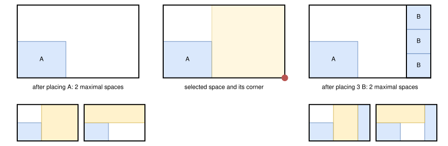
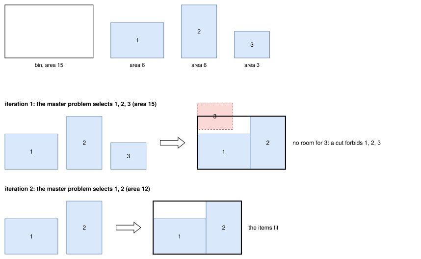
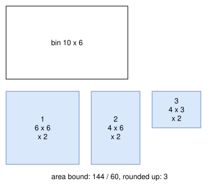

.. _internals_rectangle:

:code:`rectangle` algorithms
============================

See :ref:`rectangle<rectangle>` for the input/output format and CLI usage of this solver.

Tree search
------------

This algorithm solves the :code:`feasibility`, :code:`knapsack`, :code:`open-dimension-x`, :code:`open-dimension-y`, :code:`bin-packing` and :code:`bin-packing-with-leftovers` objectives.

It is a tree search algorithm where a single item is packed at each stage. The root node is an empty partial solution (no item packed). Given a node, a child node is generated for each feasible insertion of each unpacked item, either in the same bin or in a new bin.

The possible insertions for an unpacked item are the ones where the new item is packed above either a packed item or the bottom of the bin, then shifted right until it intersects no packed item.

.. image:: ../img/rectangle_tree_search_children.svg
   :align: center

See :doc:`the detailed description <rectangle/tree_search>`.

Tree search with maximal spaces
----------------------------------

This algorithm solves the :code:`feasibility` and :code:`knapsack` objectives with a single bin, and the :code:`bin-packing`, :code:`bin-packing-with-leftovers`, :code:`open-dimension-x` and :code:`open-dimension-y` objectives through sequential feasibility.
It doesn't support unloading constraints.

It is a tree search algorithm where a block of items is packed at each stage. The blocks (grids of copies of an item type, and their combinations) are generated first. A node stores the maximal empty rectangles of the bin; its children place each block fitting in the empty rectangle closest to a corner of the bin. A node is evaluated by completing it greedily.

See :doc:`the detailed description <rectangle/tree_search_maximal_spaces>`.

Benders decomposition
------------------------

This algorithm solves the :code:`knapsack`, :code:`bin-packing` and :code:`variable-sized-bin-packing` objectives exactly.

Its master problem assigns the items to the bins considering only their areas, as a one-dimensional problem. For each bin of its solution, a subproblem checks whether the items actually fit; if not, cuts forbidding this selection of items are added to the master problem, which is solved again.

See :doc:`the detailed description <rectangle/benders_decomposition>`.

Benders decomposition with contiguity
----------------------------------------

This algorithm solves the :code:`knapsack` and :code:`feasibility` objectives exactly, for a single bin.

Its master problem also decides the x-positions of the items (contiguous relaxation), and its subproblem only searches y-positions consistent with them.

See :doc:`the detailed description <rectangle/benders_decomposition_contiguity>`.

Dual feasible functions
-------------------------

This algorithm computes a bound for the :code:`bin-packing`, :code:`feasibility` and :code:`knapsack` objectives, for instances with a single bin type.

It builds dominated instances, in which every feasible solution of the original instance remains feasible, by transforming the dimensions of the items and of the bin; the area bound of the dominated instances is a valid bound, sometimes better than the one of the original instance.

See :doc:`the detailed description <rectangle/dual_feasible_functions>`.

Conservative scales
----------------------

This algorithm computes a bound for the :code:`bin-packing` and :code:`feasibility` objectives, for instances with a single bin type and without item rotation.

It optimizes new dimensions for the items with linear programs, such that the packings remain feasible, and computes the area bound with them.

See :doc:`the detailed description <rectangle/conservative_scales>`.

Bar relaxation
-----------------

This algorithm computes a bound for the :code:`knapsack`, :code:`feasibility`, :code:`bin-packing` and :code:`variable-sized-bin-packing` objectives.

It slices the bins into unit rows and columns, and only requires that the items can be distributed among them; the resulting linear program is solved by column generation.

See :doc:`the detailed description <rectangle/bar_relaxation>`.

.. toctree::
   :maxdepth: 1
   :hidden:

   rectangle/tree_search
   rectangle/tree_search_maximal_spaces
   rectangle/benders_decomposition
   rectangle/benders_decomposition_contiguity
   rectangle/dual_feasible_functions
   rectangle/conservative_scales
   rectangle/bar_relaxation
