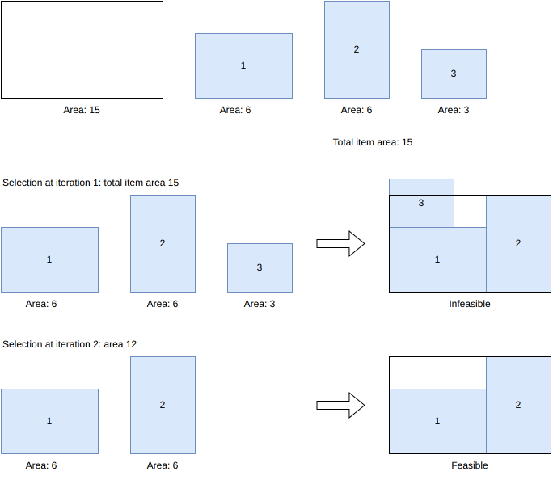
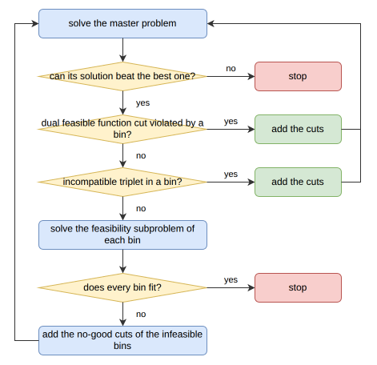
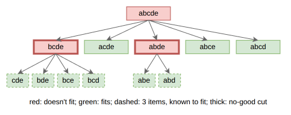

.. _internals_rectangle_benders_decomposition:

Benders decomposition
=====================

Objectives
----------

This algorithm solves the :code:`knapsack` objective, with one or several bins, and the :code:`bin-packing` and :code:`variable-sized-bin-packing` objectives. It supports the resources of the bins.

It is an exact method: when it converges, the solution found is optimal.

Principle
---------

It is a combinatorial Benders decomposition, in the spirit of Côté, Haouari and Iori (2021). The problem is split in two:

* the *master problem* decides which items go in which bin, ignoring the geometry: it is a one-dimensional problem, where each item is reduced to its area and each bin to its area;
* the *subproblems* check, for each bin of the solution of the master problem, whether its items actually fit together in the bin.

When the items of a bin don't fit, *cuts* are added to the master problem, forbidding this selection of items, and many others, in a bin of this type, and the master problem is solved again. Since the master problem is a relaxation of the problem, the value of its optimal solution is a bound. The algorithm stops when the items of every bin fit, or when the solution of the master problem can't be better than the best solution found: the best solution found is then optimal.

In the example below, the bin has an area of 15, and the items 1, 2 and 3 have an area of 6, 6 and 3. At iteration 1, with no cuts yet, the master problem selects the three items, the only selection filling the area of the bin. This selection turns out to be infeasible: once items 1 and 2 are packed, there is no room left for item 3. A cut excluding this selection is added, and at iteration 2 the master problem selects items 1 and 2 only (area 12), which fit:

Master problem
--------------

The master problem is a :ref:`onedimensional <internals_onedimensional>` instance, with the objective of the instance:

* each bin type has its area as length, and keeps its copies, its cost and its resources;
* each item type has its area as length, and keeps its copies and, for the :code:`knapsack` objective, its profit.

It is solved with the :ref:`MILP assignment <internals_onedimensional_milp_assignment>` algorithm, in non-anytime mode.

The cuts, and the geometric information the master problem can't see by itself, are encoded as onedimensional *resources* on the bin types, so that the master problem never proposes a bin violating them. A resource of a bin type has a capacity, and each copy of an item type in a bin consumes a quantity of it. A cut forbidding "at least :math:`n` copies of item type :math:`i`" uses the consumption schedule :math:`(1, \ldots, 1, 0)` with :math:`n` ones: the copies of item type :math:`i` in a bin consume :math:`\min(c, n)` in total, where :math:`c` is their number.

The following information is computed before the first iteration:

* **Eligibility.** An item type which doesn't fit a bin type by its dimensions (e.g. a 1 × 100 item in a 10 × 10 bin, although its area is small enough) is not eligible for it.
* **Incompatible pairs.** Two rectangles in a rectangle can always be separated by a vertical or a horizontal line. So two items fit together in a bin if and only if they fit side by side or one above the other, in some orientations. For each pair of item types (and each item type with itself) which don't, a resource forbids them in the same bin.
* **Precedences**, for the :code:`knapsack` objective only. An item type :math:`j` *dominates* an item type :math:`i` if its profit is at least the one of :math:`i`, if it fits in the footprint of :math:`i` in all the orientations of :math:`i`, and if it is eligible for all the bin types :math:`i` is eligible for. Then a copy of :math:`i` can always be replaced by a copy of :math:`j` if a copy of :math:`j` is left, without decreasing the profit. So no copy of :math:`i` is packed unless all the copies of :math:`j` are.

The model is the :ref:`MILP assignment <internals_onedimensional_milp_assignment>` model, where the length of an item or a bin is its area. With its variables :math:`x_{i,t,k,c}` (bin :math:`k` of type :math:`t` contains at least :math:`c` copies of item type :math:`i`), the number of copies of item type :math:`i` in a bin, counted up to :math:`n`, is :math:`\sum_{c \le n} x_{i,t,k,c}`, so all the cuts are linear. The following constraints are added for each bin :math:`(t, k)`:

* Incompatible pairs :math:`(i, i') \in \mathcal{I}_t`:

.. math::

   x_{i,t,k,1} + x_{i',t,k,1} \le 1 \qquad \text{(or } x_{i,t,k,2} \le 0 \text{ if } i = i' \text{)}

* Dual feasible function cuts :math:`D \in \mathcal{D}_t`, with a coefficient :math:`f_i` for each item type and a right-hand side :math:`F`:

.. math::

   \sum_{i,c} f_i \, x_{i,t,k,c} \le F

* Triplet and no-good cuts :math:`C \in \mathcal{C}_t`, each one forbidding :math:`n_i` copies of each item type :math:`i` of a set :math:`S`, with lifted item types :math:`L` of coefficients :math:`\alpha_j`:

.. math::

   \sum_{i \in S} \sum_{c \le n_i} x_{i,t,k,c} + \sum_{j \in L} \alpha_j \, x_{j,t,k,1} \le \sum_{i \in S} n_i - 1

Iterations
----------

At each iteration, the master problem is solved, then the bins of its solution are checked, from the cheapest checks to the most expensive ones. As soon as a check adds cuts, the master problem is solved again.

1. **Master problem.** If all the cuts are proven (see below), the value of its solution is reported as a bound of the instance. If a solution has already been found, and the solution of the master problem can't be better (smaller profit for the :code:`knapsack` objective, as many bins or more for the :code:`bin-packing` objective, cost as large or larger for the :code:`variable-sized-bin-packing` objective), the algorithm stops.
2. **Dual feasible functions.** For each bin, the most violated inequality derived from the :ref:`dual feasible functions <internals_rectangle_dual_feasible_functions>` is searched. Such an inequality is valid for any selection of items in a bin of this type, so it is added as a permanent cut. If one is found for some bin, the master problem is solved again.
3. **Incompatible triplets.** For each bin, the triplets of items of the bin which can never fit together are searched. Three rectangles are considered to fit together in a bin if and only if they fit in one of the 8 *guillotine arrangements* below, in some orientations: all three in a row, all three in a column, or two of them side by side (or one above the other) and the third one above them (or to their right). This was checked exhaustively against a search over the positions of the items, on tens of thousands of random cases; it doesn't hold for four items. If none of the 8 arrangements fits, the triplet is added as a permanent cut, forbidding these three items in a bin of this type. If one is found for some bin, the master problem is solved again.

   .. image:: ../../img/rectangle_benders_decomposition_triplet_shapes.png
      :scale: 100%
      :align: center

4. **Feasibility subproblems.** For each bin, a :code:`feasibility` instance with the items of the bin is solved with the rectangle algorithms, in non-anytime mode, with a queue of size 512 for the tree search. A bin with exactly 3 items is packed directly in the guillotine arrangement which fits, without solving a subproblem. The bins whose items fit are assembled into a solution, which is reported if it is better than the best one (for the :code:`knapsack` objective, a subset of the bins is a feasible solution).
5. **Convergence.** If every bin fits, the solution of the master problem is feasible, and the algorithm stops. Otherwise, no-good cuts are added for the bins which don't fit, and the master problem is solved again.

No-good cuts
------------

**Infeasible subsets.** Instead of forbidding the whole selection of items of a bin which doesn't fit, the algorithm looks for infeasible subsets of it: forbidding a subset forbids every selection containing it, so these cuts are stronger. The items of the selection are sorted by increasing area, so that the small items, which are usually not the cause of the infeasibility, are removed first. Then a depth-first search removes them one at a time:

* from a selection which doesn't fit, each item placed after the last item removed is removed in turn, and the feasibility of the remaining selection is checked again;
* the search continues from each remaining selection which doesn't fit;
* a selection from which no such removal gives a selection which doesn't fit becomes a no-good cut.

The selections of at most 3 items are known to fit: the incompatible pairs and triplets would have forbidden them. The search stops after 8 cuts.

In the example below, the selection *abcde* doesn't fit. Removing *a* gives *bcde*, which doesn't fit either; removing any further item of *bcde* gives a selection of 3 items, which fits, so *bcde* becomes a cut. In the same way, *abde* becomes a cut. The selections *acde*, *abce* and *abcd* fit.

**Lifting.** Each cut is then *lifted*, following the sequential lifting procedure of Balas (1975) and Wolsey (1975), as adapted by Côté, Haouari and Iori (2021). Let :math:`|C|` be the number of items of the cut: at most :math:`|C| - 1` of them can be in a bin. The item types not in the cut which fit the bin type are visited one by one, by increasing index. For an item type :math:`j`, a knapsack problem is built in the bin, with:

* the items of the cut, with a profit of 1 each;
* the item types already lifted, one copy each, with their coefficient as profit;
* one copy of :math:`j`, which must be packed, with a profit of 0.

Its value :math:`z` is the largest number of items of the cut (counting a lifted item type for its coefficient) which can be packed together with :math:`j`. It is bounded with the :ref:`bar relaxation <internals_rectangle_bar_relaxation>`, which gives an upper bound :math:`\bar{z} \ge z`. If :math:`\alpha_j = \lfloor |C| - 1 - \bar{z} \rfloor > 0`, the presence of :math:`j` in a bin excludes at least :math:`\alpha_j` items of the cut, and :math:`j` is added to the cut with the coefficient :math:`\alpha_j`: in the master problem, its first copy in a bin consumes :math:`\alpha_j`, and its other copies nothing.

**Proofs.** A feasibility subproblem may be inconclusive: it neither finds a packing nor proves that there is none. Its selection is still treated as infeasible, so that the algorithm keeps converging, but its cuts are marked as unproven. While a cut is unproven, the value of the master problem is not reported as a bound of the instance, and the solution found is not proven optimal. The dual feasible function cuts and the triplet cuts are always proven.

Search parameters
-----------------

In anytime mode, the algorithm runs until it converges or reaches the time limit. In the non-anytime modes, it also stops after 100 iterations solving feasibility subproblems. In the :code:`exact` mode, it runs as in anytime mode, and its master problem and its feasibility subproblems are also solved in :code:`exact` mode, so that their results are proven.

Automatic selection
-------------------

In the :code:`exact` mode, it is run for the :code:`knapsack` objective with a single bin, alongside the other algorithms. The :ref:`column generation <internals_generic_algorithms_column_generation>` algorithm uses it to solve its pricing problems when it needs to prove a bound.

It can be selected with :code:`--use-benders-decomposition 1` (CLI) or :code:`use_benders_decomposition` (Python).

Source files
------------

* :code:`src/rectangle/benders_decomposition.hpp`, :code:`src/rectangle/benders_decomposition.cpp`: the decomposition
* :code:`src/rectangle/item_subset_incompatibility.hpp`, :code:`src/rectangle/item_subset_incompatibility.cpp`: the incompatible triplets
* :code:`scripts/doc_figures/rectangle_benders_decomposition.py`: the figures of this page

References:

* "On the Two-Dimensional Knapsack Problem" (Caprara and Monaci, 2004)

  * https://doi.org/10.1016/S0167-6377(03)00057-9

* "A Cutting-Plane Approach for the Two-Dimensional Orthogonal Non-Guillotine Cutting Problem" (Baldacci and Boschetti, 2007)

  * https://doi.org/10.1016/j.ejor.2005.11.060

* "Combinatorial Benders Decomposition for the Two-Dimensional Bin Packing Problem" (Côté, Haouari and Iori, 2021)

  * https://doi.org/10.1287/ijoc.2020.1014

* "Optimisation de plans de palettisation hétérogène" (Le Jean, 2021, PhD thesis, Université Grenoble Alpes)

  * https://theses.fr/2021GRALM032
