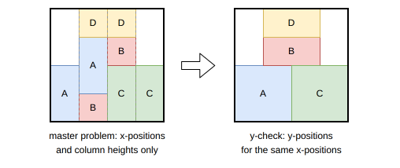
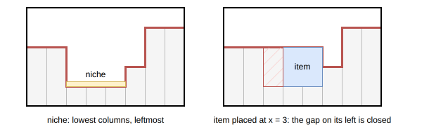
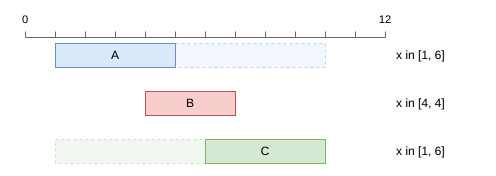

.. _internals_rectangle_benders_decomposition_contiguity:

Benders decomposition with contiguity
=====================================

Objectives
----------

This algorithm solves the :code:`knapsack` and :code:`feasibility` objectives, for a single bin (one bin type with one copy). It supports the resources of the bin, but not the defects, the maximum weight and the eligibilities.

It is an exact method when its master problem is solved to optimality: the solution found is then optimal (or the instance is proven infeasible).

Principle
---------

It is a combinatorial Benders decomposition, following Côté, Dell'Amico and Iori (2014) for the strip packing problem, as adapted by Wang, Baldacci, Furini, Wei and Liu (2025) to a bin of fixed size.

Unlike the :ref:`Benders decomposition <internals_rectangle_benders_decomposition>`, whose master problem only sees the area of the items, the master problem here also decides the x-position of each item. The subproblem, the *y-check*, then only has to find y-positions consistent with them.

Master problem
--------------

**Contiguous relaxation.** The bin is cut into unit-width columns. Each item selected is assigned to a run of consecutive columns, its x-position, in one of its orientations, and the total height of the items covering each column must not exceed the height of the bin. This is the *contiguous* relaxation of the problem (the "P|cont|Cmax" parallel processor scheduling relaxation). A solution of the master problem is not necessarily a packing: the items have no y-positions, and an item may be at different heights in the different columns it covers.

On the left of the figure below, a solution of the master problem: the heights of the columns don't exceed the height of the bin, but items A and B are cut into slices at different heights. On the right, the y-check finds y-positions for the same x-positions:

**Units and candidate positions.** Each copy of an item type is a *unit*. The candidate x-positions of a unit, in each of its orientations, are its *meet-in-the-middle patterns* (Côté and Iori, 2018), rather than all the integer positions, which keeps the model tractable. The *normal patterns* of a unit are the sums of widths of subsets of the other units (each one in one of its orientations): in any packing, the items can be pushed to the left until each one is at a normal pattern. The meet-in-the-middle patterns refine them with a threshold :math:`t`: the items to the left of :math:`t` are pushed to the left, and the items to the right of it are pushed to the right, which gives fewer positions; the threshold is chosen for each unit to minimize its number of positions.

**Input**:

* a bin of width :math:`W` and height :math:`H`, cut into columns :math:`x = 0, \ldots, W - 1`
* the units :math:`u`; for each unit :math:`u`: its profit :math:`p_u`, and its candidate placements :math:`(x, o)`: its left column :math:`x` and its orientation :math:`o`, with width :math:`w_{u,o}` and height :math:`h_{u,o}`
* the no-good cuts found so far :math:`\mathcal{C}`; each cut is given by a set of units :math:`S` and, for each unit :math:`u \in S`, a set of its candidate placements :math:`C_u`: the units of :math:`S` can't all be placed at placements of their sets

**Variables**:

* :math:`\rho_{u,x,o} \in \{0, 1\}`: :math:`\rho_{u,x,o} = 1` iff unit :math:`u` is placed with its left side at column :math:`x`, in orientation :math:`o`

**Objective**: maximize the profit of the units placed (:code:`knapsack`; no objective for :code:`feasibility`)

.. math::

   \max \sum_{u,x,o} p_u \, \rho_{u,x,o}

**Constraints**:

* Units: each unit is placed at most once (exactly once for the :code:`feasibility` objective)

.. math::

   \forall u \qquad \sum_{x,o} \rho_{u,x,o} \le 1

* Column heights: the units covering a column fit in the height of the bin

.. math::

   \forall x' \qquad \sum_{(u,x,o) \,:\, x \le x' < x + w_{u,o}} h_{u,o} \, \rho_{u,x,o} \le H

* No-good cuts

.. math::

   \forall (S, C) \in \mathcal{C} \qquad \sum_{u \in S} \; \sum_{(x,o) \in C_u} \rho_{u,x,o} \le |S| - 1

* The resources of the bin.

**Solution methods.** The master problem is solved either by a tree search (the default) or by this 0-1 MILP, with HiGHS.

The tree search decides the units one by one, in a fixed order (by item type, then by copy). A child places the next unit at one of its candidate placements, if the heights of its columns stay within the height of the bin and no cut or resource capacity is exceeded; for the :code:`knapsack` objective, another child skips the unit. The nodes are ordered by profit, and a node is discarded if its profit plus the profit of all the remaining units isn't larger than the profit of the best solution found. There is no dominance. It is explored by the :ref:`iterative beam search <internals_tree_search>`, run with a single queue of size 1024 (parameter :code:`master_problem_tree_search_not_anytime_queue_size`). Its solution is only proven optimal if the search was complete; otherwise, the solution of the decomposition isn't proven optimal either. In the :code:`exact` mode, the queue grows until the search is complete, so the master problem is solved to optimality.

Subproblem: the y-check
-----------------------

Given the x-positions (and orientations) of the selected units, the y-check looks for y-positions making a valid packing. It is strongly NP-hard, and is solved with the combinatorial branch-and-bound of Côté, Dell'Amico and Iori (2014).

**Preprocessing.** Three reductions are applied first:

* *merge items*: a unit and the units entirely to its left (or to its right) which fit in a strip of its height are merged into a single block, if a nested y-check proves that they fit;
* *lift item widths*: each block is widened up to the nearest blocks entirely to its left and to its right, since no other block can use this space;
* *shrink the strip*: only the columns where a block starts are kept.

**Branch-and-bound.** A node stores the *skyline* of the units placed: the height used in each column. The *niche* is the leftmost run of columns at the lowest height. The children of a node place, at the bottom of the niche, each unplaced unit lying entirely inside it (by increasing x-position); a last child *closes* the niche, raising it to the height of its lowest neighbor, without placing anything. When a unit is placed, the columns of the niche to its left are raised to its top (or to the height of the left neighbor of the niche, if smaller): any other unit placed there later would only be a different order of the same packing.

Five fathoming rules prune the tree: the node is infeasible if the unplaced units, stacked on the skyline, overflow a column; a unit spanning the whole niche and not higher than its neighbors is the only child; among identical units at the same position, only the first one is placed first; and a unit isn't placed to the right of a gap which another unplaced unit could fill.

Iterations
----------

At each iteration, the master problem is solved:

* if it is infeasible, the instance is infeasible;
* if no solution is found without a proof of infeasibility (time limit, or incomplete tree search), the algorithm stops;
* for the :code:`knapsack` objective, if the master problem is solved to optimality, its value is reported as a bound.

Then the y-check is run on its solution:

* if it finds y-positions, the solution is a packing, reported as the solution, and the algorithm stops;
* if it fails, a cut is added, and the master problem is solved again (see below);
* if it reaches the time limit, the algorithm stops.

**Knapsack: local Benders decomposition.** For the :code:`knapsack` objective, a failed y-check only means that the selected items don't fit *at these x-positions*. The same set of items is first checked at other x-positions, by a *local Benders decomposition*: the algorithm itself is called on a :code:`feasibility` instance with exactly these items. If it finds a packing, this packing is optimal, since the profit only depends on the items selected. Otherwise, the set of items is infeasible at any position, and a *covering cut* forbidding all the candidate placements of these units at once is added to the master problem.

**Feasibility: strengthened cuts.** For the :code:`feasibility` objective, all the units are selected, so the cut forbids the x-positions, not the set of units. It is strengthened following Wang et al. (2025):

1. *binary split*: for each unit, the units entirely to the left of its left side, and the units at or to the right of it, are checked; if one of the two sets still fails the y-check, the search continues from it;
2. *sweep*: the vertical lines are scanned from left to right, removing the units starting on the line, then from right to left, removing the units crossing it, as long as the remaining units still fail the y-check;
3. *removal*: 12 scans over the remaining units (by increasing area, width, height, perimeter, x-position and number of units they overlap, then in 6 random orders), each one removing the units one at a time as long as the remaining units still fail the y-check;
4. *windows*: the x-position :math:`x_i` of each remaining unit is widened to a window :math:`[l_i, r_i]`, as large as possible, such that the units which overlap horizontally at their x-positions still overlap for any positions in their windows. Since the y-check only depends on which units overlap horizontally, the units still can't be packed at any positions in their windows. The windows are computed with a linear program:

.. math::

   \max \sum_i (r_i - l_i) \quad \text{s.t.} \quad r_i - l_j \le w_j - 1 \;\; \forall\, i, j \text{ overlapping}, \quad 0 \le l_i \le x_i \le r_i \le W - w_i

The cut forbids the remaining units at all their candidate placements in their windows, in the same orientation. In the example below, B overlaps A and C, which don't overlap each other: A can move as far as x = 6 and C as far as x = 1 while still overlapping B.

Automatic selection
-------------------

In the :code:`exact` mode, it is run for the :code:`feasibility` objective with a single bin, alongside the other algorithms. It can be selected with :code:`--use-benders-decomposition-contiguity 1` (CLI) or :code:`use_benders_decomposition_contiguity` (Python).

Source files
------------

* :code:`src/rectangle/benders_decomposition_contiguity.hpp`, :code:`src/rectangle/benders_decomposition_contiguity.cpp`: the decomposition, the y-check and the cuts
* :code:`src/rectangle/onedimentional_contiguity/`: the master problem (MILP and tree search)
* :code:`src/algorithms/meet_in_the_middle.hpp`: the meet-in-the-middle patterns
* :code:`scripts/doc_figures/rectangle_benders_decomposition_contiguity.py`: the figures of this page

References:

* "Combinatorial Benders' Cuts for the Strip Packing Problem" (Côté, Dell'Amico and Iori, 2014)

  * https://doi.org/10.1287/opre.2013.1248

* "The Meet-in-the-Middle Principle for Cutting and Packing Problems" (Côté and Iori, 2018)

  * https://doi.org/10.1287/ijoc.2018.0806

* "Exact Algorithms for Two-Dimensional Knapsack Problems: A Unified Framework with New Benchmark Results" (Wang, Baldacci, Furini, Wei and Liu, 2025)

  * https://doi.org/10.1287/ijoc.2025.1423
