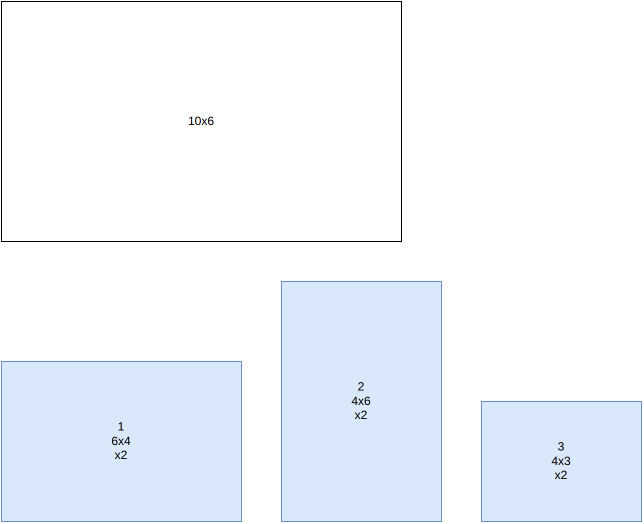
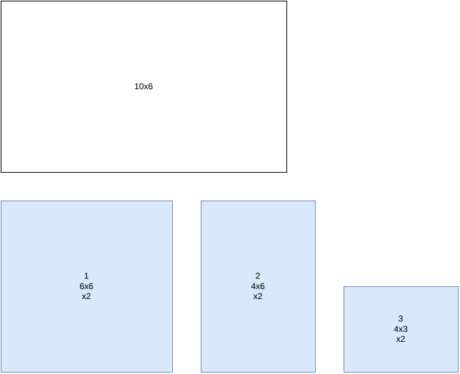
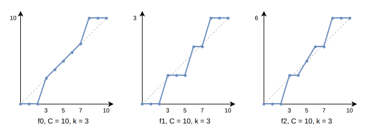

.. _internals_rectangle_dual_feasible_functions:

Dual feasible functions
=======================

Objectives
----------

This algorithm computes a bound for the :code:`bin-packing`, :code:`feasibility` and :code:`knapsack` objectives, for instances with a single bin type. It doesn't produce solutions.

It is also used by the :ref:`Benders decomposition <internals_rectangle_benders_decomposition>` to generate cuts.

Principle
---------

The algorithm builds dominated instances, in the sense that every feasible solution of the original instance is also feasible for the dominated instances. Computing the classical area bound on these instances may lead to different values, sometimes better, which remain valid bounds for the original instance.

In the example below, the bin is 10 × 6 and there are two copies each of items 1 (6 × 4), 2 (4 × 6) and 3 (4 × 3). Every pair of these items fits together in the bin, so the area bound (2 × (24 + 24 + 12) = 120, divided by the bin area 60, rounded up) is only 2:

We apply the following transformation:

* the items of height at least 4 get the height 6;
* the items of height at most 2 are removed.

Every feasible solution of the original instance is feasible for the modified instance: when the height of an item of height at least 4 is increased to the height of the bin, every item it might intersect has a height of at most 2, and is therefore among the removed items.

Only item 1 is affected by the transformation: its height becomes 6. Here is the dominated instance:

The area bound of the dominated instance (2 × (36 + 24 + 12) = 144, divided by 60, rounded up) is 3, which turns out to be tight: the original instance does require 3 bins.

Functions
---------

Such transformations are *dual feasible functions*: a function :math:`f` such that, for any set of lengths fitting in a capacity :math:`C`, the transformed lengths fit in :math:`f(C)`. The ones used are the three families of Carlier, Clautiaux and Moukrim (2007), each one parametrized by a *breakpoint* :math:`k \in [1, C / 2]`:

* :math:`f_0` rounds the long lengths up to the capacity and the short ones down to 0:

.. math::

   f_0(x) = \begin{cases} C & \text{if } x > C - k \\ x & \text{if } k \le x \le C - k \\ 0 & \text{if } x < k \end{cases}

* :math:`f_1` counts the *medium* items, of length between :math:`k` and :math:`C / 2`. Let :math:`M(c)` be the maximum number of medium items fitting in a length :math:`c`, computed greedily from the shortest ones. A medium item counts for 1, a short item for 0, the capacity for :math:`M(C)`, and a long item for the number of medium items it displaces:

.. math::

   f_1(x) = \begin{cases} M(C) - M(C - x) & \text{if } x > C / 2 \\ 1 & \text{if } k \le x \le C / 2 \\ 0 & \text{if } x < k \end{cases}

* :math:`f_2` rounds the lengths down to multiples of :math:`k`, counting the long lengths by the room they leave:

.. math::

   f_2(x) = \begin{cases} 2 \left( \lfloor C / k \rfloor - \lfloor (C - x) / k \rfloor \right) & \text{if } x > C / 2 \\ \lfloor C / k \rfloor & \text{if } x = C / 2 \\ 2 \lfloor x / k \rfloor & \text{if } x < C / 2 \end{cases}

The figure below shows the three functions for :math:`C = 10` and :math:`k = 3`, scaled so that :math:`f(C)` is at the top (for :math:`f_1`, all the medium items have length 3). The dashed line is the identity, scaled the same way: the short lengths are mostly rounded down, and the long ones up.

**In two dimensions.** A function :math:`f`, with a breakpoint :math:`k`, is applied to the widths, with the width :math:`W` of the bin as capacity, and a function :math:`g`, with a breakpoint :math:`l`, to the heights, with the height :math:`H` of the bin as capacity. The transformed area of an item of size :math:`w \times h` is :math:`f(w) \, g(h)`, and the one of the bin is :math:`f(W) \, g(H)`: for any packing of the original instance, the total transformed area of the items doesn't exceed the transformed area of the bin. All the pairs of families :math:`(f, g)` are tried, with all the pairs of breakpoints :math:`(k, l)`.

**Breakpoints.** The breakpoints tried for the widths are the widths :math:`w` of the items not larger than :math:`W / 2`, the values :math:`W - w` for the larger ones (the widths equal to :math:`W` are skipped), and :math:`W / 2`. The same is done for the heights.

**Bounds.** For each pair of families and each pair of breakpoints:

* :code:`bin-packing` and :code:`feasibility`: the bound is the total transformed area of the items divided by the transformed area of the bin, rounded up. The best bound is kept. For the :code:`feasibility` objective, the instance is proven infeasible if the bound exceeds the number of bins.
* :code:`knapsack`: the bound is the fractional (Dantzig) bound of the knapsack problem with the transformed areas: the capacity is the transformed area of the bin times its number of copies, the items are sorted by decreasing profit per transformed area, and the last one is taken fractionally. An item whose transformed area is 0 is always taken; an item which doesn't fit in the bin is never taken. The smallest bound is kept. Since the bound ignores the resources, the penalties of the *penalize* resources which increase the profit are added to it.

Rotations
---------

When an item can be rotated, its transformed area depends on its orientation. Two strategies are used:

* **Smallest orientation.** In the computation above, the smallest of the transformed areas of its two orientations is used, which keeps the bound valid whatever the orientation of the item in the packing. For :math:`f_1`, the dimension used to decide whether an item is medium is its smallest dimension which qualifies.
* **Doubled instance** (Clautiaux, Jouglet and El Hayek, 2007), for the :code:`bin-packing` and :code:`feasibility` objectives only. An instance is built where the bin is a square of side :math:`\max(W, H)`, and each item type appears twice, once in each orientation, which can't be rotated. A packing of the original instance in :math:`m` bins gives a packing of this instance in :math:`2m` bins: one in the original orientation and one rotated. So half the bound of this instance, rounded up, is a bound of the original instance. When the bin isn't a square, the bound is computed again with, in each square bin, a dummy item filling the part of the square outside the original bin, as many times as the current bound, until the bound doesn't increase anymore. The bound kept is the largest of the two strategies.

Cuts
----

For a selection of items assigned to a bin, the same functions give inequalities on the numbers of copies :math:`n_i` of each item type, valid for any selection in a bin of this type:

.. math::

   \sum_i f(w_i) \, g(h_i) \, n_i \le f(W) \, g(H)

The :ref:`Benders decomposition <internals_rectangle_benders_decomposition>` looks, for each selection proposed by its master problem, for the pair of families and the pair of breakpoints whose inequality is the most violated by the selection.

Automatic selection
-------------------

The bound is computed automatically when there is a single bin type and at most 100 items. It can be forced with :code:`--use-dual-feasible-functions 1` (CLI) or :code:`use_dual_feasible_functions` (Python).

Source files
------------

* :code:`src/rectangle/dual_feasible_functions.hpp`, :code:`src/rectangle/dual_feasible_functions.cpp`
* :code:`scripts/doc_figures/rectangle_dual_feasible_functions.py`: the figure of the functions

References:

* "New reduction procedures and lower bounds for the two-dimensional bin packing problem with fixed orientation" (Carlier, Clautiaux and Moukrim, 2007)

  * https://doi.org/10.1016/j.cor.2005.08.012

* "A new lower bound for the non-oriented two-dimensional bin-packing problem" (Clautiaux, Jouglet and El Hayek, 2007)

  * https://doi.org/10.1016/j.orl.2006.07.001

* "Heuristic approaches for the two- and three-dimensional knapsack packing problem" (Egeblad and Pisinger, 2009)

  * https://doi.org/10.1016/j.cor.2007.12.004

* "A theoretical and experimental study of fast lower bounds for the two-dimensional bin packing problem" (Serairi and Haouari, 2018)

  * https://doi.org/10.1051/ro/2017019
