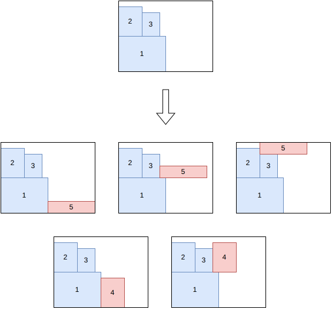

.. _internals_rectangle_tree_search:

Tree search
===========

Objectives
----------

This algorithm solves the :code:`feasibility`, :code:`knapsack`, :code:`open-dimension-x`, :code:`open-dimension-y`, :code:`bin-packing` and :code:`bin-packing-with-leftovers` objectives, and the :code:`variable-sized-bin-packing` objective when there is a single bin type. It supports the unloading constraints, and it solves the sub-problems of the :ref:`boxstacks <internals_boxstacks>` algorithms, with their axle weight constraints.

Principle
---------

It is a constructive tree search where a single item is packed at each stage. The root node is an empty partial solution. Given a node, a child node is generated for each feasible insertion of each unpacked item, either in the current (last) bin or in a new bin. The tree is explored by an iterative beam search, guided by a guide function.

The bins are considered in a fixed order: in the order in which they appear in the instance, or by increasing area for the :code:`knapsack` objective. Bins in which no remaining item fits are skipped.

Directions
----------

In the direction :code:`X`, the items are packed from left to right: a new item is packed above an item of the *skyline*, or above the bottom of the bin, then shifted to the right until it doesn't overlap the items already packed. The direction :code:`Y` is the same with the x and y axes exchanged.

The directions used depend on the instance:

* :code:`open-dimension-x`, :code:`bin-packing-with-leftovers` with leftover mode :code:`x`, and the unloading constraints along x: direction :code:`X`;
* :code:`open-dimension-y`, :code:`bin-packing-with-leftovers` with leftover mode :code:`y`, and the unloading constraints along y: direction :code:`Y`;
* the other instances with a single bin type: both directions, in separate searches;
* the other instances with several bin types: the direction of each new bin is chosen from its dimensions and the ones of the items: :code:`X` if the total height of the items divided by the height of the bin is at least their total width divided by its width, :code:`Y` otherwise.

Nodes and insertions
--------------------

A node stores the *skyline* of its current bin: the list of the *uncovered items*, the parts of the packed items visible from the right of the bin. An item, in one of its allowed orientations, can be inserted above each uncovered item, and above each defect of the bin. It is then shifted to the right until it doesn't intersect a defect.

An insertion is discarded if the item sticks out of the bin, if the maximum weight of the bin is exceeded, if the capacity of a resource is exceeded (a *penalize* resource never blocks an insertion; its penalty is subtracted from the profit instead), or if it violates the unloading constraints: with the unloading constraints, the items have unloading groups, and a new item can't block the unloading of an item of a group unloaded before it.

**Symmetry breaking.** When two item types have the same dimensions and one dominates the other (for example, it has at least the same profit), the dominated item type can only be inserted once all the copies of the dominating one are packed.

Guides
------

The guide of a node estimates the quality of the partial solution; the beam search keeps the nodes with the smallest guides. The *guide area* of a node is the area of the bins before the current one plus the area of the current bin to the left of the rightmost left side of the packed items, the area that new items can no longer use.

* Guide 0: guide area divided by the area of the items packed.
* Guide 1: same as guide 0, divided by a pseudo-profit of the items packed which favors the large items, and the long ones.
* Guide 2: area of the bounding box of the items of the current bin divided by the area of the items packed.
* Guide 3: same as guide 2, divided again by the area of the items packed.
* Guide 4: guide area divided by the profit of the items packed.
* Guide 5: same as guide 4, divided by the area of the items packed.

By default, guides 4 and 5 are used for the :code:`knapsack` objective, and guides 0 and 1 for the other objectives. Guides 2 and 3 are used by the post-process re-optimizing the last bin of the solutions.

Dominance and pruning
---------------------

Two nodes with the same number of copies of each item type packed can be compared: a node dominates the other one if it uses fewer bins, or as many bins with a skyline everywhere to the left of the other one and no more consumption of any resource in its current bin. Dominated nodes are discarded.

A node is also discarded when it can't lead to a better solution than the best one found, e.g. when it already uses as many bins as the best solution for the :code:`bin-packing` objective. When few items are left, the search also detects when an extra bin is needed.

Search
------

In anytime mode, an iterative beam search is run for each pair (guide, direction), in parallel. Each one starts with a beam of size 1, and the size of the beam is multiplied by a growth factor at each restart; when there are at most two pairs, each one is run with two growth factors, 1.33 and 1.5. When the beam search explores the whole tree, the solution found is proven optimal (or the instance proven infeasible).

In the non-anytime modes, a single beam search is run for each pair (guide, direction), with a beam of a given size.

Automatic selection
-------------------

With a single bin and the :code:`knapsack` or :code:`feasibility` objective (without unloading constraints), the tree search is run in the directions in which few items fit in a section of the bin; if there is no such direction, the :ref:`tree search with maximal spaces <internals_rectangle_tree_search_maximal_spaces>` is run instead. With a single bin and the other objectives, the tree search is run. With several bins, it is run when the item types have few copies compared to the number of items fitting in a bin, alongside the generic algorithms using it to solve their sub-problems. See :ref:`algorithm selection <internals_algorithm_selection>`.

It can be forced with :code:`--use-tree-search 1` (CLI) or :code:`use_tree_search` (Python).

Source files
------------

* :code:`src/rectangle/tree_search.hpp`, :code:`src/rectangle/tree_search.cpp`
