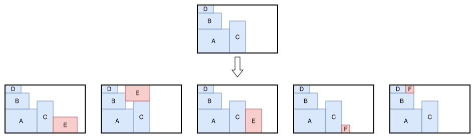
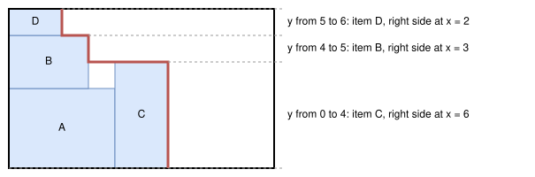
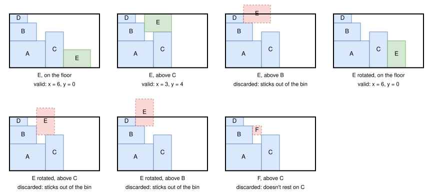
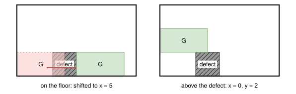
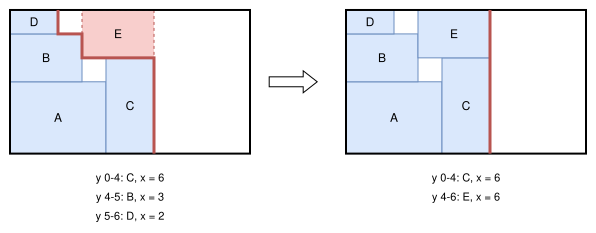
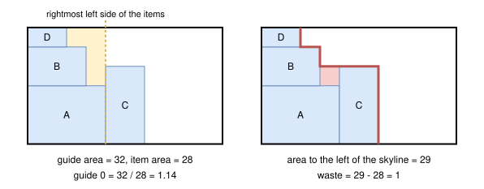
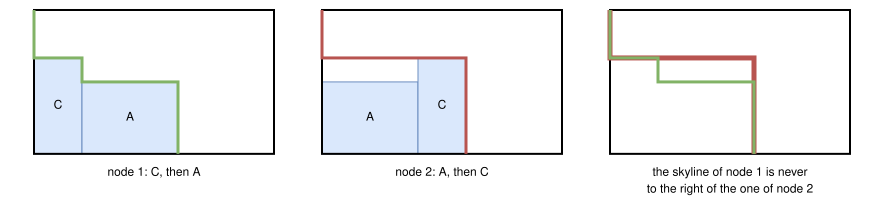

.. _internals_rectangle_tree_search:

Tree search
===========

Objectives
----------

This algorithm solves the :code:`feasibility`, :code:`knapsack`, :code:`open-dimension-x`, :code:`open-dimension-y`, :code:`bin-packing` and :code:`bin-packing-with-leftovers` objectives, and the :code:`variable-sized-bin-packing` objective when there is a single bin type. It supports the defects, the maximum weight of the bins, the resources and the unloading constraints. It also solves the sub-problems of the :ref:`boxstacks <internals_boxstacks>` algorithms, with their axle weight constraints.

Principle
---------

It is a constructive tree search where a single item is packed at each stage:

* the root node is the empty solution;
* a node is a partial solution: the items packed so far, with their positions;
* the children of a node are obtained by inserting one more item, at one of a few candidate positions, in the current (last) bin, or in a new bin if no item fits in the current bin anymore;
* a node is a *leaf* when all the items are packed.

The figure below shows a node (top), and its children inserting the items E (in both orientations) and F (bottom). The item is always inserted as far to the left as possible, at a height given by the items already packed.

The tree is far too large to be explored completely, so it is explored by an :ref:`iterative beam search <internals_tree_search>`: at each depth, only the nodes considered the most promising by a *guide* function are expanded, and the search is restarted with more and more nodes kept at each depth. Many nodes are also discarded because another node is at least as good (*dominance*), or because they can't lead to a better solution than the best one found (*bounds*).

The following sections describe, in this order, the frame in which the items are packed, the nodes, the generation of the children, the guides, the bounds and the dominance, which define the search tree, and finally the parameters of the search. The search itself is described on the :ref:`tree search <internals_tree_search>` page.

Directions and order of the bins
--------------------------------

**Directions.** The algorithm is described for the direction :code:`X`, where the bins are filled from left to right: the items are pushed to the left, and the free space of a bin is on its right. In the direction :code:`Y`, the bins are filled from bottom to top: the algorithm is the same on the instance where the x and y axes are exchanged, and the positions are converted back at the end.

The directions used depend on the instance:

* :code:`open-dimension-x`, :code:`bin-packing-with-leftovers` with leftover mode :code:`x`, and the unloading constraints along x: direction :code:`X`;
* :code:`open-dimension-y`, :code:`bin-packing-with-leftovers` with leftover mode :code:`y`, and the unloading constraints along y: direction :code:`Y`;
* the other instances with a single bin type: both directions, in separate searches;
* the other instances with several bin types: the direction is chosen for each bin when it is opened, from its dimensions and the ones of the items: :code:`X` if the total height of the items divided by the height of the bin is at least their total width divided by its width, :code:`Y` otherwise.

**Order of the bins.** The bins are opened in a fixed order: in the order in which they appear in the instance, or by increasing area for the :code:`knapsack` objective. When a new bin is opened, the bins in which none of the remaining items fits are skipped.

Nodes
-----

**Skyline.** Since the items are always pushed to the left, the only part of the current bin which matters for the next insertions is its *skyline*: the right side of the packed items, seen from the right of the bin. A node stores it as a list of horizontal *bands* covering the height of the bin, ordered from bottom to top. Each band stores the item visible from the right in it (its *uncovered item*), and the x-coordinate of the right side of this item. A band in which no item is visible is a band of the floor of the bin, at :math:`x = 0`.

In the following example, the items A, B, C and D are packed. A is not visible from the right anymore, since C covers it; B and D are only partly visible. The skyline (in red) has three bands:

The empty space to the left of the skyline, between B and C, can't receive any item anymore: it is waste.

**Other attributes.** A node also stores:

* its parent, and the item inserted to obtain it, with its position and its orientation, from which the solution is rebuilt at the end;
* the number of bins used, and the direction of the current bin;
* for each item type, its number of copies packed;
* the number of items packed, their area, their weight and their profit;
* the waste and the guide area (see below), and the largest x-coordinates of the left and right sides of the items of the current bin;
* the consumption of each resource in the current bin;
* the values used by the objectives and by the constraints: the leftover values of the bins, for the :code:`bin-packing-with-leftovers` objective; for each group of items, the smallest and largest x-coordinates of its items, for the unloading constraints, and its weight and center of gravity, for the axle weight constraints of :code:`boxstacks`.

Children
--------

**Candidate positions.** In the current bin, an item, in each of its allowed orientations, is inserted:

* on the floor of the bin (:math:`y = 0`);
* on top of each uncovered item: its bottom at the bottom of the band just above the band of this uncovered item;
* on top of each defect of the bin.

The item is then pushed to the left: its x-coordinate is the largest right side of the bands of the skyline it overlaps vertically. If it overlaps a defect, it is moved to the right of the defect, until it overlaps none.

**Discarded positions.** A candidate position is discarded if:

* the item sticks out of the bin (at the top or on the right);
* the item doesn't rest on the item (or the defect) it was inserted on: after being pushed to the left, its right side is to the left of the left side of this item. Such a position is also obtained by inserting the item lower;
* the maximum weight of the bin is exceeded;
* the capacity of a resource of the bin is exceeded. A *penalize* resource never discards a position: its penalty is subtracted from the profit of the node instead, once its capacity is exceeded;
* it violates the unloading constraints (see below).

The figure below shows the candidate positions of an item E of size 3 × 2, in both orientations, in the node of the previous figure, and a candidate position of an item F of size 1 × 1 which doesn't rest on C:

The defects of the bin are handled the same way: an item on the floor is pushed to the right of a defect it overlaps (left), and an item can rest on top of a defect (right):

**New bin.** If no item can be inserted in the current bin, a new bin is opened, and the items are inserted on its floor and on its defects. A new bin is never opened while an item still fits in the current one. If no item fits in the next bin, the bin after it is tried, and so on.

**Eligibility.** Only the item types allowed in the bin type of the bin are inserted.

**Symmetry breaking.** Inserting identical items in a different order leads to the same solutions. To avoid it, an item type :math:`j` gets a *predecessor* :math:`k` if they have the same dimensions (possibly after rotating both of them), the same orientation constraint and the same group, and if :math:`k` is at least as good as :math:`j` (by default, its profit is at least the one of :math:`j`; for two identical item types, the one of smaller index is the predecessor of the other). An item of type :math:`j` can only be inserted once all the copies of its predecessors are packed. The same rule is applied to a rotatable item type and an oriented one of the same dimensions: the rotatable one can only be inserted in the orientation of the oriented one once all its copies are packed.

**Unloading constraints.** The items of group 0 are unloaded first, then the items of group 1, etc., by moving them to the right (direction :code:`X`). The position of a new item is discarded:

* *only x movements*: if one of the uncovered items it overlaps vertically, and therefore which it blocks, belongs to a group unloaded before the new item;
* *increasing x*: if the new item is to the left of an item of a group unloaded after it, or to the right of an item of a group unloaded before it.

**Update of the skyline.** In the child, the bands of the skyline covered by the new item are replaced by a single band containing the new item, and the bands it partly covers are cut. In the figure below, E is inserted on top of C: it covers the bands of B and D entirely, which are replaced by its own band.

Guides
------

At each depth, the beam search keeps the nodes with the smallest *guide*. The guides compare the area that a partial solution has already "consumed" to the area or the profit of its items.

**Guide area.** Let :math:`x_s` be the largest x-coordinate of the left side of the items of the current bin. The *guide area* of a node is the area of the bins before the current one, plus the area of the current bin to the left of :math:`x_s` and of the skyline (in yellow on the left of the figure below).

**Waste.** The *waste* of a node is the area of the bins before the current one plus the area to the left of the skyline (in red on the right of the figure below), minus the area of the items packed. It is a lower bound of the waste of any solution containing this partial solution. It is increased to the area of the bins before the current one plus the area to the left of the rightmost item of the current bin, minus the area of all the items of the instance, if this is larger.

The guides are, with :math:`A_g` the guide area, :math:`A` the area of the items packed, :math:`P` their profit, :math:`n` their number, and :math:`A_b` the area of the bounding box of the items of the current bin (:math:`A_b` is computed in the current bin only):

.. list-table::
   :header-rows: 1
   :widths: 1 2 4

   * - Guide
     - Value
     - Idea
   * - 0
     - :math:`A_g / A`
     - Little consumed area per area packed.
   * - 1
     - :math:`A_g / A / Q \times n`
     - Same, favoring the large items, and the long ones: :math:`Q` is a *pseudo-profit*, the sum over the items packed of :math:`(w h)^{0.1}`, or :math:`w^{0.2} h^{0.1}` for an oriented item of width :math:`w` and height :math:`h`.
   * - 2
     - :math:`A_b / A`
     - Compact current bin.
   * - 3
     - :math:`A_b / A / A \times n`
     - Same, favoring the large items.
   * - 4
     - :math:`A_g / P`
     - Little consumed area per profit packed.
   * - 5
     - :math:`A_g / P / A \times n`
     - Same, favoring the large items.

By default, guides 4 and 5 are used for the :code:`knapsack` objective, and guides 0 and 1 for the other objectives. Guides 2 and 3 are used by the post-process re-optimizing the last bin of the solutions. The sub-problems of :code:`boxstacks` also use guides 8 and 9, which favor the nodes whose items keep the axle weights low.

**Groups.** When the items have groups (unloading constraints), the nodes are first compared by the sum of the group ids of their items, plus one per item: the nodes containing more items of late groups, to be packed first, come first. The guide only breaks the ties.

Solutions and bounds
--------------------

**Solutions.** Each node generated is compared to the best solution found so far:

* :code:`knapsack` and :code:`feasibility`: any node is a solution, compared by profit;
* :code:`bin-packing` and :code:`variable-sized-bin-packing`: the leaves, compared by number of bins;
* :code:`bin-packing-with-leftovers`: the leaves, compared by number of bins, then by leftover value of the last bin (then of all the bins, if requested);
* :code:`open-dimension-x` and :code:`open-dimension-y`: the leaves, compared by length used along the open dimension.

**Bounds.** A node is discarded if it can't lead to a better solution than the best one found:

* :code:`bin-packing` and :code:`variable-sized-bin-packing`: the area of all the items plus the waste of the node must fit in the bins, in their order. If the bins needed are at least as many as in the best solution, the node is discarded;
* :code:`bin-packing-with-leftovers`: if the node uses more bins than the best solution, or as many bins and a leftover value which isn't larger. The leftover value of a node can only decrease in its descendants in the same bin;
* :code:`open-dimension-x` and :code:`open-dimension-y`: the length used along the open dimension is at least the right side of the rightmost item packed, and at least the area of all the items plus the waste of the node, divided by the height of the bin;
* :code:`knapsack` and :code:`feasibility`: the nodes are only discarded once a solution packing all the items is found.

**Extra bin.** When the remaining items have a total area smaller than the area of a bin, the search tries to detect that the current bin is full, to tighten the waste for the :code:`bin-packing` bound: if one of the remaining items, in its narrowest orientation, fits in none of the bands of the skyline, a new bin will be needed for it. The waste then becomes at least the area of the bins up to the current one, plus the width of this item times the height of the bin, minus the area of all the items.

Dominance
---------

Two nodes with the same number of copies of each item type packed can be compared: they lead to the same sets of remaining items. Node 1 dominates node 2 if:

* it uses fewer bins; or
* it uses as many bins, and:

  * its skyline is never to the right of the one of node 2;
  * it doesn't consume more of any resource in the current bin;
  * for :code:`bin-packing-with-leftovers`, its leftover values aren't smaller.

Every completion of node 2 is then also a completion of node 1, so node 2 can be discarded. In the following example, the same items A and C are packed in a different order. In node 2, C is packed after A and covers it, wasting the space above A. Node 1 dominates node 2.

**Bands that can't receive an item.** When the space between the top of an item and the top of the bin is smaller than the height of the smallest item, no item can be inserted above it anymore. In the dominance check, the bands above it are then considered to extend at least to its right side. The same is done for the bands below an item whose bottom is lower than the height of the smallest item. This makes the dominance detect more nodes.

Search
------

The tree is explored by the :ref:`iterative beam search <internals_tree_search>`, which generates all the children of a node at once. The depth of a node is its number of items packed.

In anytime mode, an iterative beam search is run for each pair (guide, direction), in parallel. When there are at most two pairs, each one is run twice, with the growth factors 1.33 and 1.5; otherwise, the growth factor is 1.5. In the non-anytime modes, each search is run with a queue of size 1, then with a queue of the size given by the parameter :code:`not_anytime_tree_search_queue_size` (2048 by default).

Fixed items
-----------

Some items may be fixed beforehand, for example by the :code:`boxstacks` algorithms. The root node then contains them, and the other items can only be inserted to the right of them. An item can then also be inserted against the corners of the items of the skyline, so that the sparse packings needed by :code:`boxstacks` can be built.

Automatic selection
-------------------

With a single bin and the :code:`knapsack` or :code:`feasibility` objective (without unloading constraints), the tree search is run in the directions in which few items fit in a section of the bin; if there is no such direction, the :ref:`tree search with maximal spaces <internals_rectangle_tree_search_maximal_spaces>` is run instead. With a single bin and the other objectives, the tree search is run. With several bins, it is run when the item types have few copies compared to the number of items fitting in a bin, alongside the generic algorithms using it to solve their sub-problems. See :ref:`algorithm selection <internals_algorithm_selection>`.

It can be forced with :code:`--use-tree-search 1` (CLI) or :code:`use_tree_search` (Python).

Source files
------------

* :code:`src/rectangle/tree_search.hpp`, :code:`src/rectangle/tree_search.cpp`
* :code:`scripts/doc_figures/rectangle_tree_search.py`: the figures of this page
