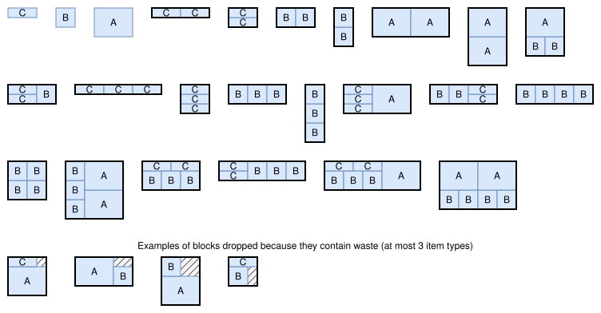
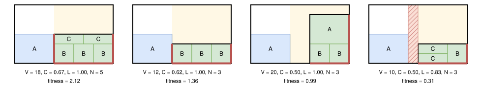
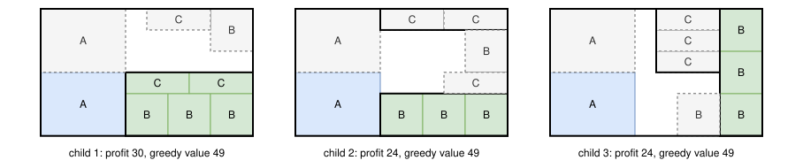

.. _internals_rectangle_tree_search_maximal_spaces:

Tree search with maximal spaces
===============================

Objectives
----------

This algorithm only handles instances with a single bin. It solves the :code:`knapsack` and :code:`feasibility` objectives directly, and the :code:`bin-packing-with-leftovers`, :code:`open-dimension-x` and :code:`open-dimension-y` objectives through the :ref:`sequential feasibility <internals_generic_algorithms_sequential_feasibility>` algorithm, which solves a sequence of :code:`feasibility` sub-problems with this algorithm. It supports the defects, the maximum weight of the bin and the resources, but not the unloading constraints.

Principle
---------

It is a tree search where a *block* of items is packed at each stage, following the approach of Araya, Moyano and Sanchez (2020) and of Guesser, Alves De Queiroz and Miyazawa (2026) for the container loading problem, in two dimensions:

* the blocks, rectangles filled with items, are generated before the search;
* a node stores the *maximal empty spaces* of the bin, the largest empty rectangles;
* to generate the children of a node, the empty space closest to a corner of the bin is selected, and each block fitting in it is placed in the corner of the space closest to this corner of the bin;
* a node is evaluated by completing it greedily.

It is well suited to the instances where many items fit in the bin. Packing these items one by one, as the :ref:`tree search <internals_rectangle_tree_search>` does, requires too many decisions; packing blocks of identical items at once requires much fewer. Unlike in the tree search, an item can also be packed in any empty space of the bin, not only to the right of the items already packed.

The following sections use an example with a bin of size 10 × 6 and three item types, which can't be rotated: A (size 4 × 3, 2 copies, profit 12), B (size 2 × 2, 4 copies, profit 4) and C (size 3 × 1, 3 copies, profit 3).

Effective bin
-------------

Before the search, the lengths that can be reached by stacking items are computed: a length :math:`\ell` is *reachable* along x if it is the total width of a set of items, each one in one of its orientations, without using more copies of an item type than available (this is a subset sum problem, solved by dynamic programming). The same is done along y with the heights.

Since the items of a packing can always be pushed towards the left and the bottom of the bin, the bin can be reduced to the largest reachable lengths not larger than its dimensions without losing any solution. The search is run in this *effective bin*.

Blocks
------

A *block* is a set of items with fixed relative positions, described by its bounding rectangle. The blocks are generated before the search, up to 10000 blocks:

* the **simple blocks**: the grids of :math:`c_x \times c_y` copies of an item type, in one of its orientations, for all the numbers of copies :math:`c_x` and :math:`c_y` such that the grid fits in the bin and doesn't use more copies than available;
* the **combined blocks**: two blocks side by side (the second one to the right of the first one) or one above the other (the second one above the first one).

The blocks to process are kept in a priority list. The blocks of a single item come first; then the blocks are ordered by decreasing *efficiency*, the profit of their items divided by the area of their rectangle; then by increasing number of items. At each step, the first block of the list is removed from the list and combined with each block already generated, in both directions. A combined block is added to the list if:

* it fits in the bin;
* it doesn't use more copies of an item type than available;
* there isn't already a block with the same rectangle and the same numbers of copies of each item type;
* it doesn't exceed the maximum weight of the bin or the capacity of a resource on its own.

Two simple blocks of the same item type and orientation aren't combined: the grids already contain their combinations. Then the block is added to the generated blocks. When the list contains more than 10000 blocks, its last block is removed.

When the instance has at most 3 item types, the blocks containing waste (whose items don't fill their rectangle completely) are dropped when they are removed from the list, instead of being generated and combined.

The figure below shows the 24 blocks generated for the example, in the order in which they are generated, and examples of blocks dropped because they contain waste:

Nodes and maximal spaces
------------------------

A node stores:

* the blocks placed, with their positions;
* the *maximal empty spaces* of the bin: the empty rectangles which aren't contained in another empty rectangle. They may overlap;
* for each item type, its number of copies packed, and the blocks which can still be placed, the *valid* blocks: the ones which don't use more copies than remaining, and don't exceed the maximum weight or the capacity of a resource of the bin given the blocks already placed;
* the number of items packed, their area, their weight, their profit and their resource consumption;
* its *greedy value* (see below).

At the root, the only maximal empty space is the effective bin. The defects of the bin are handled as blocks placed before the search: the maximal empty spaces of the root are the ones of the effective bin minus its defects.

**Update.** When a block is placed, each maximal empty space it overlaps is removed, and replaced by up to four new spaces: the parts of the space to the left of the block, to its right, below it and above it, each one extending over the whole space in the other direction. A new space is only added if it isn't contained in another space. Then the valid blocks are updated, and the spaces in which no valid block fits are removed, since they can't be used anymore.

In the figure below, after placing A in the bottom-left corner, the empty space of the bin is described by 2 maximal spaces (in yellow under the node), which overlap: the space to the right of A, and the space above A. Placing three B on the right of the bin cuts both of them.

.. image:: ../../img/rectangle_tree_search_maximal_spaces_spaces.svg
   :scale: 100%
   :align: center

Children
--------

**Selection of the space.** The children of a node all place a block in the same maximal space: the space closest to a corner of the bin. The distance of a space to the corners of the bin is the distance between its left side and the left side of the bin or between its right side and the right side of the bin, whichever is smaller, plus the same distance along y. Ties are broken by preferring the largest space.

The *anchor corner* is the corner of the selected space on the side of the closest corner of the bin. In the middle of the figure above, both spaces touch two sides of the bin, and the space to the right of A, which is larger, is selected; its anchor corner is its bottom-right corner, since the space touches the right side of the bin but not its left side.

**Insertions.** Each valid block which fits in the selected space (its rectangle is not larger than the space in both directions) is placed in the anchor corner. The candidate insertions are sorted by decreasing *fitness*:

.. math::

   V \times C^\alpha \times L^\beta \times N^{-\gamma}

where:

* :math:`V` is the profit of the block, minus the penalties of the *penalize* resources whose capacity it makes exceeded;
* :math:`C` is the *relative contact* of the block: the length of its sides in contact with the sides of the bin or with the blocks already placed, divided by its perimeter. Sides at a distance smaller than :math:`\delta` times the dimensions of the space or of the block are considered in contact. Blocks fitting tightly are preferred;
* :math:`L` is the *area-loss factor*: the fraction of the area of the space which remains usable after placing the block. In each direction, the length of the space not covered by the block is reduced to the largest length reachable with the remaining items; :math:`L` is the area of the block extended by these lengths, divided by the area of the space. Blocks leaving gaps that no remaining item can fill are penalized;
* :math:`N` is the number of items of the block: the blocks with many items are slightly penalized.

Two sets of parameters are used: :math:`(\alpha, \beta, \gamma, \delta) = (3.70, 2.66, 0.40, 0.014)` while the items packed cover less than 67.4% of the effective bin, and :math:`(2.09, 1.46, 0.47, 0.037)` once they cover more.

The figure below shows candidate insertions in the selected space of the previous figure, with the sides in contact in red. The last block leaves on its left a gap of width 1, which no remaining item can fill (in hatched red): its area-loss factor is :math:`(5 + 0) \times (2 + 4) / (6 \times 6) = 0.83`.

The children are generated one at a time, by decreasing fitness: a node of a queue of size :math:`w` generates at most :math:`w` children (see the :ref:`tree search <internals_tree_search>` page).

Greedy value
------------

A node is evaluated by completing it greedily: from the node, the insertion of best fitness is applied repeatedly, until no block fits in the selected space. The *greedy value* of the node is the profit of this completion.

The figure below shows the first three children of the node of the previous figures (the block they place in green), and their greedy completions (dashed). The three children lead to a completion packing all the items.

The greedy value is used everywhere a node has to be evaluated:

* **Guide.** The nodes with the largest greedy value come first in the queues, then the ones with the largest profit.
* **Solutions.** The greedy completion of a node is a solution: each node is compared to the best solution found through its greedy value, and the solution returned is the greedy completion of the best node.
* **Dominance.** Two nodes with the same number of copies of each item type packed are compared, and the one with the smallest greedy value is dominated. Since the number of items packed doesn't determine the depth of a node, which is its number of blocks, the nodes are compared to the nodes of all the queues (global dominance).
* **Bound.** The nodes are only discarded once a node packing all the items is found. For the :code:`feasibility` objective, the search stops as soon as the greedy completion of a node packs all the items.

Search
------

The tree is explored by the :ref:`iterative beam search <internals_tree_search>` generating the children one at a time, with a growth factor of 2. A single search is run.

In the non-anytime modes, the search is run with a queue of size 1, then with a queue of the size given by the parameter :code:`not_anytime_tree_search_maximal_spaces_queue_size` (16 by default).

Automatic selection
-------------------

With a single bin and the :code:`knapsack` or :code:`feasibility` objective, without unloading constraints, it is run when many items fit in a section of the bin along both directions. See :ref:`algorithm selection <internals_algorithm_selection>`.

It can be forced with :code:`--use-tree-search-maximal-spaces 1` (CLI) or :code:`use_tree_search_maximal_spaces` (Python).

Source files
------------

* :code:`src/rectangle/block.hpp`, :code:`src/rectangle/block.cpp`: the reachable lengths and the blocks
* :code:`src/rectangle/tree_search_maximal_spaces.hpp`, :code:`src/rectangle/tree_search_maximal_spaces.cpp`: the branching scheme and the search
* :code:`scripts/doc_figures/rectangle_tree_search_maximal_spaces.py`, :code:`scripts/doc_figures/rectangle_maximal_spaces_model.py`: the figures of this page

References:

* "A beam search algorithm for the biobjective container loading problem" (Araya, Moyano and Sanchez, 2020)

  * https://doi.org/10.1016/j.ejor.2020.03.040

* "A tree search-based heuristic for the three-dimensional single container loading problem" (Guesser, Alves De Queiroz and Miyazawa, 2026)

  * https://doi.org/10.1016/j.ejor.2026.01.039
