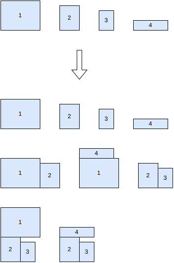
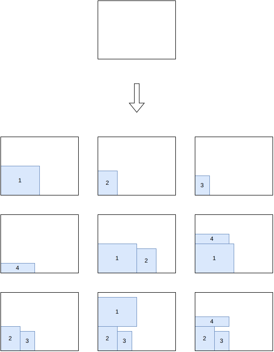
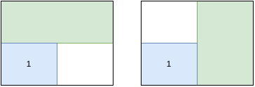
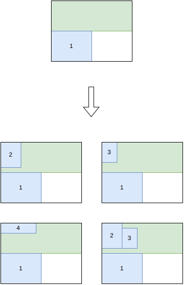

.. _internals_rectangle_tree_search_maximal_spaces:

Tree search with maximal spaces
===============================

Objectives
----------

This algorithm solves the :code:`feasibility` and :code:`knapsack` objectives with a single bin. It doesn't support the unloading constraints and the axle weight constraints.

Principle
---------

It is a tree search where a *block* of items is packed at each stage, following the approach of Araya, Moyano and Sanchez (2020) and of Guesser, Alves De Queiroz and Miyazawa (2026) for the container loading problem, in two dimensions. The empty space of the bin is described by its *maximal empty spaces*, and the blocks are placed in the corners of these spaces.

It is well suited to the instances where many items fit in the bin, where packing them one by one, as the :ref:`tree search <internals_rectangle_tree_search>` does, requires too many decisions.

Blocks
------

A block is a set of items arranged in a guillotine pattern, described by its bounding rectangle. The blocks are generated before the search:

* the *simple* blocks: grids of :math:`c_x \times c_y` copies of an item type, in one of its orientations;
* the combined blocks: two blocks side by side, or one above the other.

The blocks are processed by decreasing fill rate (the area of their items divided by the area of their bounding rectangle), each one being combined with the blocks already generated, up to a maximum number of blocks. Blocks exceeding the maximum weight or the resource capacities of the bin on their own are discarded.

Here is an example of block generation from 4 items:

Branching scheme
----------------

A node stores the blocks placed and the list of the maximal empty rectangles of the bin, the empty rectangles which aren't contained in another empty rectangle. To generate the children of a node, the empty space whose corner is the closest to a corner of the bin is selected; then one child is generated for each remaining block that fits inside it, placed in that corner. The maximal empty rectangles are then updated: each one intersected by the block is split into up to four maximal empty rectangles, and the ones contained in another one are removed.

At the root node, the only maximal empty rectangle is the bin itself, so one child is generated per candidate block, placed in its bottom-left corner:

Placing a block can leave more than one maximal empty rectangle: after placing the block containing item ``1`` in the bottom-left corner, both the strip above it and the strip to its right are maximal empty rectangles, and both are stored in the node:

When generating the children of this node, one of these maximal empty rectangles is selected, and one child is generated per remaining block that fits inside:

Guide
-----

The children of a node are generated by decreasing *fitness* of their insertion:

.. math::

   V \times C^\alpha \times L^\beta \times N^{-\gamma}

where :math:`V` is the profit of the block, :math:`C` its relative contact with the sides of the space and the blocks around it, :math:`L` the *area-loss factor* (the fraction of the area of the space which remains usable after placing the block, given the lengths that can actually be reached by stacking items), and :math:`N` its number of items. Two sets of exponents are used: one while the bin is not filled much, and the other once the fill rate of the node exceeds a threshold.

A node is evaluated by completing it greedily, inserting the block with the best fitness at each step; the beam search keeps the nodes with the best completions.

Automatic selection
-------------------

With a single bin and the :code:`knapsack` or :code:`feasibility` objective, without unloading constraints, it is run when many items fit in a section of the bin along both directions. See :ref:`algorithm selection <internals_algorithm_selection>`.

It can be forced with :code:`--use-tree-search-maximal-spaces 1` (CLI) or :code:`use_tree_search_maximal_spaces` (Python).

Source files
------------

* :code:`src/rectangle/block.hpp`, :code:`src/rectangle/block.cpp`: the blocks
* :code:`src/rectangle/tree_search_maximal_spaces.hpp`, :code:`src/rectangle/tree_search_maximal_spaces.cpp`: the branching scheme and the search

References:

* "A beam search algorithm for the biobjective container loading problem" (Araya, Moyano and Sanchez, 2020)

  * https://doi.org/10.1016/j.ejor.2020.03.040

* "A tree search-based heuristic for the three-dimensional single container loading problem" (Guesser, Alves De Queiroz and Miyazawa, 2026)

  * https://doi.org/10.1016/j.ejor.2026.01.039
