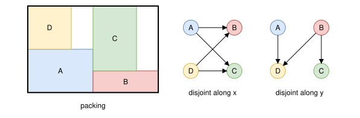
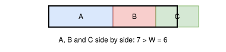

.. _internals_rectangle_tree_search_packing_classes:

Tree search on packing classes
==============================

Objectives
----------

This algorithm solves the :code:`feasibility` objective, for a single bin (one bin type with one copy). It supports the rotations of the items and the eligibilities, but not the defects, the fixed items, the unloading constraints, the maximum weight and the resources.

It is an exact method: it either finds a packing of all the items, or proves that there is none. It is mainly useful to prove infeasibility: its running time doesn't depend on the size of the bin.

Principle
---------

It follows the exact algorithm of Fekete, Schepers and van der Veen (2007), based on the characterization of the packings by *packing classes* (Fekete and Schepers, 2004).

For each axis, the *packing class* of a packing is described by the pairs of items whose projections on the axis overlap. Two items don't overlap iff their projections are disjoint along at least one axis. The search decides, for each axis and each pair of items, whether their projections overlap or are disjoint, but not which item comes first: a packing class represents many packings, and the positions are only computed at the end.

In the figure below, a packing and, for each axis, the graph of the pairs of items whose projections are disjoint along it. Each edge is oriented from the item which comes first along the axis. Every pair is an edge of at least one of the two graphs; B and D are disjoint along both axes.

**Characterization.** Fekete and Schepers (2004) show that the items fit in the bin iff there are, for each axis, a set of pairs of items *disjoint* along it, such that:

* every pair of items is disjoint along at least one axis;
* for each axis, the graph of the pairs disjoint along it is a *comparability graph*: its edges can be oriented transitively (if :math:`a \to b` and :math:`b \to c`, then :math:`a \to c`);
* for each axis, the items of each clique of the graph of the pairs disjoint along it fit side by side in the length of the bin along the axis: the sum of their lengths along the axis is at most the length of the bin.

Given a transitive orientation, the position of an item along the axis is the total length of the longest chain of items before it. Two items disjoint along the axis are ordered by the orientation, so their projections don't overlap; the chains of the orientation are cliques of the graph, so the items fit in the bin.

Conversely, the pairs disjoint along an axis in a packing satisfy these conditions, and the graph of the pairs which overlap along it is then an *interval graph* (the graph of the intersections of the projections of the items). The search only has to consider such packing classes, which allows stronger propagation (see the induced cycles below).

Tree search
-----------

**Nodes.** A node stores, for each axis and each pair of items, the state of the pair: *overlap*, *disjoint* or *unknown*; and the rotation of each item, possibly not fixed yet. The root node has all the pairs unknown. The search is a depth-first search.

**Rotations.** The rotations are fixed first, one item at a time, the largest items first: a node with an item whose rotation is not fixed yet has two children, one for each rotation. Until its rotation is fixed, the length of an item along an axis is its smallest length along it over its rotations.

**Propagation.** At each node, the following rules are applied until none of them changes the states of the pairs:

* two items whose lengths along an axis sum to more than the length of the bin overlap along it;
* two items overlapping along an axis are disjoint along the other one; if they overlap along both axes, the node is infeasible;
* *cliques*: for each axis and each pair not known to overlap along it, a clique of items pairwise disjoint along the axis and containing the pair is built greedily, from the items disjoint from both items of the pair, the longest ones first. If the items of the clique don't fit side by side in the bin, the pair overlaps along the axis (the node is infeasible if it is known to be disjoint);
* *induced cycles*: the graph of the pairs overlapping along an axis is an interval graph, so it contains no induced cycle of length 4. For four items :math:`a, b, c, d`: if :math:`a\text{–}b`, :math:`b\text{–}c` and :math:`c\text{–}d` overlap and both chords :math:`a\text{–}c` and :math:`b\text{–}d` are disjoint, then :math:`d\text{–}a` is disjoint; if the four sides overlap and a chord is disjoint, the other chord overlaps.

**Obstructions.** Once the rotations are fixed, the pairs not known to overlap along an axis are considered disjoint along it, and the algorithm looks for an *obstruction*: a set of these pairs which can't all be disjoint along the axis, so that at least one of them overlaps:

* the graph of these pairs is not a comparability graph: an *implication class* of the graph contains an edge in both directions (Golumbic, 1980). The edges p → q and p → w are in the same class if q and w are not adjacent, and the edges p → q and w → q too if p and w are not adjacent. The obstruction is the set of pairs from which the contradiction is derived;
* otherwise, the graph is oriented transitively (Golumbic, 1980) and the longest chain of the orientation doesn't fit in the length of the bin. The obstruction is the set of pairs of the items of the chain.

In the figure below, A, B and C are pairwise not known to overlap along x, but their widths sum to more than the width of the bin: one of the pairs A–B, A–C and B–C overlaps along x.

The x-axis is checked first. If no axis has an obstruction, the pairs considered disjoint form a valid packing class: the positions of the items are given by the longest chains of the orientations, and the packing is the solution.

**Branching.** If every pair of the obstruction is already known to be disjoint, the node is infeasible. If only one of its pairs is unknown, it overlaps, and the node is processed again without branching. Otherwise, the unknown pair of the obstruction whose lengths along the other axis take the largest fraction of the bin is chosen (along the other axis, the pair is then disjoint, so this is the most constrained choice), and the node has two children: one where the pair overlaps along the axis (explored first), and one where it is disjoint.

**Symmetries.** Two items are *indistinguishable* in a node if they have the same lengths and the same states with all the other items. In the child where the chosen pair is disjoint, the pairs made of items indistinguishable from the items of the chosen pair are disjoint too: a packing class where one of them overlaps is isomorphic to one where the chosen pair overlaps, which is explored in the other child (Fekete, Schepers and van der Veen, 2007, Lemma 8).

Strengths and weaknesses
------------------------

The search reasons on the relative positions of the items, not on their coordinates, so its size doesn't depend on the size of the bin. It is efficient when the infeasibility comes from the interactions between the items in two dimensions.

It has no reasoning on the coordinates of the items until the packing class is complete. When the infeasibility comes from the lengths of the items, which can't be combined to fill the bin along an axis, it may explore many nodes. The :ref:`Benders decomposition with contiguity <internals_rectangle_benders_decomposition_contiguity>`, whose master problem decides the x-positions of the items, is then often faster; both algorithms are run in parallel in the :code:`exact` mode.

Automatic selection
-------------------

In the :code:`exact` mode, it is run for the :code:`feasibility` objective with a single bin, alongside the other algorithms. It can be selected with :code:`--use-tree-search-packing-classes 1` (CLI) or :code:`use_tree_search_packing_classes` (Python).

It can also be used to solve the subproblems of the :ref:`Benders decomposition <internals_rectangle_benders_decomposition>`, with :code:`--benders-decomposition-subproblem-use-tree-search-packing-classes 1` (CLI) or :code:`benders_decomposition_subproblem_use_tree_search_packing_classes` (Python).

Source files
------------

* :code:`src/rectangle/tree_search_packing_classes.hpp`, :code:`src/rectangle/tree_search_packing_classes.cpp`: the algorithm
* :code:`scripts/doc_figures/rectangle_tree_search_packing_classes.py`: the figures of this page

References:

* "A Combinatorial Characterization of Higher-Dimensional Orthogonal Packing" (Fekete and Schepers, 2004)

  * https://doi.org/10.1287/moor.1030.0079

* "An Exact Algorithm for Higher-Dimensional Orthogonal Packing" (Fekete, Schepers and van der Veen, 2007)

  * https://doi.org/10.1287/opre.1060.0369

* "Algorithmic Graph Theory and Perfect Graphs" (Golumbic, 1980)
