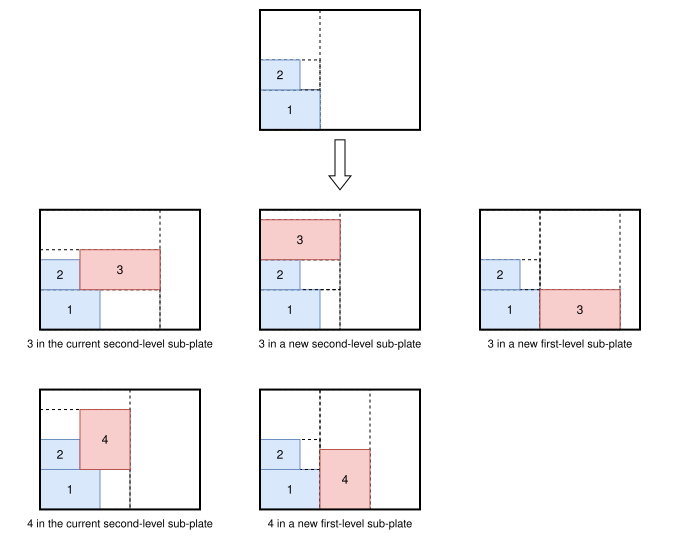
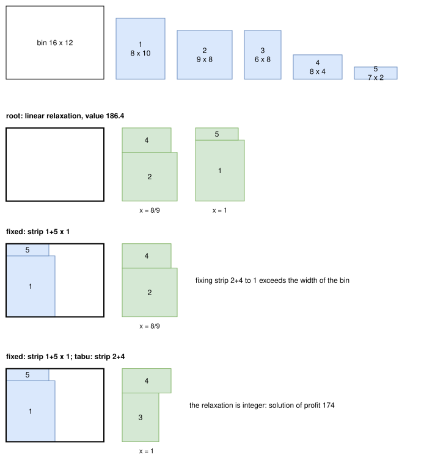
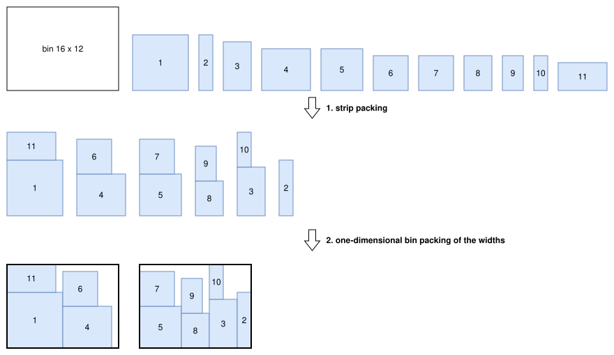
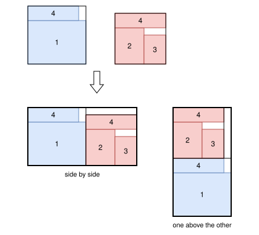
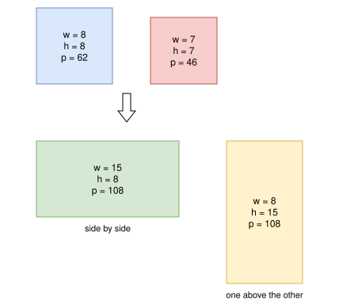

.. _internals_rectangleguillotine:

:code:`rectangle-guillotine` algorithms
=======================================

See :ref:`rectangleguillotine<rectangleguillotine>` for the input/output format and CLI usage of this solver.

Tree search
------------

This algorithm solves the :code:`feasibility`, :code:`knapsack`, :code:`open-dimension-x`, :code:`open-dimension-y`, :code:`bin-packing`, :code:`bin-packing-with-leftovers` and :code:`bin-packing-cutting-cost` objectives.

It generates 2- and 3-staged guillotine patterns.

It is a tree search algorithm where a single item is packed at each stage. The root node is an empty partial solution (no item packed). Given a node, a child node is generated for each feasible insertion of each unpacked item.

The possible insertions for an unpacked item are:

* In the current second-level sub-plate, in a new third-level sub-plate
* In the current first-level sub-plate, in a new second-level sub-plate
* In the same bin, in a new first-level sub-plate
* In a new bin

The positions of the items are fixed once they are inserted, but the positions of the cuts might change when other items get inserted.

See :doc:`the detailed description <rectangleguillotine/tree_search>`.

Tree search with maximal spaces
----------------------------------

This algorithm solves the :code:`feasibility` and :code:`knapsack` objectives, and, through sequential feasibility, the :code:`open-dimension-x`, :code:`open-dimension-y` and :code:`bin-packing-with-leftovers` objectives, with a single bin.

It generates unlimited-staged guillotine patterns.

It is a tree search algorithm where a block of items is packed at each stage, in the unused spaces of the bin, which are the leaves of the cut tree of the pattern and never overlap.

.. image:: ../img/rectangleguillotine_tree_search_maximal_spaces_root_children.svg
   :align: center

See :doc:`the detailed description <rectangleguillotine/tree_search_maximal_spaces>`.

Column generation strips
---------------------------

This algorithm solves the :code:`knapsack`, :code:`open-dimension-x` and :code:`open-dimension-y` objectives.

It generates k-staged guillotine patterns. It is fast when k = 2. When k >= 4, it becomes impractical.

It is a tree search algorithm where a whole strip is packed at each stage. Contrary to the tree search maximal spaces algorithm, the strips are not generated beforehand, but dynamically in the nodes through column generation.

See :doc:`the detailed description <rectangleguillotine/column_generation_strips>`.

Sequential strips / one-dimensional
---------------------------------------

This algorithm solves the :code:`bin-packing` and :code:`bin-packing-with-leftovers` objectives.

It is a two-phase heuristic: it first generates strips containing all the items by solving a strip packing problem, then groups the strips into bins by solving a one-dimensional bin packing problem.

See :doc:`the detailed description <rectangleguillotine/sequential_strips_onedimensional>`.

Tree search hypergraph
-------------------------

This algorithm solves the :code:`feasibility` and :code:`knapsack` objectives exactly.

It generates unlimited-staged guillotine patterns.

This is a kind of tree search algorithm, but instead of generating children from one parent node, children are generated from two parent nodes: two blocks are combined either side by side or one above the other. The blocks are processed best first, guided by a dynamic programming bound, until the best block is proven optimal.

See :doc:`the detailed description <rectangleguillotine/tree_search_hypergraph>`.

Tree search hypergraph with infinite copies
-------------------------------------------

This algorithm solves the :code:`feasibility` and :code:`knapsack` objectives.

It generates unlimited-staged guillotine patterns.

This algorithm works the same way as the tree search hypergraph algorithm, except that the item type quantities are not taken into account, so it can be solved by dynamic programming. Therefore, it is very fast, and it gives a bound, but the generated solution might be infeasible regarding the available number of item copies.

See :doc:`the detailed description <rectangleguillotine/tree_search_hypergraph_infinite_copies>`.

Dual feasible functions
-------------------------

This algorithm computes a bound for the :code:`bin-packing` objective.

See :ref:`rectangle <internals_rectangle_dual_feasible_functions>`

.. toctree::
   :maxdepth: 1
   :hidden:

   rectangleguillotine/tree_search
   rectangleguillotine/tree_search_maximal_spaces
   rectangleguillotine/column_generation_strips
   rectangleguillotine/sequential_strips_onedimensional
   rectangleguillotine/tree_search_hypergraph
   rectangleguillotine/tree_search_hypergraph_infinite_copies
