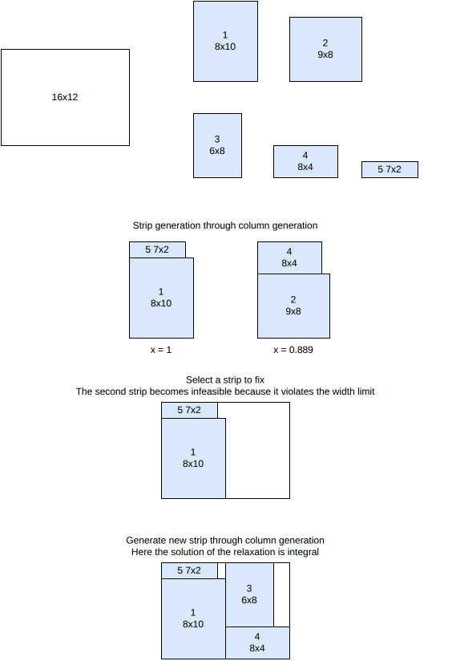

.. _internals_rectangleguillotine_column_generation_strips:

Column generation strips
========================

Objectives
----------

This algorithm solves the :code:`knapsack`, :code:`open-dimension-x` and :code:`open-dimension-y` objectives, with a single bin.

It generates k-staged guillotine patterns. It is fast when k = 2. When k >= 4, it becomes impractical. It doesn't support the defects, the stacks, the minimum waste length and the maximum numbers of cuts.

Principle
---------

A k-staged pattern is made of first-level sub-plates, the *strips*, placed side by side, each one being a (k-1)-staged pattern. The algorithm chooses the strips by solving a Dantzig-Wolfe reformulation of the problem, where a variable is a strip, by column generation. Contrary to the tree search with maximal spaces algorithm, the strips are not generated beforehand, but dynamically, by the pricing problem.

Here is an illustration of the algorithm:

Model
-----

**Input**:

* a bin of width :math:`W`
* item types :math:`j = 1, \ldots, n`; for each item type :math:`j`: a profit :math:`p_j`, a width :math:`w_j` and a number of copies :math:`q_j`
* a set :math:`K` of feasible strips; for each strip :math:`k \in K`, :math:`x_j^k` is the number of copies of item type :math:`j` it contains

**Variables**:

* :math:`y^k \in \{0, \ldots, q^{\max}\}`, :math:`k \in K`: number of times strip :math:`k` is used

**Objective**: maximize the total profit of the packed items

.. math::

   \max \sum_{k} \Big( \sum_{j} p_j \, x_j^k \Big) y^k

**Constraints**:

* Bin width: the strips selected must fit side by side in the bin

.. math::

   \sum_{k} \Big( \max_{j} w_j x_j^k \Big) y^k \le W

* Item demand: each item type used at most :math:`q_j` times

.. math::

   \forall j \qquad \sum_{k} x_j^k \, y^k \le q_j

For the open dimension objectives, the width of the strips is minimized instead, all the items being packed.

Pricing problem
---------------

The pricing problem consists in finding a strip of negative reduced cost

.. math::

   rc(y^k) = \Big( \max_{j} w_j x_j^k \Big) u + \sum_{j} x_j^k v_j - \sum_{j} p_j x_j^k

where :math:`u` and :math:`v_j` are the dual variables of the bin width and item demand constraints. For a given strip width :math:`w`, the best strip is a (k-1)-staged guillotine knapsack problem in a :math:`w \times H` rectangle, where the profit of an item type is :math:`p_j - v_j`. It is solved for the strip widths from the largest available one downwards, keeping the strips of positive reduced profit:

* **One-staged strips** (base cases, used for 2-staged patterns and, inside higher-staged ones, for their last stage): a strip whose items are stacked one above the other is a one-dimensional knapsack problem along the height of the strip, solved with the :ref:`onedimensional <internals_onedimensional>` algorithms. With the :code:`exact` cut type, the items have exactly the width of the strip; with the :code:`non-exact` and :code:`roadef2018` cut types, they may be narrower (the waste on their right is trimmed); with the :code:`roadef2018` cut type and oriented items, two items of the same width may share a level.
* **Two-staged homogeneous strips**, for 3-staged patterns: a strip made of identical items.
* **Recursion.** Only if none of the strips above has a positive reduced profit, the (k-1)-staged knapsack problem of each strip width is solved with the rectangleguillotine algorithms themselves, which may run this algorithm again. A strip width is skipped when an upper bound on the reduced profit of its strips (the sum of the reduced profits of the items fitting in it) can't make it improving.

**Enumeration.** When there are few of them, all the strips of a type are enumerated before the column generation (one-staged :code:`roadef2018` strips, two-staged homogeneous strips, two-staged :code:`exact`, :code:`non-exact` and :code:`roadef2018` strips, three-staged homogeneous strips), and the corresponding pricing problems are then skipped. Each strip generated is also a solution on its own (the rest of the bin being waste), and is reported as such.

The first pricing problem is solved with the dual values set to 0, which gives the strips of largest profit. Since the pricing problems stop early when the time is up, the bound of the column generation (the value of the linear program plus the number of items times the best reduced cost found) is only used when all of them were solved.

Search
------

The column generation gives the linear relaxation of the model, which is a bound: a profit bound for the :code:`knapsack` objective, a width bound for the open dimension objectives. Integer solutions are found by the limited discrepancy search of `columngenerationsolver <https://github.com/fontanf/columngenerationsolver>`_: at each node, a strip of the linear solution is fixed, and the column generation is run again on the residual problem; the nodes deviating from the rounding of the linear solution are explored by increasing number of deviations. In anytime mode, the search goes on until the time limit; in the non-anytime modes, it stops by itself.

**Orientation.** The strips are vertical (first-level sub-plates side by side along x). For horizontal first-level cuts, the algorithm is run on the instance where the x and y axes are exchanged. When the orientation of the first stage is free, both are run in parallel.

Automatic selection
-------------------

With a single bin, it is run for the :code:`knapsack` and open dimension objectives with 2-staged patterns, or 3-staged homogeneous ones, and none of the features it doesn't support. It is also used by the :ref:`sequential strips / one-dimensional <internals_rectangleguillotine_sequential_strips_onedimensional>` algorithm. See :ref:`algorithm selection <internals_algorithm_selection>`.

It can be forced with :code:`--use-column-generation-strips 1` (CLI) or :code:`use_column_generation_strips` (Python).

Source files
------------

* :code:`src/rectangleguillotine/column_generation_strips.hpp`, :code:`src/rectangleguillotine/column_generation_strips.cpp`
