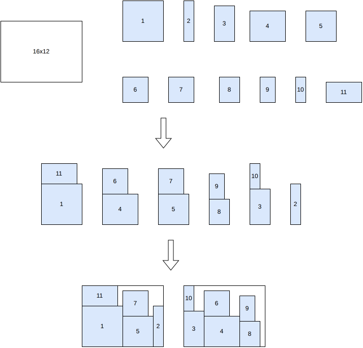

.. _internals_rectangleguillotine_sequential_strips_onedimensional:

Sequential strips / one-dimensional
===================================

Objectives
----------

This algorithm solves the :code:`bin-packing` and :code:`bin-packing-with-leftovers` objectives, with a single bin type.

Principle
---------

It is a two-phase heuristic:

1. Generate a set of strips by solving a strip packing problem: pack all the items in a strip of the height of the bin, minimizing its total width. It is solved with the :ref:`column generation strips <internals_rectangleguillotine_column_generation_strips>` algorithm, with the :code:`open-dimension-x` objective.
2. Solve a :ref:`one-dimensional <internals_onedimensional>` bin packing problem where each strip becomes an item, its width being its length, and each bin becomes a one-dimensional bin, its width being its length. It decides how the strips are grouped into bins.

The solution is then built by placing, in each bin, the strips assigned to it side by side.

Contrary to the tree search with maximal spaces algorithm and to the column generation strips algorithm, the strips generated contain exactly all the items.

The strips of the first phase are chosen to minimize the total width, not to be grouped well into bins, so the result is a heuristic solution.

Automatic selection
-------------------

It is not part of the automatic selection. It can be selected with :code:`--use-sequential-strips-onedimensional 1` (CLI) or :code:`use_sequential_strips_onedimensional` (Python).

Source files
------------

* :code:`src/rectangleguillotine/sequential_strips_onedimensional.hpp`, :code:`src/rectangleguillotine/sequential_strips_onedimensional.cpp`
