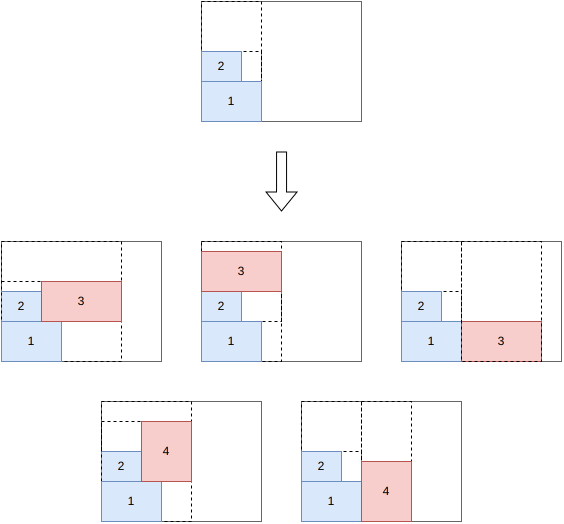

.. _internals_rectangleguillotine_tree_search:

Tree search
===========

Objectives
----------

This algorithm solves the :code:`feasibility`, :code:`knapsack`, :code:`open-dimension-x`, :code:`open-dimension-y`, :code:`bin-packing`, :code:`bin-packing-with-leftovers` and :code:`bin-packing-cutting-cost` objectives.

It generates 2-staged and 3-staged guillotine patterns, and supports all the features of the :code:`rectangleguillotine` problem type: the cut types, the defects, the stacks, the trims, the cut thickness, the minimum waste length, the minimum and maximum distances between cuts, the maximum numbers of cuts, and the cutting costs.

Principle
---------

It is a constructive tree search. A pattern is described by its cuts: the first-level cuts split the bin into first-level sub-plates, the second-level cuts split a first-level sub-plate into second-level sub-plates, and the third-level cuts split a second-level sub-plate into third-level sub-plates. At each stage, a new third-level sub-plate is filled, either:

* in the current second-level sub-plate;
* in the current first-level sub-plate, in a new second-level sub-plate;
* in the current bin, in a new first-level sub-plate;
* in a new bin.

The third-level sub-plate contains a single item at its bottom (with possibly some waste above), a single item at its top (when it would intersect a defect at the bottom), two items of the same width one above the other, or no item (to skip a defect).

The positions of the items are fixed once they are inserted, but the positions of the cuts may change when other items get inserted: a new item taller than the current second-level sub-plate moves its 2-cut up, and a new item wider than the current first-level sub-plate moves its 1-cut to the right. The node keeps, for each cut, the farthest position it can be moved to without intersecting a defect, and the insertions which would require moving a cut beyond it are discarded.

The orientation of the first-level cuts (vertical or horizontal) is given by the parameters; when it is free and there is a single bin type, both orientations are searched separately.

Stacks
------

The items of a stack must be cut in a given order. An item can only be inserted if all the items before it in its stack are already packed.

Guides
------

The guide of a node estimates the quality of the partial solution; the beam search keeps the nodes with the smallest guides.

* Guide 0: current area (the area of the bins used so far, up to the current cuts) divided by the area of the items packed.
* Guide 1: waste rate divided by the mean area of the items packed.
* Guides 4 and 5: current area divided by the profit of the items packed (and by their area for guide 5).
* Guides 9 and 10: cutting cost divided by the area of the items packed, for the :code:`bin-packing-cutting-cost` objective.

By default, guides 4 and 5 are used for the :code:`knapsack` objective, guides 9 and 10 for the :code:`bin-packing-cutting-cost` objective, and guides 0 and 1 for the other objectives.

Search
------

In anytime mode, an iterative beam search is run for each pair (guide, first-stage orientation), in parallel. Each one starts with a beam of size 1, and the size of the beam is multiplied by a growth factor at each restart; when there are at most two pairs, each one is run with two growth factors, 1.33 and 1.5. When the beam search explores the whole tree, the solution found is proven optimal (or the instance proven infeasible).

In the non-anytime modes, a single beam search is run for each pair, with a beam of a given size.

Automatic selection
-------------------

It is the default algorithm for the instances whose features or numbers of stages are not supported by the other algorithms, and, with several bins, for the instances where the item types have few copies compared to the number of items fitting in a bin. See :ref:`algorithm selection <internals_algorithm_selection>`.

It can be forced with :code:`--use-tree-search 1` (CLI) or :code:`use_tree_search` (Python).

Source files
------------

* :code:`src/rectangleguillotine/tree_search.hpp`, :code:`src/rectangleguillotine/tree_search.cpp`
