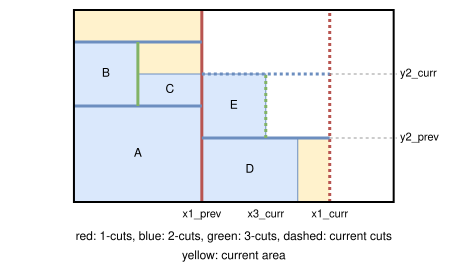
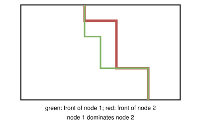

.. _internals_rectangleguillotine_tree_search:

Tree search
===========

Objectives
----------

This algorithm solves the :code:`feasibility`, :code:`knapsack`, :code:`open-dimension-x`, :code:`open-dimension-y`, :code:`bin-packing`, :code:`bin-packing-with-leftovers` and :code:`bin-packing-cutting-cost` objectives.

It generates 2-staged and 3-staged guillotine patterns, and supports all the features of the :code:`rectangleguillotine` problem type: the cut types, the defects, the stacks, the trims, the cut thickness, the minimum waste length, the minimum and maximum distances between cuts, the maximum numbers of cuts, the cutting costs and the resources.

Principle
---------

It is a constructive tree search. A pattern is described by its cuts: the 1-cuts split the bin into first-level sub-plates, the 2-cuts split a first-level sub-plate into second-level sub-plates, and the 3-cuts split a second-level sub-plate into third-level sub-plates, which contain the items. In the following, the 1-cuts are vertical; with horizontal 1-cuts, the algorithm is the same on the instance where the x and y axes are exchanged.

At each stage, a new third-level sub-plate is filled, either:

* in the current second-level sub-plate, to the right of the last third-level sub-plate;
* in the current first-level sub-plate, in a new second-level sub-plate, above the last one;
* in the current bin, in a new first-level sub-plate, to the right of the last one;
* in a new bin.

The figure below shows a node (top) and its children of the first three kinds inserting the items 3 and 4 (bottom); the dashed lines are the first- and second-level sub-plates, which grow to contain the new item. Item 4 doesn't fit in a new second-level sub-plate:

.. image:: ../../img/rectangleguillotine_tree_search_children.svg
   :align: center

A third-level sub-plate contains a single item at its bottom (with possibly some waste above it), a single item at its top (when it would intersect a defect at the bottom), two items of the same width one above the other (with the :code:`roadef2018` cut type), or no item (to skip a defect).

The positions of the items are fixed once they are inserted, but the positions of the *current* cuts, the right side of the current first-level sub-plate, the top of the current second-level sub-plate and the right side of the current third-level sub-plate, may still move when other items are inserted: an item taller than the current second-level sub-plate moves its 2-cut up, and an item wider than the current first-level sub-plate moves its 1-cut to the right.

**Two stages.** A 2-staged pattern is handled as a 3-staged pattern with a single first-level sub-plate covering the whole bin, whose 2-cuts play the role of the 1-cuts: the orientation of the cuts, the minimum and maximum distances between cuts, and the maximum numbers of cuts are shifted by one level.

**Orientation of the 1-cuts.** It is given by the parameters. When it is free and there is a single bin type, both orientations are searched in separate searches; with several bin types, it is chosen for each new bin, both orientations giving children.

**Order of the bins.** The bins are opened in a fixed order: in the order in which they appear in the instance, or by increasing area for the :code:`knapsack` objective.

Nodes
-----

A node stores:

* its parent, the items it inserted and its insertion, from which the solution is rebuilt at the end;
* the number of bins used, and the orientation of the 1-cuts of the current bin;
* its *front*: the positions :math:`x_1^{prev}` of the last closed 1-cut, :math:`x_1^{curr}` of the current 1-cut, :math:`y_2^{prev}` of the last closed 2-cut, :math:`y_2^{curr}` of the current 2-cut and :math:`x_3^{curr}` of the current 3-cut;
* for the current cuts, whether they can still be moved by any length, or only by at least the minimum waste length, or not at all, and the farthest positions they can be moved to (because of the defects and of the maximum distances between cuts);
* the items placed on top of their third-level sub-plate in the current second-level sub-plate, which move with its 2-cut;
* for each stack, the number of its items packed;
* the number of items packed, their area and their profit, the numbers and lengths of the cuts of each stage, the cutting cost and the resource consumption of the current bin.

**Current area and waste.** The *current area* of a node (in yellow above) is the area that the next items can't use anymore: the area of the bins before the current one, plus the area of the current bin to the left of :math:`x_1^{prev}`, plus the area of the current first-level sub-plate below :math:`y_2^{prev}`, plus the area of the current second-level sub-plate to the left of :math:`x_3^{curr}`:

.. math::

   A_{prev} + x_1^{prev} H + (x_1^{curr} - x_1^{prev}) \, y_2^{prev} + (x_3^{curr} - x_1^{prev}) (y_2^{curr} - y_2^{prev})

Once all the items are packed, it is the area of the bins before the current one plus :math:`x_1^{curr} H`. The *waste* of a node is its current area minus the area of the items packed.

Children
--------

**Items.** The items of an item type are organized in *stacks*, and an item can only be inserted once all the items before it in its stack are packed: only the next item of each stack is a candidate. When two stacks contain identical item types in the same order, the second one can't get ahead of the first one. Each candidate item is tried in each of its allowed orientations, at the bottom-left corner of the new third-level sub-plate:

* it must fit in the bin, minus its trims;
* with the :code:`homogenous` cut type, it must have the same item type as the other items of the second-level sub-plate;
* if it intersects a defect, or if the cut above it intersects a defect: with the :code:`roadef2018` and :code:`non-exact` cut types, it is placed on top of its third-level sub-plate instead, above at least the cut thickness and the minimum waste length; with the other cut types, the insertion is discarded.

With the :code:`exact` and :code:`homogenous` cut types, the third-level sub-plates contain no waste above their item: the 2-cut is fixed at the top of the first item of the second-level sub-plate, and the next items of the second-level sub-plate must have the same height. With the :code:`roadef2018` cut type, two items of the same width can also be inserted one above the other.

**Defects.** A third-level sub-plate can also contain no item, to skip a defect: it then extends to the right of (or above) the defect. Such a node is never kept as it is: its children replace it among the children of its parent.

**Positions of the cuts.** Then the positions of the cuts are updated, and the insertion is discarded if no valid position exists:

* the current cuts only move outwards: the 1-cut to the right of the new item, the 2-cut above it;
* when a cut moves, it must move by at least the cut thickness plus the minimum waste length, so that the waste created is not too small;
* the distances between consecutive 1-cuts (resp. 2-cuts) must be at least the minimum distance between 1-cuts (resp. 2-cuts); when the maximum number of 1-cuts (resp. 2-cuts) is reached, the current sub-plate extends to the end of the bin;
* unless cutting through defects is allowed, a cut can't cross a defect: it is moved to the right of (or above) the defect; the items on top of their third-level sub-plate move with the 2-cut, and must not intersect a defect either;
* the cuts can't go beyond the farthest positions allowed by the maximum distances between cuts and by the defects, nor beyond the hard trims; the soft trims may be used by the last sub-plates;
* the capacities of the resources of the bin must not be exceeded (a *penalize* resource never discards an insertion; its penalty is subtracted from the profit instead).

**Restricting the children.** A new second-level sub-plate is only opened if no item fits in the current second-level sub-plate without moving its cuts; a new first-level sub-plate is only opened if no item fits in the current first-level sub-plate without moving its 1-cut; a new bin is only opened if no item fits in the current bin. Among the children of a node, a child whose front dominates the front of another child with the same items (see below) discards it.

Guides
------

The guides compare the current area of a node to the area or to the profit of its items. With :math:`A_c` the current area, :math:`A` the area of the items packed, :math:`P` their profit, :math:`n` their number, :math:`r` the waste rate :math:`(A_c - A) / A_c` (replaced by :math:`0.01 + r / 2` when it is below 0.02) and :math:`C` the cutting cost:

.. list-table::
   :header-rows: 1
   :widths: 1 2 4

   * - Guide
     - Value
     - Idea
   * - 0
     - :math:`A_c / A`
     - Little consumed area per area packed.
   * - 1
     - :math:`r / A \times n`
     - Little waste, favoring the large items.
   * - 4
     - :math:`A_c / P`
     - Little consumed area per profit packed.
   * - 5
     - :math:`A_c / P / A \times n`
     - Same, favoring the large items.
   * - 9
     - :math:`C / A`
     - Little cutting cost per area packed.
   * - 10
     - :math:`C / A / A \times n`
     - Same, favoring the large items.

By default, guides 4 and 5 are used for the :code:`knapsack` objective, guides 9 and 10 for the :code:`bin-packing-cutting-cost` objective, and guides 0 and 1 for the other objectives.

Solutions and bounds
--------------------

**Solutions.** Each node generated is compared to the best solution found so far:

* :code:`knapsack` and :code:`feasibility`: any node is a solution, compared by profit;
* :code:`bin-packing`: the leaves (all the items packed), compared by number of bins;
* :code:`bin-packing-with-leftovers`: the leaves, compared by waste, then by the area of the second leftover (the part of the last first-level sub-plate above the items);
* :code:`open-dimension-x` and :code:`open-dimension-y`: the leaves, compared by length used;
* :code:`bin-packing-cutting-cost`: the leaves, compared by cutting cost: the cost of the bins, of the cuts and of the waste.

**Bounds.** A node is discarded if it can't lead to a better solution than the best one found:

* :code:`bin-packing`: the area of all the items plus the waste of the node must fit in the bins, in their order; if the bins needed are at least as many as in the best solution, the node is discarded;
* :code:`bin-packing-with-leftovers`: if its waste is larger than the waste of the best solution;
* :code:`knapsack`: if the profit of the node plus the remaining area of the bins times the largest profit per area of the item types (or the total profit, if the remaining items fit in the remaining area) isn't larger than the profit of the best solution;
* :code:`open-dimension-x` and :code:`open-dimension-y`: the length used is at least the current 1-cut, and at least the area of all the items plus the waste of the node, divided by the height of the bin;
* :code:`bin-packing-cutting-cost`: if its cutting cost is at least the cutting cost of the best solution;
* :code:`feasibility`: once a solution packing all the items is found.

Dominance
---------

Two nodes with the same number of items packed in each stack can be compared, unless one of them just skipped a defect. Node 1 dominates node 2 if its cutting cost isn't larger (for the :code:`bin-packing-cutting-cost` objective), if the resource consumption of its current bin isn't larger when both are in the same bin, and if its front dominates the front of node 2:

* node 1 is in an earlier bin; or
* both are in the same bin, with the same orientation of the 1-cuts, and the front of node 1 is nowhere beyond the front of node 2: for example, :math:`x_1^{curr}` of node 1 is not larger than :math:`x_1^{prev}` of node 2, or the five positions of the front of node 1 are not larger than the ones of node 2 (with special cases when the current second-level sub-plate reaches the top of the bin).

Search
------

The tree is explored by the :ref:`iterative beam search <internals_tree_search>`, which generates all the children of a node at once. The depth of a node is its number of items packed.

In anytime mode, an iterative beam search is run for each pair (guide, orientation of the 1-cuts), in parallel. When there are at most two pairs, each one is run twice, with the growth factors 1.33 and 1.5; otherwise, the growth factor is 1.5. In the non-anytime modes, each search is run with a queue of size 1, then with a queue of the size given by the parameter :code:`not_anytime_tree_search_queue_size` (2048 by default).

Automatic selection
-------------------

It is the default algorithm for the instances whose features or numbers of stages are not supported by the other algorithms, and, with several bins, for the instances where the item types have few copies compared to the number of items fitting in a bin. See :ref:`algorithm selection <internals_algorithm_selection>`.

It can be forced with :code:`--use-tree-search 1` (CLI) or :code:`use_tree_search` (Python).

Source files
------------

* :code:`src/rectangleguillotine/tree_search.hpp`, :code:`src/rectangleguillotine/tree_search.cpp`
* :code:`scripts/doc_figures/rectangleguillotine_tree_search.py`: the figures of the front and of the dominance
