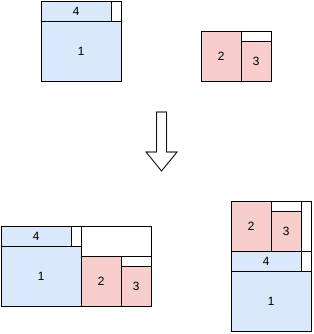

.. _internals_rectangleguillotine_tree_search_hypergraph:

Tree search hypergraph
======================

Objectives
----------

This algorithm solves the :code:`feasibility` and :code:`knapsack` objectives, with a single bin.

It generates guillotine patterns with an unlimited number of stages. It only considers the first bin type, and doesn't support the defects, the stacks, the minimum waste length, the minimum and maximum distances between cuts, the maximum numbers of cuts and a limited number of stages.

It is an exact method: when it stops before the time limit, the solution found is optimal.

Principle
---------

It is a kind of tree search, but instead of generating children from one parent node, children are generated from two parent nodes. A node is a *block*: a guillotine pattern, with the tight bounding box of its items. The initial blocks are the items alone. For two given blocks, two child blocks are generated by combining them side by side (a vertical cut) or one above the other (a horizontal cut); the bounding box of the combination takes the maximum of the two blocks along the other axis, so the blocks don't need to have matching dimensions. A combination is only valid if it doesn't use more copies of an item type than available.

This is similar to the block generation step of the tree search with maximal spaces algorithm. In the tree search with maximal spaces algorithm, the block generation stops once enough blocks have been generated; in this algorithm, it stops when the block generated is proven to be an optimal solution.

Bound
-----

The blocks are processed best first, by decreasing *potential*: the profit of the block plus an upper bound on the profit that can be packed in the rest of the bin around it. This bound is computed beforehand, for every width and height, by dynamic programming:

* :math:`\text{dp}(w, h)` is the best profit of a guillotine pattern in a :math:`w \times h` rectangle, ignoring the numbers of copies of the item types (any number of copies is allowed);
* :math:`\text{rdp}(w, h)` is the best profit which can be packed in the rest of the bin when a :math:`w \times h` rectangle is placed in it, computed backwards from the full bin: the bin can be obtained from the :math:`w \times h` rectangle by successive guillotine cuts, and each cut adds a rectangle worth :math:`\text{dp}` of its dimensions.

Since the numbers of copies are ignored, :math:`\text{profit} + \text{rdp}(w, h)` is an upper bound on the profit of any pattern containing the block. The algorithm stops as soon as no block remaining in the queue has a potential larger than the profit of the best pattern found, which is then optimal. The dynamic programs are computed on the bin minus its trims.

Search
------

* **Initial blocks.** One block per item type and per allowed orientation, containing a single item.
* **Queue.** The blocks to process are stored in 2000 buckets, the bucket :math:`k` containing the blocks whose potential is between :math:`0.99^{k+1} U` and :math:`0.99^k U`, where :math:`U = \text{dp}(W, H)` is the bound of the whole bin. The buckets are processed by decreasing potential, and the blocks of a bucket in the reverse order of their insertion: the order is best first up to 1%. When the upper limit :math:`0.99^k U` of the next bucket isn't larger than the profit of the best pattern found, no remaining block can improve it, and the search stops.
* **Combinations.** A block taken from the queue is skipped if its potential isn't larger than the profit of the best pattern found anymore, or if a block with the same dimensions and the same numbers of copies of each item type has already been processed. Otherwise, it is combined with each block already processed, itself included, side by side and one above the other. A combination is discarded if it doesn't fit in the bin, if its potential isn't larger than the profit of the best pattern found, or if it uses more copies of an item type than available.
* **Solutions.** Each combination whose profit is larger than the profit of the best pattern found becomes the new best pattern. The pattern is rebuilt from the cut tree of the block, with additional cuts trimming the waste when a block is smaller than the space it is placed in.

Automatic selection
-------------------

It is not part of the automatic selection. It can be selected with :code:`--use-tree-search-hypergraph 1` (CLI) or :code:`use_tree_search_hypergraph` (Python).

Source files
------------

* :code:`src/rectangleguillotine/tree_search_hypergraph.hpp`, :code:`src/rectangleguillotine/tree_search_hypergraph.cpp`
