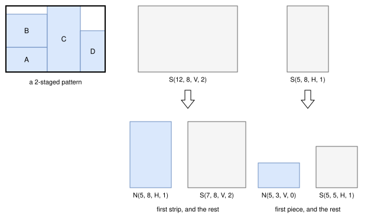
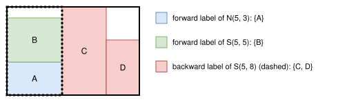

.. _internals_rectangleguillotine_tree_search_hypergraph:

Tree search hypergraph
======================

Objectives
----------

This algorithm solves the :code:`feasibility` and :code:`knapsack` objectives, with a single bin, exactly.

It generates guillotine patterns with any number of stages, or an unlimited number of stages, with the :code:`non-exact`, :code:`exact` and :code:`roadef2018` cut types (any cut type with an unlimited number of stages) and any orientation of the first stage. It supports the cut thickness, the rotations of the items, the hard trims, the soft right and top trims, and the resources. It doesn't support the defects, the stacks, the minimum waste length, the minimum and maximum distances between cuts, the maximum numbers of cuts, the soft left and bottom trims, and the :code:`homogenous` cut type with a limited number of stages.

It is the bidirectional labeling algorithm with b-values in a decision hypergraph of Léonard and Clautiaux (2026), with the bounds of the linear relaxation of the flow formulation of the hypergraph (Léonard and Clautiaux, 2026).

Decision hypergraph
-------------------

A *state* is a sub-plate of a pattern. A *hyperarc* decomposes a state, its *target*, into one or two smaller states, its *sources*: a pattern of the target is made of a pattern of each source. A state can also be a *leaf*: waste, or items. A pattern of the bin is then a tree of states, from the bin to the leaves.

**Limited number of stages.** With :math:`K` stages, there are two kinds of states, where :math:`o` is an orientation (vertical or horizontal), :math:`\bar{o}` the other orientation, and :math:`r` the number of stages left:

* :math:`N(w, h, o, r)`: a sub-plate of dimensions :math:`w \times h`, whose sub-plates, if it is cut, are obtained by cuts of orientation :math:`o`. The bin is :math:`N(W, H, o_1, K)`, where :math:`o_1` is the orientation of the first stage. It is a leaf: waste, an item of dimensions :math:`w \times h` (except for the bin itself), or, if :math:`r = 0`, the items separated by the extra cut of the cut type (one item and a waste for :code:`non-exact`, one or two items and a waste for :code:`roadef2018`). Otherwise, if :math:`r \ge 1`, it is cut: the hyperarc :math:`N(w, h, o, r) \leftarrow S(w, h, o, r)`.
* :math:`S(w, h, o, r)`: the part of a sub-plate which remains to be cut by cuts of orientation :math:`o`. For :math:`o` vertical, it is waste; or its first strip :math:`N(c, h, \bar{o}, r - 1)` followed by the rest :math:`S(\lfloor w - c - t \rfloor, h, o, r)`; or a single last strip :math:`N(c, h, \bar{o}, r - 1)`, the rest being waste. :math:`t` is the cut thickness and :math:`\lfloor x \rfloor` the largest normal position not larger than :math:`x`.

The lengths of the states are *normal positions*, the sums of item dimensions with the cut thickness (Herz, 1972; Christofides and Whitlock, 1977), except the dimensions of the bin: an item of a leaf fills its sub-plate exactly, so the dimension of a strip along its cut is never rounded down. With "any" orientation of the first stage, a goal state gathers the bins of both orientations.

The figure below shows a 2-staged pattern, and the two hyperarcs which cut the bin into its first strip and the rest, and the first strip into its first piece (item A) and the rest:

**Unlimited number of stages.** A state :math:`P(w, h)` is a rectangle whose dimensions are *raster points* (Scheithauer and Terno, 1996), as for the :ref:`tree search hypergraph with infinite copies <internals_rectangleguillotine_tree_search_hypergraph_infinite_copies>`. It is waste, an item in its bottom left corner, or it is cut: :math:`P(w, h) \leftarrow P(c, h) + P(\lfloor w - c - t \rfloor, h)` and :math:`P(w, h) \leftarrow P(w, c) + P(w, \lfloor h - c - t \rfloor)`, with :math:`c` not larger than the rest: a cut whose first part is larger than the rest is dominated by the cut at the rest, a larger rectangle having more patterns.

The states are numbered in a topological order: the sources of a hyperarc come before its target.

Labels
------

A *label* of a state is the vector of the numbers of copies of each item type of a pattern of the state. The labels are packed into 64-bit words, with one more bit than needed for the number of copies of each item type: the sum of two labels is an addition of the words, and it doesn't exceed the numbers of copies iff adding the complement of the numbers of copies doesn't set any of the extra bits. The labels of a state are kept without duplicates (with a hash table), sorted by decreasing profit, so that merging two sets of labels stops as soon as the sum of the profits falls below a threshold.

The numbers of copies are limited by the number of items of each type which fit in the bin. With the :code:`feasibility` objective, the profit of an item is its area, and the patterns with all the items are the patterns of maximum profit.

Bounds
------

The numbers of copies are relaxed with non-negative multipliers :math:`\lambda_i`: the *reduced profit* of an item type is :math:`p_i - \lambda_i`, and the profit of a pattern is at most its reduced profit plus :math:`\Lambda = \sum_i \lambda_i b_i`, where :math:`b_i` is the number of copies of the item type. Without the numbers of copies, two dynamic programs on the hypergraph give, for each state :math:`v`:

* :math:`\text{dp}(v)`: the best reduced profit of a pattern of :math:`v`, computed in the topological order from its leaves and hyperarcs;
* :math:`\text{rdp}(v)`: the best reduced profit of a completion of a pattern of :math:`v` into a pattern of the bin, computed in the reverse order: along each hyperarc, the completion of a source is the completion of the target plus the best pattern of the other source.

The multipliers are the dual values of the linear relaxation of the flow formulation of the hypergraph, whose variables are the patterns of the bin:

.. math::

   \max \sum_p \text{profit}(p) \, x_p \quad \text{s.t.} \quad \sum_p n_i(p) \, x_p \le b_i \;\; (\lambda_i), \qquad \sum_p x_p \le 1, \qquad x \ge 0

It is solved by column generation (parameter :code:`linear_programming_solver_name`), the pricing problem being :math:`\text{dp}` with the reduced profits. Each pricing gives the bound :math:`\text{dp}(\text{bin}) + \Lambda` for its multipliers, and the multipliers of the best one are kept. This is the bound reported at the start.

Bidirectional search
--------------------

For a threshold :math:`T`, a search builds all the patterns of the bin of reduced profit at least :math:`T`:

* **Forward pass.** In the topological order, the forward labels of a state are its leaves, and the sums of the forward labels of the sources of its hyperarcs. A forward label of :math:`v` of reduced profit :math:`c` is kept iff its *b-value* is good enough: :math:`2c + \text{rdp}(v) - \text{dp}(v) \ge T`.
* **Backward pass.** In the reverse order, a backward label of a state is a pattern of the rest of the bin around it. The backward labels of a source of a hyperarc are the sums of the backward labels of its target and of the forward labels of the other source. A backward label of :math:`v` is kept iff :math:`2c + \text{dp}(v) - \text{rdp}(v) \ge T`. The bin has the empty backward label.
* **Merge.** For each hyperarc, the forward labels of its sources and the backward labels of its target are merged, the two smallest sets first; and for each leaf, the leaf and the backward labels of its state. The best pattern of profit at least the threshold is kept, and rebuilt from the origins of its labels.

For a pattern of reduced profit at least :math:`T` and any state of its tree, the b-values of the part of the pattern below the state and of the rest add up to at least :math:`2T`, so one of them passes its filter: the pattern is built by the merge at the hyperarc of the last state of its tree whose rest passes the filter. With these thresholds, the two passes stop half-way, measured by the gap between the bounds and the threshold rather than by a structural resource such as the area, and they keep far fewer labels than a single forward pass.

Thresholds
----------

The threshold starts at the bound and decreases by 0.1% of the bound at each search, but never below the profit of the best solution known (minus :math:`\Lambda`), including the solutions found by the other algorithms running in parallel. When a search ends with a pattern of profit at least the threshold plus :math:`\Lambda`, it is optimal. Otherwise, all the patterns of profit at least the threshold plus :math:`\Lambda` have been searched, which is a new bound. With the :code:`feasibility` objective, a single search, with the total profit of the items as threshold, finds a pattern with all the items or proves that there is none.

Resources
---------

The resources are only taken into account in the profits of the complete patterns: the patterns which exceed the capacity of a resource which is not penalized are skipped, and the penalties of the penalized resources whose capacity is exceeded are subtracted from the profit, as in the solutions. The bounds ignore the resources, so they remain valid (with a negative penalty, the profit may increase: the sum of the negative penalties is added to the bounds). With many penalized resources, for example the subset-row cuts of the pricing problems of the column generation, the bounds are weak, so the optimal pattern is often found quickly, but proving its optimality takes long.

Work
----

The work of the algorithm is measured by its number of elementary operations: the pairs of labels considered by the merges, and the leaves and hyperarcs considered by the dynamic programming algorithms computing the bounds, including the ones of the column generation computing the multipliers of the Lagrangian relaxation, which dominate the work on the instances with many items in the bin. In the non-anytime modes, it stops when this number reaches :code:`not_anytime_tree_search_hypergraph_number_of_operations_per_item` (:math:`10^4` by default) times the number of items, as the queue sizes of the other tree search algorithms, which set a work proportional to the number of items. It then returns the best solution found and the bound of its last complete search. The work needed varies by several orders of magnitude between instances of the same size: it mostly depends on the gap between the bound and the profit of the optimal solution.

Automatic selection
-------------------

It is run for the :code:`knapsack` objective with a single bin when it supports the instance and the hypergraph has at most :code:`tree_search_hypergraph_maximum_number_of_states` states (:math:`2^{22}` by default), together with the other algorithms of the automatic selection, and also for the :code:`feasibility` objective in the :code:`exact` mode. When few patterns have a profit close to the bound, it finds and proves the optimal solutions quickly, which the heuristic algorithms may miss; otherwise, it improves the bound while the other algorithms find good solutions. This includes the pricing problems of the :ref:`column generation <internals_generic_algorithms_column_generation>`, where it is also used alone when a bound on the best pattern is needed: without maximum work in the :code:`exact` mode, to prove whether a column with an improving reduced cost exists, and with the same maximum work as the other pricing calls in the other modes, where the time is better spent finding solutions. See :ref:`algorithm selection <internals_algorithm_selection>`.

It can be forced with :code:`--use-tree-search-hypergraph 1` (CLI) or :code:`use_tree_search_hypergraph` (Python).

Source files
------------

* :code:`src/rectangleguillotine/tree_search_hypergraph.hpp`, :code:`src/rectangleguillotine/tree_search_hypergraph.cpp`
* :code:`src/rectangleguillotine/normal_positions.hpp`, :code:`src/rectangleguillotine/normal_positions.cpp`: the normal positions and the raster points

References:

* "Bidirectional labeling with b-values in directed graphs and decision hypergraphs" (Léonard and Clautiaux, 2026)

  * https://github.com/Arturgo/Papier_BIDIR

* "An efficient solver for integral flows in decision hypergraphs with applications to orthogonal knapsack problems" (Léonard and Clautiaux, 2026)

  * https://doi.org/10.1287/ijoc.2025.1692
