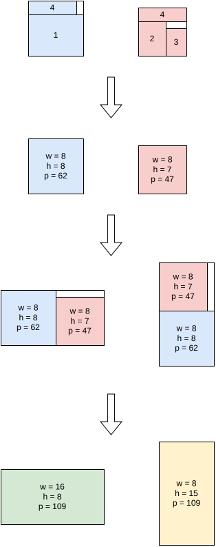

.. _internals_rectangleguillotine_tree_search_hypergraph_infinite_copies:

Tree search hypergraph with infinite copies
===========================================

Objectives
----------

This algorithm solves the :code:`feasibility` and :code:`knapsack` objectives, with a single bin, and computes a bound for the :code:`knapsack` objective.

It generates guillotine patterns with an unlimited number of stages. It has the same limitations as the :ref:`tree search hypergraph <internals_rectangleguillotine_tree_search_hypergraph>` algorithm.

Principle
---------

It works the same way as the tree search hypergraph algorithm, except that the numbers of copies of the item types are not taken into account. Without them, a block is only described by its dimensions, and the best pattern for each dimensions can be computed by dynamic programming: the best profit in a :math:`w \times h` rectangle is the best of the items fitting exactly in it, and of the best patterns of the two parts of each vertical and horizontal guillotine cut of the rectangle.

**Raster points.** Any guillotine pattern can be transformed into a pattern with the same items whose cuts are at *normal positions*, the sums of item dimensions (with the cut thickness), by pushing its items towards the origin (Herz, 1972; Christofides and Whitlock, 1977). The dynamic program only needs the rectangles whose dimensions are *raster points*: what remains of the bin after cutting a normal position (Scheithauer and Terno, 1996). This makes the array of the dynamic program much smaller than one entry per integer width and height.

**Bound and solution.** Ignoring the numbers of copies is a relaxation, so the profit of the dynamic program is an upper bound for the :code:`knapsack` objective. Its solution is reported if it satisfies the numbers of copies. Otherwise, a feasible solution is computed with the same dynamic program restricted to the item types whose copies can't run out in a bin (more copies than the number of their items fitting in it).

**Array size.** When the array of the dynamic program with all the item types is too large, the dynamic program is first solved with only the item types of largest profit per unit area whose array fits, with increasing maximum sizes (:math:`2^{14}`, :math:`2^{16}`, :math:`2^{18}`, ...): with fewer item types, there are much fewer raster points, and the solution is often almost as good. The bound is only computed with all the item types.

It is very fast, and its solution is often optimal when the items have many copies.

Automatic selection
-------------------

With a single bin, it is run for the :code:`knapsack` objective when the item types have many copies compared to the number of items fitting in the bin (e.g. in the sub-problems of the sequential single knapsack and column generation algorithms), the bin is not too large, the number of stages is unlimited, and none of the features it doesn't support is used. See :ref:`algorithm selection <internals_algorithm_selection>`.

It can be forced with :code:`--use-tree-search-hypergraph-infinite-copies 1` (CLI) or :code:`use_tree_search_hypergraph_infinite_copies` (Python).

Source files
------------

* :code:`src/rectangleguillotine/tree_search_hypergraph_infinite_copies.hpp`, :code:`src/rectangleguillotine/tree_search_hypergraph_infinite_copies.cpp`

References:

* Herz (1972), for the normal positions

* "An Algorithm for Two-Dimensional Cutting Problems" (Christofides and Whitlock, 1977)

  * https://doi.org/10.1287/opre.25.1.30

* Scheithauer and Terno (1996), for the raster points
