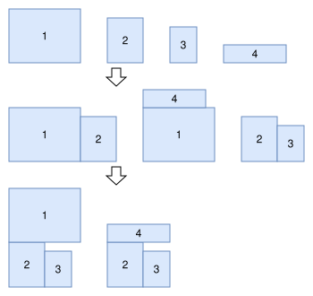
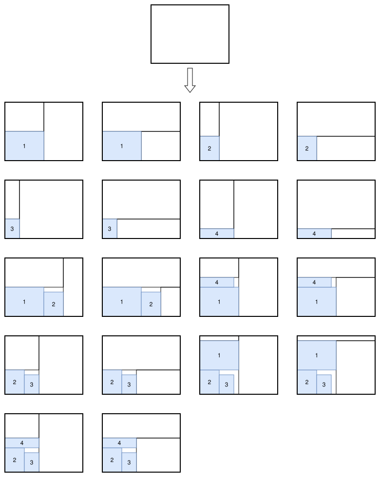
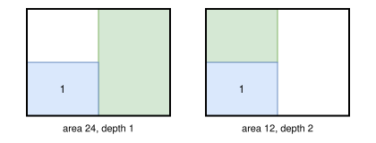
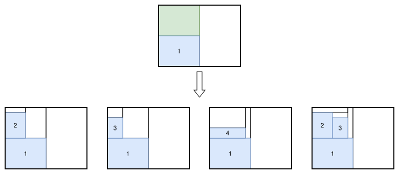

.. _internals_rectangleguillotine_tree_search_maximal_spaces:

Tree search with maximal spaces
===============================

Objectives
----------

This algorithm only handles instances with a single bin. It solves the :code:`feasibility` and :code:`knapsack` objectives directly, and the :code:`bin-packing`, :code:`open-dimension-x`, :code:`open-dimension-y` and :code:`bin-packing-with-leftovers` objectives through the :ref:`sequential feasibility <internals_generic_algorithms_sequential_feasibility>` algorithm.

It generates guillotine patterns with an unlimited number of stages. It doesn't support the defects, the stacks, the minimum waste length, the minimum and maximum distances between cuts, and the maximum numbers of cuts.

Principle
---------

It is the guillotine version of the :ref:`tree search with maximal spaces for rectangle <internals_rectangle_tree_search_maximal_spaces>`: a block of items is packed at each stage, in an empty space of the bin. The blocks are guillotine patterns themselves: grids of copies of an item type, and their combinations side by side or one above the other, generated before the search exactly as for :code:`rectangle` (same order, same limit of 10000 blocks, same rule dropping the blocks with waste when there are at most 3 item types), except that the cut thickness is added between the items of a grid and between the two parts of a combined block. Here is an example of block generation from 4 items:

Unused rectangular spaces
-------------------------

To keep the patterns guillotine, the empty spaces are the leaves of the cut tree of the pattern: the *unused rectangular spaces*. Placing a block of width :math:`w_b` and height :math:`h_b` at the bottom-left corner of an unused space splits the rest of the space with two guillotine cuts, into two new unused spaces which don't overlap:

* with a vertical cut first: the part to the right of the block, over the whole height of the space, and the part above the block, over the width of the block;
* with a horizontal cut first: the part above the block, over the whole width of the space, and the part to the right of the block, over the height of the block.

The new spaces are separated from the block by the cut thickness. The direction of the first cut alternates with the depth of the space in the cut tree: if it is vertical at even depths, it is horizontal at odd depths; the space to the right of the block in the first case (above it in the second case) has the depth of the space plus one, and the other one the depth plus two. The orientation of the first stage is given by the parameters; when it is free, both orientations are tried for the first block, so two children are generated per candidate block, one with a vertical cut and one with a horizontal cut, and the orientation chosen holds for the rest of the pattern:

Here are the two unused spaces of the first child generated above, with their areas and their depths in the cut tree:

Unlike in the :code:`rectangle` case, the unused spaces never overlap. After each insertion, the blocks which use more copies of an item type than remaining are discarded, and so are the spaces in which no remaining block fits. To generate the children of a node, the unused space with the smallest area, the most constrained one, is selected (ties are broken by preferring the space closest to the bottom-left corner of the bin), and one child is generated per remaining block that fits inside:

Greedy value and search
-----------------------

**Insertions.** The children of a node are generated one at a time, by decreasing profit of the block divided by the area of the space (and vertical cuts first).

**Greedy value.** A node is evaluated by completing it greedily: from the node, the block with the largest profit divided by the area of the selected space is placed repeatedly, until no space is left. The *greedy value* of the node is the profit of this completion. It is used:

* as guide: the nodes with the largest greedy value come first in the queues, then the ones with the largest profit;
* for the dominance: two nodes with the same number of copies of each item type packed are compared, and the one with the smallest greedy value is dominated. Since the depth of a node is its number of blocks, not its number of items, the nodes are compared to the nodes of all the queues (global dominance);
* for the solutions: the nodes are compared to the best solution found by their profit, and the solution returned is the greedy completion of the best node.

**Bound.** The nodes are only discarded once a node packing all the items is found.

**Search.** The tree is explored by the :ref:`iterative beam search <internals_tree_search>` generating the children one at a time, with a growth factor of 2. A single search is run. In the non-anytime modes, the search is run with a queue of size 1, then with a queue of the size given by the parameter :code:`not_anytime_tree_search_maximal_spaces_queue_size` (16 by default).

Automatic selection
-------------------

With a single bin, it is run for the instances with an unlimited number of stages and none of the features it doesn't support (except when the hypergraph tree search with infinite copies is selected instead). See :ref:`algorithm selection <internals_algorithm_selection>`.

It can be forced with :code:`--use-tree-search-maximal-spaces 1` (CLI) or :code:`use_tree_search_maximal_spaces` (Python).

Source files
------------

* :code:`src/rectangleguillotine/block.hpp`, :code:`src/rectangleguillotine/block.cpp`: the blocks
* :code:`src/rectangleguillotine/tree_search_maximal_spaces.hpp`, :code:`src/rectangleguillotine/tree_search_maximal_spaces.cpp`: the branching scheme and the search

References:

* "A beam search algorithm for the biobjective container loading problem" (Araya, Moyano and Sanchez, 2020)

  * https://doi.org/10.1016/j.ejor.2020.03.040

* "A tree search-based heuristic for the three-dimensional single container loading problem" (Guesser, Alves De Queiroz and Miyazawa, 2026)

  * https://doi.org/10.1016/j.ejor.2026.01.039

* "EATKG: An Open-Source Efficient Exact Algorithm for the Two-Dimensional Knapsack Problem with Guillotine Constraints" (Wang, Baldacci, Liu and Wei, 2025)

  * https://doi.org/10.1016/j.ejor.2025.05.033
