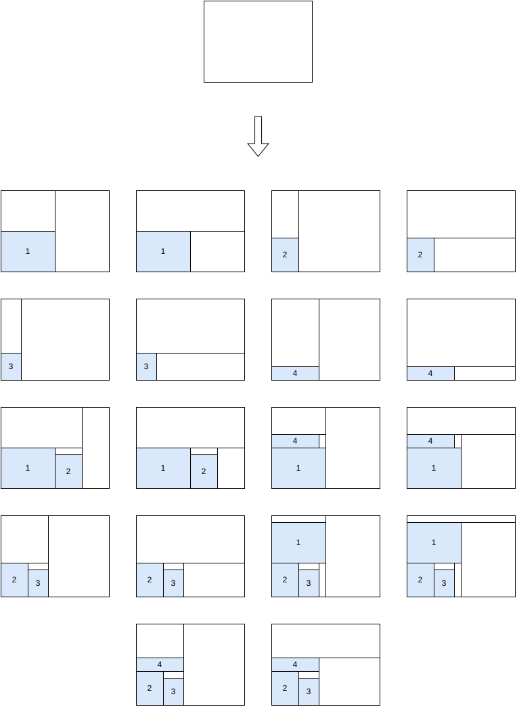
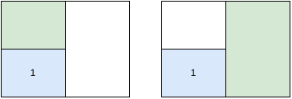
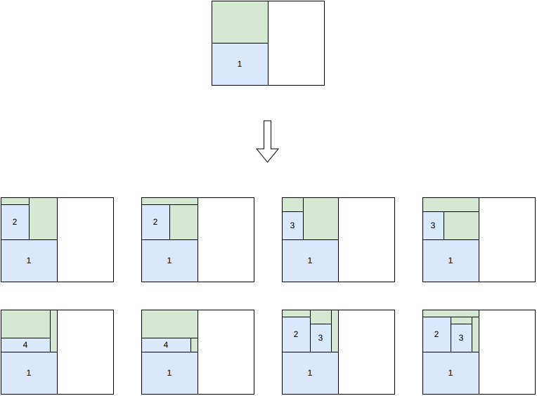

.. _internals_rectangleguillotine_tree_search_maximal_spaces:

Tree search with maximal spaces
===============================

Objectives
----------

This algorithm only handles instances with a single bin. It solves the :code:`feasibility` and :code:`knapsack` objectives directly, and the :code:`open-dimension-x`, :code:`open-dimension-y` and :code:`bin-packing-with-leftovers` objectives through the :ref:`sequential feasibility <internals_generic_algorithms_sequential_feasibility>` algorithm.

It generates guillotine patterns with an unlimited number of stages. It doesn't support the defects, the stacks, the minimum waste length, the minimum and maximum distances between cuts, and the maximum numbers of cuts.

Principle
---------

It is the guillotine version of the :ref:`tree search with maximal spaces for rectangle <internals_rectangle_tree_search_maximal_spaces>`: a block of items is packed at each stage, in an empty space of the bin. The blocks are guillotine patterns themselves: grids of copies of an item type, and their combinations side by side or one above the other, generated before the search. Here is an example of block generation from 4 items:

.. image:: ../../img/rectangleguillotine_tree_search_maximal_spaces_1.png
   :scale: 100%
   :align: center

Unused rectangular spaces
-------------------------

To keep the patterns guillotine, the empty spaces are the leaves of the cut tree of the pattern: the *unused rectangular spaces*. Placing a block of width :math:`w_b` and height :math:`h_b` at the bottom-left corner of an unused space splits the rest of the space with two guillotine cuts, into two new unused spaces which don't overlap:

* with a vertical cut first: the part to the right of the block, over the whole height of the space, and the part above the block, over the width of the block;
* with a horizontal cut first: the part above the block, over the whole width of the space, and the part to the right of the block, over the height of the block.

The direction of the cuts is given by the depth of the space in the cut tree and by the orientation of the first stage. At the root, both orientations are tried, so two children are generated per candidate block, one with a vertical cut and one with a horizontal cut:

Here are the two unused spaces of the first child generated above:

Unlike in the :code:`rectangle` case, the unused spaces never overlap. To generate the children of a node, the unused space with the smallest area, the most constrained one, is selected, and one child is generated per remaining block that fits inside:

Search
------

The children of a node are generated by decreasing profit of the block divided by the area of the space. A node is evaluated by completing it greedily, inserting the best scored block at each step; the beam search keeps the nodes with the best completions. The tree is explored by an iterative beam search.

Automatic selection
-------------------

With a single bin, it is run for the instances with an unlimited number of stages and none of the features it doesn't support (except when the hypergraph tree search with infinite copies is selected instead). See :ref:`algorithm selection <internals_algorithm_selection>`.

It can be forced with :code:`--use-tree-search-maximal-spaces 1` (CLI) or :code:`use_tree_search_maximal_spaces` (Python).

Source files
------------

* :code:`src/rectangleguillotine/block.hpp`, :code:`src/rectangleguillotine/block.cpp`: the blocks
* :code:`src/rectangleguillotine/tree_search_maximal_spaces.hpp`, :code:`src/rectangleguillotine/tree_search_maximal_spaces.cpp`: the branching scheme and the search

References:

* "A beam search algorithm for the biobjective container loading problem" (Araya, Moyano and Sanchez, 2020)

  * https://doi.org/10.1016/j.ejor.2020.03.040

* "A tree search-based heuristic for the three-dimensional single container loading problem" (Guesser, Alves De Queiroz and Miyazawa, 2026)

  * https://doi.org/10.1016/j.ejor.2026.01.039

* "EATKG: An Open-Source Efficient Exact Algorithm for the Two-Dimensional Knapsack Problem with Guillotine Constraints" (Wang, Baldacci, Liu and Wei, 2025)

  * https://doi.org/10.1016/j.ejor.2025.05.033
