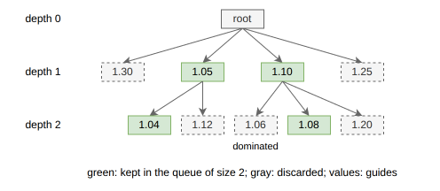
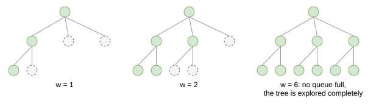

.. _internals_tree_search:

Tree search
===========

Most pattern-generating algorithms of PackingSolver are tree searches. They differ in how they build the solutions, but almost all of them explore their search tree with the same algorithm, an *iterative beam search*, implemented in the `treesearchsolver <https://github.com/fontanf/treesearchsolver>`_ library. This page describes what these algorithms have in common; the page of each algorithm describes how it builds the solutions. (The tree searches with hypergraphs of :code:`rectangleguillotine` are the exception: they explore their search tree completely, by dynamic programming.)

Branching scheme
----------------

Each tree search defines a *branching scheme*, which describes its search tree:

* the **root**: an empty solution;
* the **children** of a node: in general, the node with one more item, or one more block of items, packed at one of a few candidate positions;
* whether a node is a **leaf**, i.e. a complete solution, which isn't expanded;
* which nodes are **solutions** for the objective of the instance, and when a solution is **better** than another one;
* a **bound**: whether a node can't lead to a better solution than a given one;
* a **guide**: an order on the nodes, from the most promising to the least promising one;
* a **dominance** relation: a key, such that only the nodes with the same key can be compared (typically, the number of copies of each item type packed), and whether a node *dominates* another one, i.e. whether every solution which can be obtained from the second node can also be obtained, or improved, from the first one;
* optionally, the **depth** of a node. By default, the depth of a child is the depth of its parent plus one.

The iterative beam search only uses these components, so the same search applies to all the problem types.

Beam search
-----------

A *beam search* is a breadth-first search in which only a limited number of nodes is kept at each depth. The nodes of each depth are kept in a *queue*, ordered by guide, of maximum size :math:`w`.

The beam search starts with the root in the queue of depth 0. Then, depth by depth, each node of the queue of the current depth is processed, from the most promising one:

* if the node is discarded by the bound, compared to the best solution found so far, the next node is processed;
* otherwise, its children are generated. Each child:

  * is compared to the best solution found, which it replaces if it is better;
  * is discarded if it is a leaf, or if it is discarded by the bound;
  * otherwise, is added to the queue of its depth. If this queue is full, the child is only added if it is more promising than the least promising node of the queue, which is then removed;
  * is not added if it is dominated by a node of the queue with the same key; when it is added, the nodes of the queue with the same key which it dominates are removed.

When the queue of the current depth is empty, the search moves to the next depth. It ends when the queues of all the next depths are empty.

The figure below shows the first two depths with :math:`w = 2`. The values are the guides (smaller is better). At depth 1, the two nodes with the smallest guides are kept. At depth 2, the node of guide 1.06 is dominated by another node of the queue, so the nodes of guides 1.04 and 1.08 are kept.

Since a node usually has many children, the queues are usually full, and the nodes discarded because a queue is full are the ones that make the search incomplete.

Iterative beam search
---------------------

The best size of the queues isn't known in advance: a small size gives a solution quickly, a large size gives a better solution, slowly. The *iterative beam search* runs successive beam searches, with larger and larger queues. The first one is run with :math:`w = 1`: it is a greedy algorithm, which quickly gives a first solution. Then, after each beam search, :math:`w` becomes :math:`\max(w + 1, \lfloor w \times g \rfloor)`, where :math:`g > 1` is the *growth factor*.

Each beam search uses the best solution found by the previous ones for its bounds, so the later beam searches discard more nodes.

**Optimality proof.** If no queue was ever full during a beam search, no node was discarded because of the size of a queue. The nodes were only discarded by the bounds and the dominance, which never discard a node leading to a strictly better solution: the whole tree has been explored implicitly. The best solution found is then optimal or, if no solution was found, the instance is infeasible, and the search stops.

The figure below shows the nodes kept (in green) by successive beam searches on a small tree whose nodes are ordered by guide from left to right. With :math:`w = 6`, no queue is ever full, so the tree is explored completely.

The search also stops when the time limit is reached, or when the best solution reaches a bound proven by another algorithm.

Variants
--------

**Children generated one at a time.** Some branching schemes, those of the tree searches with maximal spaces, generate the children of a node one at a time, from the most promising one, instead of all at once. A node of the queue then generates at most :math:`w` children: the next ones would anyway be less promising than the :math:`w` children already generated. This saves the time spent generating children which would be discarded. If a node has more than :math:`w` children, the beam search is not complete.

**Global dominance.** By default, a node is only compared, for the dominance, to the nodes of the queue of its depth. When the depth doesn't determine the items packed, for example when the children pack blocks of several items, nodes of different depths may have the same key. Some algorithms then compare a node to the nodes of all the queues.

Runs in PackingSolver
---------------------

The tree searches of PackingSolver follow the same pattern, detailed on the page of each algorithm:

* **Parallel searches.** In anytime mode (and in the :code:`exact` mode, which runs the searches the same way), an iterative beam search is run for each combination of a few parameters of the branching scheme, typically the guide and the direction in which the bins are filled, in parallel. When there are only a few combinations, each one may also be run with two growth factors, 1.33 and 1.5; otherwise, the growth factor is 1.5. Each search uses the best solution it found itself for its bounds. They report their solutions to a common output, and all stop as soon as the best solution is proven optimal.
* **Non-anytime modes.** Each search is only run with :math:`w = 1`, then with a single larger queue size, given by a parameter of the algorithm. In the :code:`not-anytime-deterministic` mode, each search reports its solutions to its own output, and these outputs are merged at the end in a fixed order, so that the result doesn't depend on the order in which the threads find their solutions.

Source files
------------

* :code:`include/treesearchsolver/iterative_beam_search_2.hpp` (`treesearchsolver <https://github.com/fontanf/treesearchsolver>`_): the iterative beam search
* :code:`include/treesearchsolver/iterative_beam_search.hpp`: the iterative beam search generating the children one at a time
* :code:`scripts/doc_figures/tree_search.py`: the figures of this page
