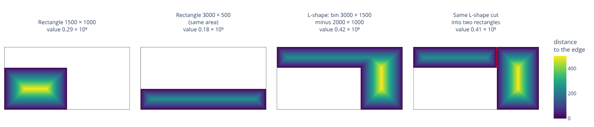

.. _leftovers:

Leftovers
=========

With the :code:`bin-packing-with-leftovers` objective, the solver first minimizes the number of bins, and then maximizes the value of what remains in stock: the **leftover** of the last bin, and, as tie-breaks, the leftovers of the other bins. With the :code:`variable-sized-bin-packing-with-leftovers` objective, it minimizes the cost of the bins minus a refund for the value of their leftovers (see :ref:`objectives`).

This page describes how a leftover is defined from a packing (its shape) and how its value is computed. It applies to the :ref:`rectangle<rectangle>`, :ref:`box<box>`, :ref:`box-stacks<boxstacks>` and :ref:`irregular<irregular>` problem types, and to the :ref:`rectangle-guillotine<rectangleguillotine>` problem type with the :code:`variable-sized-bin-packing-with-leftovers` objective (see :ref:`leftovers-rectangleguillotine`). The :ref:`one-dimensional<onedimensional>` problem type measures its leftovers directly by the length left in the bin.

Shape of a leftover
-------------------

The leftover of a bin is the bin minus the space used by its items. The space used is a box in a corner of the bin: it goes from this corner to the items, along the dimensions given by the **leftover mode**, and covers the whole bin along the other dimensions. Depending on the leftover mode, the leftover is:

* a **rectangle** (or a box), when the used space covers the whole bin along all but one dimension; for example, with the mode ``x`` of the :ref:`rectangle<rectangle>` problem type, the leftover is the part of the bin on the right of the items;
* an **L-shape**, when the used space stops at the items along two dimensions; for example, with the default mode ``area`` of the :ref:`rectangle<rectangle>` problem type, the leftover is the bin minus the rectangle between its bottom-left corner and the top-right corner of the items; in three dimensions, the leftover is a box minus a corner box;
* the same L-shape **cut** into rectangles (or boxes), with the modes ending with ``cut``; when the leftover is kept as separate pieces, the cut is made along the faces of the used space, in the order which gives the largest value;
* a **staircase**, with the modes ``staircase``: instead of a single box covering all the items, each item uses the box between the corner of the bin and its opposite corner, and the leftover is the bin minus the union of these boxes. It follows the outline of the items more closely, so it is larger than the L-shape, and it is suited to the case where the next items are packed into what remains of the bin.

The leftover modes of each problem type:

.. list-table::
   :header-rows: 1
   :widths: 1 2 2 2 2

   * - Problem type
     - Rectangle (or box)
     - L-shape
     - Cut L-shape
     - Staircase
   * - :ref:`rectangle<rectangle>`
     - ``x``, ``y``
     - ``area`` (default)
     - ``area-cut``
     - ``staircase``
   * - :ref:`box<box>`
     - ``x``, ``y``, ``z``
     - ``xy``, ``xz``, ``yz``, ``xyz`` (default)
     - ``xy-cut``, ``xz-cut``, ``yz-cut``, ``xyz-cut``
     - ``staircase``
   * - :ref:`box-stacks<boxstacks>`
     - ``x``, ``y``
     - ``xy`` (default)
     - ``xy-cut``
     - ``staircase``
   * - :ref:`irregular<irregular>`
     - ``left``, ``right``, ``bottom``, ``top``
     - ``bottom-left`` (default), ``bottom-right``, ``top-left``, ``top-right``
     - ``bottom-left-cut``, ``bottom-right-cut``, ``top-left-cut``, ``top-right-cut``
     - ``bottom-left-staircase``, ``bottom-right-staircase``, ``top-left-staircase``, ``top-right-staircase``

For the :ref:`irregular<irregular>` problem type, the bin and the items are replaced by their bounding boxes. With the modes of the last three columns, the items are packed the same way, towards the same corner: only the shape of the leftover differs.

With a staircase leftover, the staircase value used as a tie-break (see below) measures the same region as the leftover itself.

Value of a leftover
-------------------

The **leftover value type** (``leftover_value_type``) defines how the value of a leftover is computed from its shape. It is one of:

* ``squared-area`` (default): the value of a leftover is the square of its area (or of its volume, in three dimensions); when the leftover is cut, it is the sum of the squares of the areas of its pieces;
* ``depth``: the value of a leftover also accounts for how compact it is, as described below.

Which one to choose depends on how the leftovers are reused:

* when the bin stays whole, and the items of the next jobs are packed into what remains of it, the free area is what matters: choose ``squared-area``;
* when the leftovers are cut out and stored as stock, a large compact piece is worth more than a long thin one of the same area: choose ``depth``.

Squared area
^^^^^^^^^^^^

Squaring the area doesn't change how two leftovers are ranked: the larger one is worth more. But it changes how the leftovers of several bins add up: a single large leftover is worth more than several smaller leftovers of the same total area. For example, two leftovers of 1.5 m² and 0.5 m² are worth 1.5² + 0.5² = 2.5, and two leftovers of 1 m² are only worth 1² + 1² = 2. In the same way, an L-shape is worth more than the same L-shape cut into two rectangles, and with the modes ending with ``cut``, the cut which is chosen is the one which gives the most unbalanced pieces.

Depth
^^^^^

With the ``depth`` value type, the value of a leftover is its area times the **average depth** of its points, the depth of a point being its distance to the edge of the leftover: the half side of the largest square centered on the point which fits in the leftover. Points close to the edge of a leftover, or in a thin part of it, count for little; points deep inside count for more.

In other words, the value is the integral, over the points of the leftover, of their depth. It is also the integral, over *t*, of the area of the leftover shrunk by *t* on every side.

The figure above shows the depth of the points of a few leftovers. A 1500 × 1000 rectangle is worth 0.29 × 10⁹, but a 3000 × 500 rectangle of the same area is only worth 0.18 × 10⁹. An L-shape is worth a bit more than the same L-shape cut into two rectangles, since cutting it creates a new edge, along which the points lose their depth.

For a *w* × *h* rectangle, with *h* ≤ *w*, the value is *h*\ :sup:`2` (3 *w* − *h*) / 12; for a square of side *s*, it is *s*\ :sup:`3` / 6. In three dimensions, the value is the volume of the leftover times the average depth of its points.

As a consequence:

* among the leftovers of a given area, compact ones are worth more than long and thin ones; for example, the solver prefers to leave a single rectangle on the side of the bin rather than an L-shape of slightly larger area whose arms are thin;
* the value grows faster than the area (like the area to the power 1.5): a single large leftover is worth more than several smaller leftovers of the same total area, as with the ``squared-area`` value type, but less strongly;
* the value has no parameter to tune.

Comparison of solutions
-----------------------

For the :code:`bin-packing-with-leftovers` objective, two solutions are compared on:

#. the number of bins;
#. the value of the leftover of the last bin;
#. the staircase value of the last bin: the area of the bin which is not dominated by an item, an item dominating the points between the corner of the bin and the opposite corner of the item; it measures how compact the packing of the last bin is;
#. if ``leftover_all_bins`` is enabled (default), the total value of the leftovers of all the bins of the instance, the bins which are not used counting for their whole value;
#. if ``leftover_all_bins`` is enabled, the total staircase value of all the bins.

For the :code:`variable-sized-bin-packing-with-leftovers` objective, two solutions are compared on their net cost, the cost of their bins minus the refunds of their leftovers (see :ref:`objectives`), then on the total staircase value of all the bins.

The solution also reports these values, in the fields ``LeftoverValue``, ``StaircaseLeftoverValue``, ``TotalLeftoverValue`` and ``TotalStaircaseLeftoverValue`` of the output. With the ``squared-area`` value type, ``LeftoverValue`` and ``TotalLeftoverValue`` are squared areas, while the staircase values are areas.

Post-process
------------

In the not-anytime optimization modes, for the :ref:`rectangle<rectangle>`, :ref:`box<box>`, :ref:`box-stacks<boxstacks>` and :ref:`irregular<irregular>` problem types, the bins of the best solution are re-packed at the end to improve their leftovers. A re-packed bin keeps the same items, and it is kept only if its leftover is better.

* With the :code:`bin-packing-with-leftovers` objective, the last bin is re-packed with the tree search, if it contains few items; then, if ``leftover_all_bins`` is enabled, the other bins are re-packed.
* With the :code:`bin-packing`, :code:`variable-sized-bin-packing`, :code:`variable-sized-bin-packing-with-leftovers` and :code:`knapsack` objectives, all the bins are re-packed. Except for :code:`variable-sized-bin-packing-with-leftovers`, the value of the solution doesn't change: the re-packed solution only replaces the best one if the total leftover value of the bins is greater.

.. _leftovers-rectangleguillotine:

Rectangle guillotine
--------------------

For the :ref:`rectangle-guillotine<rectangleguillotine>` problem type, the :code:`bin-packing-with-leftovers` objective minimizes the number of bins, then the waste (the area of the bins which is used, minus the area of the items, the plate after the last 1-cut of the last bin being the leftover), and then maximizes the area of the second leftover: the sub-plate after the last 2-cut of the last first-level sub-plate of the last bin.

With the :code:`variable-sized-bin-packing-with-leftovers` objective, the leftovers of a bin are the pieces that its guillotine cuts already separate from the items: the plate after its last 1-cut, and the sub-plate after the last 2-cut of its last first-level sub-plate, when they are not used. Since they are rectangles, the leftovers of a bin are valued like a cut leftover: with ``squared-area``, their value is the sum of the squares of their areas. Two solutions are compared on their net cost: the cost of their bins minus the refunds of their leftovers (see :ref:`objectives`).
